# PicoCalc FX-CG50 AI — firmware indipendente per PicoCalc + Pimoroni Pico Plus 2 W

Firmware **scritto da zero** in C++20 per la ClockworkPi **PicoCalc**, ispirato
alle funzioni e all'interfaccia della calcolatrice grafica Casio fx-CG50, con
chat AI (Claude e ChatGPT) tramite Wi-Fi. Scheda principale: **Pimoroni Pico
Plus 2 W** (RP2350B, 8 MB di PSRAM, 16 MB di flash); profilo alternativo:
**Raspberry Pi Pico 2 W** (RP2350A, 4 MB di flash, senza PSRAM).

> **Non è un emulatore.** Non contiene firmware, ROM, codice o grafica Casio:
> ogni modalità è reimplementata in modo indipendente. La documentazione Casio è
> usata solo come riferimento di comportamento.

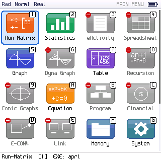  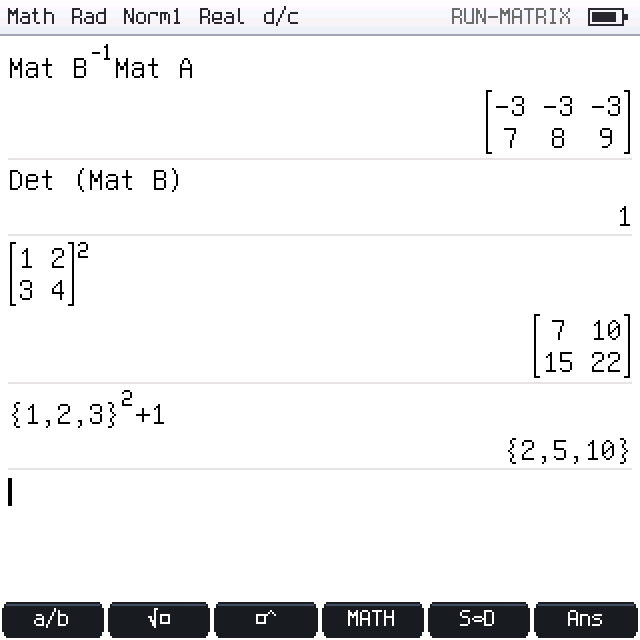 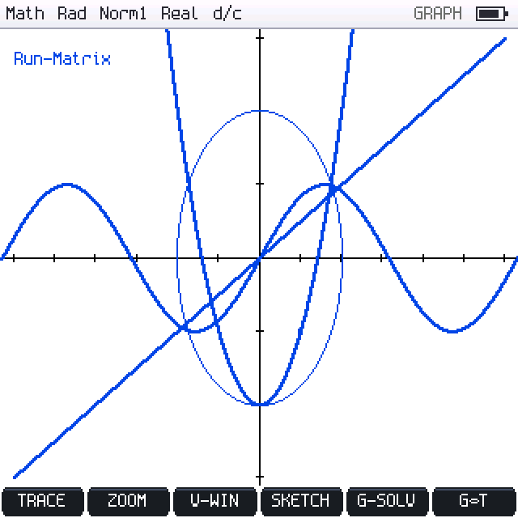 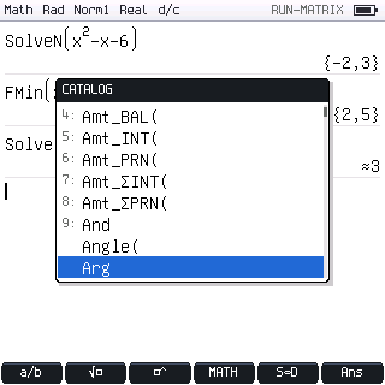  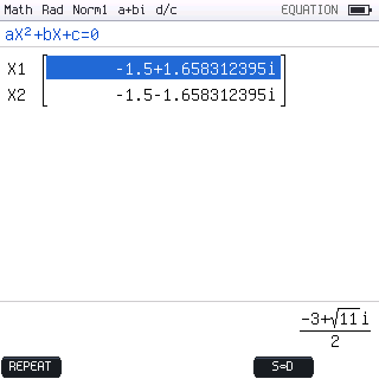  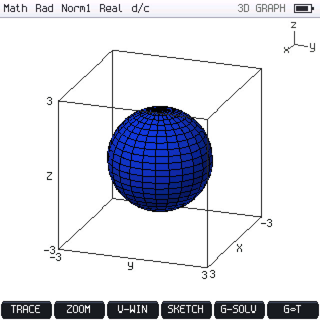 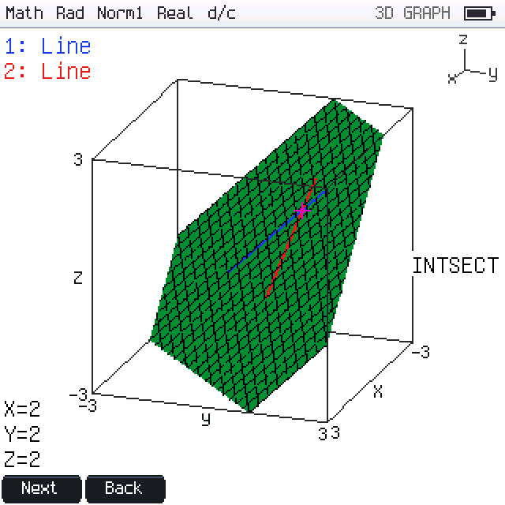 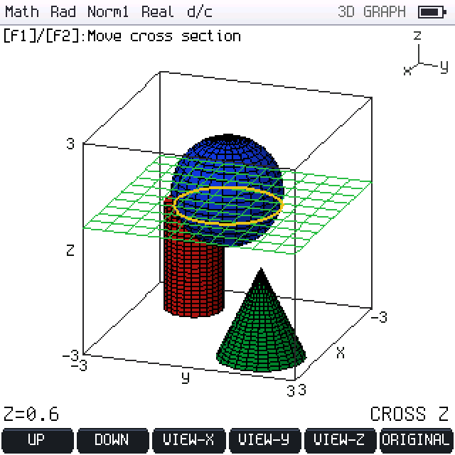 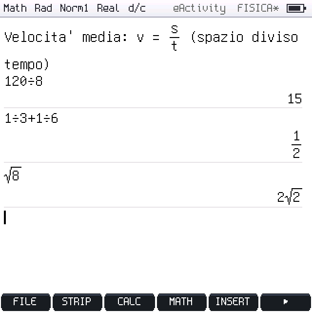 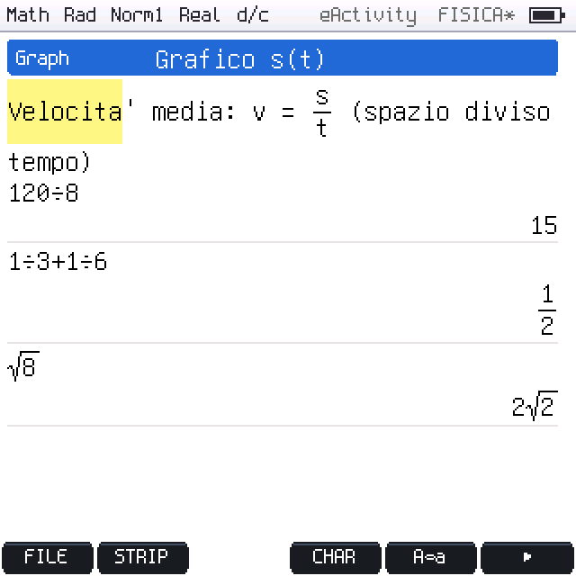 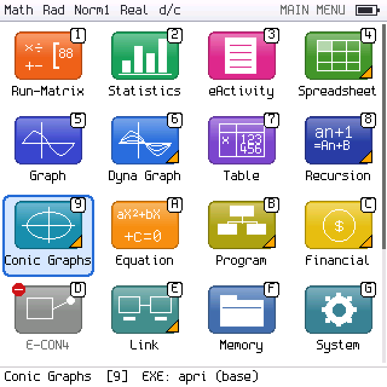 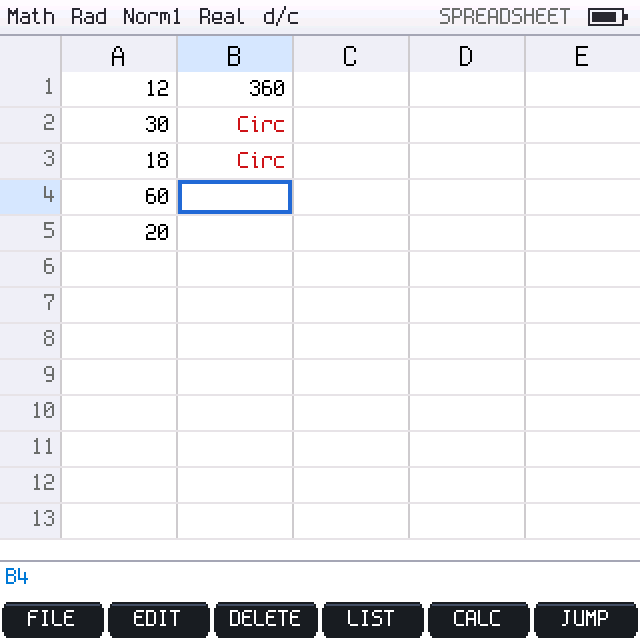 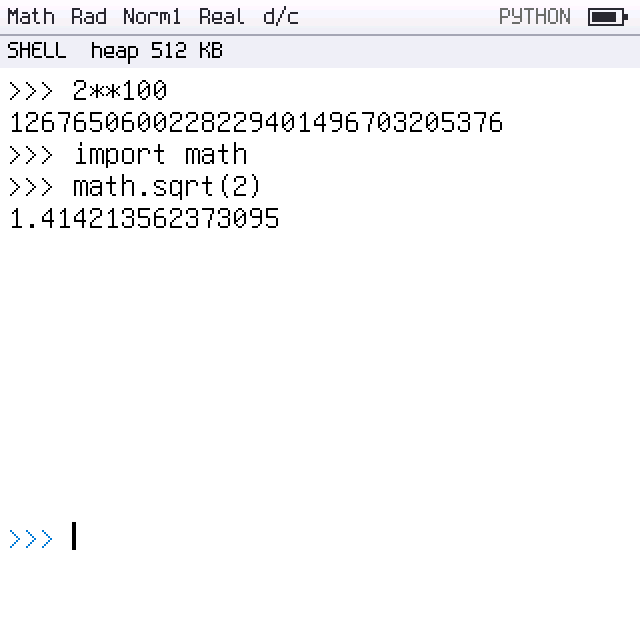  

## Stato (v1.20.0)

La **v1.20.0** porta **Program sulla microSD** della **Pimoroni Pico Plus 2 W**
([docs/PROGRAM.md](docs/PROGRAM.md)): i programmi **C, C++ e C#** sono file
sorgente standard in `PICOCALC/CODE` (progetti = cartelle), con un gestore dei
file (NEW, RENAME, COPY, MOVE, DEL-ALL, SEARCH, password), un editor per il
codice (evidenziazione, rientro, parentesi, trova/sostituisci, undo/redo, file
fino a 4 MB), il **DEBUG** passo passo, un nucleo dell'interprete nuovo
confrontato con gcc, g++ e Mono su 51 programmi, la libreria `fx` con
statistiche, distribuzioni e finanza e un **gestore delle librerie**
([docs/LIBRARIES.md](docs/LIBRARIES.md)) che installa dall'indice HTTPS con
SHA-256, dipendenze e installazione atomica. Program resta Base fino a Java
(v1.21.0). Il **Raspberry Pi Pico 2 W resta congelato** alla v1.16.0.
Rapporti:
[docs/reports/ANALISI_FONTI_v1.20.0.md](docs/reports/ANALISI_FONTI_v1.20.0.md),
[docs/reports/SVILUPPO_v1.20.0.md](docs/reports/SVILUPPO_v1.20.0.md).

La **v1.19.0** porta **Geometry alla parità completa** con il capitolo 14 del
manuale fx-CG50 sulla **Pimoroni Pico Plus 2 W** ([docs/GEOMETRY.md](docs/GEOMETRY.md)):
menu File/View, Edit/Option/Properties, Draw/Draw Spec, Construct, Transform e
Animate; gli oggetti costruiti e le immagini delle trasformazioni restano
**legati** ai genitori (grafo delle dipendenze con ricalcolo incrementale);
casella di misura con **blocchi** (scrivere una lunghezza o un angolo vincola la
figura), misure incollate che si aggiornano, espressioni, colori e tratti,
Undo/Redo, animazioni con traccia e tabella verso le liste e Statistics; file
`.pcgeo` versione 2 che legge anche quelli della v1.17.0. La modalità passa da
Base ad **Available**. Il **Raspberry Pi Pico 2 W resta congelato** alla
v1.16.0. Rapporti:
[docs/reports/ANALISI_FONTI_v1.19.0.md](docs/reports/ANALISI_FONTI_v1.19.0.md),
[docs/reports/SVILUPPO_v1.19.0.md](docs/reports/SVILUPPO_v1.19.0.md).

La **v1.18.0** porta **Statistics alla parità completa** con il capitolo 6
del manuale fx-CG50 sulla **Pimoroni Pico Plus 2 W** ([docs/STATISTICS.md](docs/STATISTICS.md)):
editor delle liste a tre pagine con formule nella testa e colori, StatGraph1–3
con 20 tipi di grafico, 12 regressioni (anche sinusoidale e logistica) con i
residui, TEST (Z, t, χ², F, ANOVA a una e due vie), INTR, DIST con le 24
funzioni, VARS › STAT in Run-Matrix; i valori sono verificati contro scipy,
numpy e statsmodels. **Distribution** (MENU › O) entra come modalità **Base**
con lo stesso nucleo del DIST ([docs/DISTRIBUTION.md](docs/DISTRIBUTION.md)).
Il **Raspberry Pi Pico 2 W resta congelato** alla v1.16.0. Rapporti:
[docs/reports/ANALISI_FONTI_v1.18.0.md](docs/reports/ANALISI_FONTI_v1.18.0.md),
[docs/reports/SVILUPPO_v1.18.0.md](docs/reports/SVILUPPO_v1.18.0.md).

La **v1.17.0** è la **base di tutte le modalità**: ogni modalità del menu si
apre, fa il suo lavoro principale, salva e rimette a posto il suo stato ed esce
senza perdite di memoria (verificato su entrambe le schede da
`tests/apps_init_test.cpp`). Sulla **Pimoroni Pico Plus 2 W** arrivano dieci
modalità nello stato **Base** — si usano, ma la parità con la fx-CG50 non è
ancora completa (triangolo ambra sull'icona): **Spreadsheet**, **Dyna Graph**,
**Recursion**, **Conic Graphs**, **Program** (C, C++, C#), **Financial**,
**Link** (USB seriale, con `tools/picocalc_link.py` per il PC), **Geometry**,
**Picture Plot** e **Python** (MicroPython). Record del workspace v12 con un
CRC per sezione. Il **Raspberry Pi Pico 2 W resta congelato** alla v1.16.0.
Dalla v1.18.0 una modalità per versione arriva alla parità completa, a
partire da Statistics ([docs/ROADMAP.md](docs/ROADMAP.md)). Rapporti:
[docs/reports/ANALISI_FONTI_v1.17.0.md](docs/reports/ANALISI_FONTI_v1.17.0.md),
[docs/reports/SVILUPPO_v1.17.0.md](docs/reports/SVILUPPO_v1.17.0.md).

La **v1.16.0** porta **eActivity** alla parità con il capitolo 10 del manuale
fx-CG50 su **entrambe le schede** ([docs/EACTIVITY.md](docs/EACTIVITY.md)):
documenti con righe di testo (espressioni Math, colori, marcatori, memo),
righe di calcolo valutate come in Run-Matrix con il ricalcolo fino alla riga
di stop, immagini, **strisce** che aprono Run-Matrix, Graph, Table,
Statistics, Equation e 3D Graph con dati propri, Notes, memorie Mat/Vct/List
per documento. Con questa versione il **Raspberry Pi Pico 2 W è congelato**:
le modalità successive arrivano solo sulla Pimoroni Pico Plus 2 W
([docs/ROADMAP.md](docs/ROADMAP.md)). Rapporti:
[docs/reports/ANALISI_FONTI_v1.16.0.md](docs/reports/ANALISI_FONTI_v1.16.0.md),
[docs/reports/SVILUPPO_v1.16.0.md](docs/reports/SVILUPPO_v1.16.0.md).

La **v1.15.0** mette le **fondamenta comuni** delle modalità che mancano
ancora, senza modalità nuove (quelle disponibili sono le stesse della
v1.14.0): modalità e servizi per scheda con controlli bloccanti del build,
record del workspace **v11** a sezioni (i dati delle modalità che un firmware
non ha vengono conservati), file tipizzati con **MEMORY › FILES**, guscio
comune delle modalità (TABLE), editor di testo, calcoli a passi interrompibili
con AC (3D Graph) e, solo sulla Pimoroni Pico Plus 2 W, grafico 2D a schermo
diviso, variabili legate e celle, nucleo dell'interprete dei programmi in
**C, C++ e C#**. Piano: la v1.16.0 porta **eActivity** su entrambe le schede,
poi il Raspberry Pi Pico 2 W resta fermo e le modalità successive arrivano solo
sulla Plus ([docs/ROADMAP.md](docs/ROADMAP.md)). Rapporti:
[docs/reports/ANALISI_FONTI_v1.15.0.md](docs/reports/ANALISI_FONTI_v1.15.0.md),
[docs/reports/SVILUPPO_v1.15.0.md](docs/reports/SVILUPPO_v1.15.0.md).

La **v1.14.0** porta il **3D Graph** alla parità con la fx-CG50 (capitolo 16
del manuale, tabella voce per voce in
[docs/reports/SVILUPPO_v1.14.0.md](docs/reports/SVILUPPO_v1.14.0.md), guida
[docs/GRAPH3D.md](docs/GRAPH3D.md)): modelli **Line**, **Plane**, **Sphere**,
**Cylinder**, **Cone** con tutti i moduli di input e le condizioni «Invalid
Setting», grafici **Z=**, **Param** (S, T), **Rot X**/**Rot Y**; lista con
SELECT/DELETE/TYPE/**3D-GMEM**/DRAW e **FORMAT** (Line/Area Color);
**V-Window 3D** con Xgrid/Ygrid, S/T e gli angoli **θ/φ**, INITIAL e
**3D-VMEM**; **SET UP** con Axes, Box, Label; rotazione con i tasti e
**ROTATE** automatico, **ZOOM** con VIEW-X/Y/Z e ORIGINAL, **SKETCH**,
**PICTURE**, **TRACE** con le coordinate, **G-Solve** **CROSS**, **INTSECT**
(NOT FOUND, INFINITE) e **RELATION**; z-buffer condiviso da tutti i grafici
nella PSRAM della Plus, taglio esatto al box. Nuovo record del workspace
**v10** (i record v1–v9 si leggono e i dati 3D vengono convertiti).
Novità: [docs/CHANGELOG.md](docs/CHANGELOG.md) · fonti:
[docs/reports/ANALISI_FONTI_v1.14.0.md](docs/reports/ANALISI_FONTI_v1.14.0.md).

La **v1.13.1** è una versione di correzione della v1.13.0, senza funzioni
nuove: revisione completa (test, sanitizer, analisi statica, fuzzing,
simulatore, confronto con il manuale) e **18 errori corretti**, ognuno con un
test che lo riproduce: tra questi la lettura di record vecchi che dopo il
salvataggio non si sarebbero più riletti, calcoli di distribuzioni che non
terminavano (HypergeoCD, InvGeoCD), forme esatte complesse errate in EQUATION,
nCr/nPr limitati a n ≤ 100000, CSV e salvataggi interrotti, Σ con estremi
enormi. Elenco: [docs/reports/ERRORI_v1.13.1.md](docs/reports/ERRORI_v1.13.1.md) ·
rapporto: [docs/reports/SVILUPPO_v1.13.1.md](docs/reports/SVILUPPO_v1.13.1.md).

La v1.13.0 porta **Run-Matrix** alla parità di funzioni con la fx-CG50
(tabella voce per voce in
[docs/reports/SVILUPPO_v1.13.0.md](docs/reports/SVILUPPO_v1.13.0.md)):
**List "nome"** e **List File 1–6**, tutte le funzioni di lista; simboli
**P** ed **E** e **ENG/ENG←**; **Simplify** manuale con le regole del
manuale; Base-N con le variabili A–F in Hex, liste e matrici, i limiti di bit
e gli errori; editor MAT/VCT senza il limite di 64 elementi con i decimali
conservati; tutti i comandi grafici (**PxlTest(**, **DrawStat**, **DrawDyna**,
**DrawR**, **DrawWeb**, **DrawFTG**, **G-SelOn/Off**, **StoPict/RclPict**,
**BG-Pict**, stili **Sketch**, **Graph Y>/Y</Y≥/Y≤** e X…, **G∫dx**), salvati
anche nei progetti `.pcgraph`; round trip **Math/Line** esatto con tutti i
modelli; **CALC** (Solve, SolveN, FMin, FMax, d²/dx², Σ con passo),
**PROB**, **distribuzioni**, **CONVERT** (103 unità), **TVM**, angoli DMS e
ʳ/ᵍ, complessi ∠, numeri casuali, variabili statistiche, stringhe Str 1–20,
**function memory** f1–f20, istruzioni multiple con `:` e **◢**,
**CATALOG**, **CAPTURE**, menu OPTN/VARS nell'ordine della fx-CG50 e i
messaggi d'errore della calcolatrice. Nuovo record del workspace **v9**: i
record della v1.12.0 e precedenti si leggono senza perdite.
Sulla base della v1.12.0, che ha completato **EQUATION** come il capitolo 4
del manuale (SIML, POLY, SOLVER con coefficienti esatti e complessi, VARS ›
EQUATION; guida: [docs/EQUATION.md](docs/EQUATION.md)), e della v1.11.0.
Novità: [docs/CHANGELOG.md](docs/CHANGELOG.md) ·
rapporto: [docs/reports/SVILUPPO_v1.13.0.md](docs/reports/SVILUPPO_v1.13.0.md) ·
fonti: [docs/reports/ANALISI_FONTI_v1.13.0.md](docs/reports/ANALISI_FONTI_v1.13.0.md).

| | Stato |
|---|---|
| Compilazione UF2 (Pico SDK 2.2.0) per Pimoroni Pico Plus 2 W e per Pico 2 W | ✅ entrambe compilano, nessun warning; cartelle e UF2 separati per scheda |
| Test automatici host | ✅ 61 test sul profilo Pico Plus 2 W e 54 sul Pico 2 W: 58 e 52 suite C++ (18 623 controlli sulla Plus e 16 297 sul Pico 2 W, più le ≈ 334 000 verifiche di integrità dello stress dell'allocatore su due thread), l'interoperabilità FAT/exFAT con fsck e mtools (41) e, sulla Plus, le prove di Link con il PC (6); tutti superati anche con AddressSanitizer/UBSan (UBSan bloccante dalla v1.13.1), allocatore su due thread con ThreadSanitizer; fuzzing con libFuzzer in `tools/fuzz`; gli stessi test girano su GitHub Actions a ogni push |
| Test relay AI | ✅ 15 test (SDK ufficiali contro API simulate, TLS reale in loopback) |
| Parità con la fx-CG50 | Statistics (v1.18.0, Pimoroni Pico Plus 2 W, [tabella](docs/reports/SVILUPPO_v1.18.0.md)), Run-Matrix (v1.13.0), EQUATION (v1.12.0), 3D Graph (v1.14.0) ed eActivity (v1.16.0, [tabella](docs/reports/SVILUPPO_v1.16.0.md#3-tabella-di-parità-finale)): ✅ ogni voce della tabella di parità presente o differenza inevitabile documentata ([Run-Matrix](docs/reports/SVILUPPO_v1.13.0.md#5-tabella-di-parit%C3%A0-finale), [EQUATION](docs/reports/SVILUPPO_v1.12.0.md#4-tabella-di-parità-finale), [3D Graph](docs/reports/SVILUPPO_v1.14.0.md#5-tabella-di-parità-finale)); le dieci modalità **Base** della v1.17.0 e Distribution (v1.18.0) si usano ma ❌ **non** hanno ancora la parità; ❌ **non completa** neanche per le altre modalità — GRAPH in [docs/GRAPH_PARITY.md](docs/GRAPH_PARITY.md), elenco in [docs/FEATURE_MATRIX.md](docs/FEATURE_MATRIX.md) |
| **Prova su PicoCalc fisica** | ❌ **non ancora eseguita**, né con il Pico Plus 2 W né con il Pico 2 W: display, tastiera, flash, PSRAM, microSD, Wi-Fi e TLS vanno collaudati con [docs/HARDWARE_TEST_v1.18.0.md](docs/HARDWARE_TEST_v1.18.0.md), [v1.17.0](docs/HARDWARE_TEST_v1.17.0.md), [v1.16.0](docs/HARDWARE_TEST_v1.16.0.md), [v1.15.0](docs/HARDWARE_TEST_v1.15.0.md), [v1.14.0](docs/HARDWARE_TEST_v1.14.0.md), [v1.13.1](docs/HARDWARE_TEST_v1.13.1.md), [v1.13.0](docs/HARDWARE_TEST_v1.13.0.md), [v1.12.0](docs/HARDWARE_TEST_v1.12.0.md), [v1.11.0](docs/HARDWARE_TEST_v1.11.0.md), [v1.10.0](docs/HARDWARE_TEST_v1.10.0.md), [v1.9.0](docs/HARDWARE_TEST_v1.9.0.md) e [v1.8.0](docs/HARDWARE_TEST_v1.8.0.md), diagnostica SYSTEM → DIAG |

Dettagli: [docs/BUILD_STATUS.md](docs/BUILD_STATUS.md) · stato per funzione:
[docs/FEATURE_MATRIX.md](docs/FEATURE_MATRIX.md) · scheda e memoria:
[docs/PICO_PLUS_2W.md](docs/PICO_PLUS_2W.md) · ripresa del lavoro: [CONTINUE.md](CONTINUE.md).

### Cosa cambia con il Pimoroni Pico Plus 2 W

| | Pico Plus 2 W | Pico 2 W |
|---|---|---|
| Memoria per i dati pesanti | PSRAM 8 MB (pool TLSF separato; la SRAM resta per stack, framebuffer e codice critico) | heap SRAM ≈ 190 KB |
| Liste statistiche (List 1–26) / cronologia Run-Matrix | 999 elementi per lista (come la fx-CG50), 20 000 in tutte le liste / 200 righe | 255 per lista, 1 530 in tutto / 40 |
| Matrici e vettori (Mat/Vct A–Z, Ans) | lato fino a 999, 10 000 elementi per matrice, 20 000 in tutto | lato fino a 40, 400 elementi per matrice, 1 200 in tutto |
| Punti delle curve GRAPH | 400 000 per schermata (40 000 per grafico), layer statici in cache durante TRACE | 24 000 (6000 per grafico) |
| Immagini PICT, poligoni pieni | 1 MB, 4096 vertici | 96 KB, 256 vertici |
| 3D Graph | 50 punti per lato (come la fx-CG50), z-buffer, immagine della scena per TRACE | 25 punti per lato, algoritmo del pittore |
| Flash | firmware 4 MB, archivio interno LittleFS ≈ 11 MB, workspace 2 × 512 KB | firmware 2 MB, LittleFS ≈ 1,9 MB, workspace 2 × 64 KB |

Se la PSRAM non supera il self-test all'avvio il firmware parte comunque, con i
limiti RAM del Pico 2 W, e lo segnala. Un UF2 della Plus copiato su un Pico 2 W
viene riconosciuto (capacità reale della flash) e non scrive oltre il chip.

## Modalità disponibili

| Tasto | Modalità | Contenuto |
|---|---|---|
| 1 | **Run-Matrix** | input **Math** (2D: frazioni, frazioni miste, radici, potenze, ∫, d/dx, Σ, Π, \|x\|, logₐb, periodo, matrici; **SHIFT+INS** per l'argomento di un modello) o **Line** (**INS** sovrascrittura, frazioni **⌟**, risultati scorrevoli); **risultati esatti** (frazioni, √, π) con S⇔D che non altera il valore, Frac Result d/c ↔ ab/c, sviluppo periodico, **▶Simp** e Simplify; **matrici, vettori e liste** (`[[1,2][3,4]]`, `{1,2}`, Mat/Vct/**List 1–26**, Det, Trn, inversa, Ref/Rref, DotP, CrossP, Sum, Mean, Seq…) con l'**editor MAT/VCT** (SHIFT 3: celle esatte e complesse, CSV) e le schermate **MatAns/ListAns**; cronologia modificabile sul posto con ricalcolo; Ans/PreAns e A–Z che conservano la forma esatta, `→A~F`; relazioni e logica, Int÷/Rmdr; VARS (A–Z, V-WIN, TABLE); **simboli ingegneristici** e display Eng; **Base-N intera** (Dec/Hex/Bin/Oct, And/Or/Xor/Xnor/Not/Neg), DMS, complessi, Pol/Rec; **comandi grafici** (Plot, F-Line, Circle, Text, Graph Y=…) disegnati da GRAPH; **CLIP** (SHIFT 8/9), copia/incolla, undo/redo; **parentesi colorate**; **cursore sulla causa degli errori** — vedi [docs/RUN_MATRIX.md](docs/RUN_MATRIX.md) |
| 3 | **eActivity** | documenti `.pceact` (cartelle, NEW, SEARCH, MEMO); righe di **testo** con espressioni Math, colori, marcatori e memo; righe di **calcolo** come Run-Matrix con ricalcolo fino alla riga di stop (AC = Break); immagini PICT/CAPT; **strisce** di Run-Matrix, Graph, Table, Statistics, Equation, 3D Graph e Notes con dati propri e barra azzurra; memorie Mat/Vct/List per documento; 24 KB per documento sul Pico 2 W, 256 KB sulla Plus — [docs/EACTIVITY.md](docs/EACTIVITY.md) |
| 2 | **Statistics** | **v1.18.0, Pimoroni Pico Plus 2 W: parità con il capitolo 6** — editor a tre pagine (SRT-A/D su più liste, DEL, DEL-ALL, INS, ADD, JUMP, colori, formule nella testa, List File, CSV), StatGraph1–3 con 20 tipi, CALC con 12 regressioni e residui, TEST, INTR, DIST con le 24 funzioni, SET UP, VARS › STAT — [docs/STATISTICS.md](docs/STATISTICS.md). Raspberry Pi Pico 2 W (v1.16.0): **List 1–26** con i sottonomi (riga SUB) e i file **CSV** (OPTN), fino a 999 elementi per lista sulla Pico Plus 2 W (255 sul Pico 2 W), SET XList/YList, 1-Var/2-Var, 9 regressioni (ax+b, Med-Med, X², X³, X⁴, Log, Exp, ab^x, Power) con grafico e copia in GRAPH, scatter/xyLine/istogramma/box plot, distribuzioni (normale, binomiale, Poisson, t, χ², F), test Z/t e intervalli |
| 5 | **Graph** | Y1–Y20: Y=, r=, parametriche, X=, 8 tipi di disequazioni (Union/Intsect), intervalli, sovrapposizioni [A=…], grafici da lista, funzioni composte; TRACE, ZOOM (13 funzioni), V-Window con memorie, SKETCH, G-SOLVE (ROOT, MAX, MIN, Y-ICEPT, INTSECT, Y-CAL, X-CAL, ∫dx anche tra radici/intersezioni), Modify, memorie grafiche, PICT e sfondo, progetti `.pcgraph` sulla microSD o nella flash interna — vedi [docs/GRAPH_PARITY.md](docs/GRAPH_PARITY.md) |
| 7 | **Table** | tabelle di Y=, r= e parametriche da Start/End/Step o da una lista (fino a 999 righe), derivate, EDIT e ROW DELETE/INSERT/ADD, LISTMEM, GPH-CON/GPH-PLT — vedi [docs/TABLE.md](docs/TABLE.md) |
| J | **3D Graph** | parità con la fx-CG50 (v1.14.0, [docs/GRAPH3D.md](docs/GRAPH3D.md)): fino a 3 grafici fra modelli Line, Plane, Sphere, Cylinder, Cone e Z=, Param, Rot X/Y; FORMAT, 3D-GMEM, V-Window con θ/φ e 3D-VMEM, SET UP, rotazione e ROTATE, ZOOM e viste, TRACE, SKETCH, G-Solve CROSS/INTSECT/RELATION, PICTURE; z-buffer con la PSRAM, pittore senza
| A | **Equation** | SIML 2–6 incognite e POLY grado 2–6 con coefficienti esatti e complessi, soluzioni esatte, ×k, Infinitely Many Solutions con la formula, Complex Mode; SOLVER su qualsiasi variabile (Lower/Upper, Lft/Rgt); VARS › SimRes/PlyRes; disequazioni (estensione) — [docs/EQUATION.md](docs/EQUATION.md) |
| F | **Memory** | uso della memoria, cancellazione selettiva (anche di 3D Graph, 3D G-Mem, 3D V-Win, matrici e vettori), salvataggio |
| G | **System** | Input/Output (Math/Line), angolo, formato display, modo complesso, frazioni, retroilluminazione, archivio dei file (microSD o flash interna), Wi-Fi, relay AI; INFO (SRAM, PSRAM) e DIAG (memoria, PSRAM, allocatore su 2 core, flash, LCD, microSD, flash interna, GRAPH) |
| K | **Conversion** | conversioni metriche (10 grandezze) |
| M | **AI Chat** | conversazione con Claude o ChatGPT tramite relay HTTPS |
| N | **Symbols** | guida di simboli e funzioni |

### Modalità Base (v1.17.0 e v1.18.0, solo Pimoroni Pico Plus 2 W)

Si aprono e si usano; l'icona ha un **triangolo ambra** perché la parità con la
fx-CG50 non è ancora completa (cosa manca: [docs/FEATURE_MATRIX.md](docs/FEATURE_MATRIX.md)).
Ognuna salva il suo stato nel record e i suoi file nella microSD o nella flash
interna (MEMORY › FILES); le operazioni lunghe si interrompono con AC.

| Tasto | Modalità | Contenuto |
|---|---|---|
| 4 | **Spreadsheet** | celle A1…Z999, formule `=` con riferimenti relativi/assoluti e intervalli, ricalcolo automatico, Circular ERROR, COPY/CUT/PASTE/FILL su blocchi, colonna ↔ List, `.pcsheet` — [docs/SPREADSHEET.md](docs/SPREADSHEET.md) |
| 6 | **Dyna Graph** | una funzione con un coefficiente che varia da Start a End, animazione con tre velocità — [docs/DYNA_GRAPH.md](docs/DYNA_GRAPH.md) |
| 8 | **Recursion** | an+1 e an+2, tabella con Σan, grafico e ragnatela — [docs/RECURSION.md](docs/RECURSION.md) |
| 9 | **Conic Graphs** | parabole, circonferenza, ellisse, iperboli; TRACE e G-SOLVE — [docs/CONIC_GRAPHS.md](docs/CONIC_GRAPHS.md) |
| B | **Program** | programmi C, C++ e C# come sorgenti sulla microSD (v1.20.0): gestore dei file, editor per il codice, RUN, DEBUG, libreria `fx`, librerie installabili (LIB) — [docs/PROGRAM.md](docs/PROGRAM.md), [docs/LIBRARIES.md](docs/LIBRARIES.md) |
| C | **Financial** | interesse semplice e composto (TVM), flussi di cassa, ammortamento, tassi, giorni — [docs/FINANCIAL.md](docs/FINANCIAL.md) |
| E | **Link** | workspace e file da e verso il PC sulla USB seriale con `tools/picocalc_link.py` — [docs/LINK.md](docs/LINK.md) |
| O | **Distribution** (v1.18.0) | le 24 funzioni di distribuzione (PD, CD, inverse) con Data Variable o List, Ans/ListAns, Save Res, grafico con l'area; stesso nucleo del DIST di Statistics — [docs/DISTRIBUTION.md](docs/DISTRIBUTION.md) |
| H | **Geometry** | **parità con il capitolo 14 (v1.19.0)**: Draw e Draw Spec, Construct e Transform legati ai genitori, casella di misura con blocchi, animazioni con traccia e tabella — [docs/GEOMETRY.md](docs/GEOMETRY.md) |
| I | **Picture Plot** | punti su un'immagine di sfondo, liste e regressione — [docs/PICTURE_PLOT.md](docs/PICTURE_PLOT.md) |
| L | **Python** | MicroPython v1.24.1: SHELL, script `.py`, `input()`, KeyboardInterrupt con AC, `casioplot` — [docs/PYTHON.md](docs/PYTHON.md) |

**E-CON4** richiede un data logger esterno: la sua icona è grigia con un segno
rosso e apre una schermata che spiega perché. Sul **Raspberry Pi Pico 2 W**
(congelato alla v1.16.0) le modalità Base mostrano «Non disponibile sul
Raspberry Pi Pico 2 W: richiede la Pimoroni Pico Plus 2 W».
Il progetto di ogni modalità (responsabilità, servizi condivisi, modello dati,
dipendenze, test) è in [docs/APPLICATIONS_ARCHITECTURE.md](docs/APPLICATIONS_ARCHITECTURE.md);
la separazione tra le applicazioni è verificata da `tests/architecture_test.cpp`.

## Tastiera PicoCalc → fx-CG50

| PicoCalc | Funzione | PicoCalc | Funzione |
|---|---|---|---|
| F1–F5 | tasti funzione F1–F5 | Shift+F1 (F6) | F6 |
| Shift+F2 (F7) | SHIFT (one-shot) | Shift+F3 (F8) | OPTN |
| Shift+F4 (F9) | VARS | Shift+F5 (F10) | SET UP |
| Enter | EXE | Esc | EXIT (tenuto premuto: menu) |
| Tab | MENU | Backspace / Del | DEL / cancella a destra |
| Shift+Esc (Break) | AC | Shift+Enter (Insert) | → (memorizza) |
| SHIFT poi Backspace | INS (sovrascrittura in Line, argomento in Math) | | |
| Ctrl+C / X / V / Z / Y | copia / taglia / incolla / annulla / ripeti | frecce | navigazione |
| SHIFT 3 | editor MAT/VCT (Run-Matrix) | SHIFT 8 / SHIFT 9 | CLIP (selezione) / PASTE |

Nel menu principale i tasti `1`–`9` e `A`–`N` aprono direttamente la modalità.

## Installazione rapida

1. Scarica l'UF2 della tua scheda (dalla release o compilandolo, vedi sotto):
   `picocalc_fxai_pico_plus_2w.uf2` per il Pimoroni Pico Plus 2 W,
   `picocalc_fxai_pico2w.uf2` per il Raspberry Pi Pico 2 W. **Gli UF2 non sono
   intercambiabili**: un'immagine Plus su un Pico 2 W lo segnala all'avvio e non
   salva nulla finché non si installa quella giusta.
2. Tieni premuto **BOOT/BOOTSEL** sul modulo e collegalo via USB: appare l'unità `RP2350`.
3. Copia l'UF2 sull'unità: il modulo si riavvia nel firmware. I dati salvati
   (variabili, liste, grafici) restano dopo l'aggiornamento; quelli di una
   v1.8.0 vengono importati.

Guida completa (relay AI incluso): [docs/INSTALLATION.md](docs/INSTALLATION.md).

## Compilazione

```bash
export PICO_SDK_PATH=/percorso/pico-sdk   # SDK >= 2.1, testato con 2.2.0
scripts/build.sh                          # Pico Plus 2 W -> build/pico_plus_2w/picocalc_fxai_pico_plus_2w.uf2
scripts/build.sh --board pico2w           # Pico 2 W      -> build/pico2w/picocalc_fxai_pico2w.uf2
tests/run_host_tests.sh                   # test host di entrambi i profili (--sanitize: ASan/UBSan, --tsan)
scripts/make_release.sh                   # pacchetto: sorgenti, i due UF2 con la versione, SHA256SUMS
```

Opzioni (`scripts/build.sh --help`, oppure `-D` a CMake): `FXAI_BOARD`
(`PICO_PLUS_2W` predefinito, `PICO2W`), `FXAI_OPT_LEVEL` (`O2` predefinito),
`FXAI_FRAMEBUFFER_IN_PSRAM` (solo Plus), `FXAI_ENABLE_BT`, `FXAI_ENABLE_LTO`
(sperimentale), `FXAI_DISPLAY_CALIBRATION_SCREEN` (schermata di prova colori
all'avvio), `FXAI_LCD_RGB565` (LCD a 16 bit invece dei 18 bit ufficiali),
`FXAI_RELAY_CA_FILE` (certificato CA del relay AI). Dettagli in
[docs/PICO_PLUS_2W.md](docs/PICO_PLUS_2W.md#8-build).

Toolchain usata e verificata: Pico SDK 2.2.0 (con i sottomoduli tinyusb,
cyw43-driver, lwip, mbedtls), `gcc-arm-none-eabi` 13.2 di Ubuntu 24.04, CMake
≥ 3.16 e Ninja; comandi completi di installazione in
[docs/INSTALLATION.md](docs/INSTALLATION.md). Lo stesso procedimento è
automatizzato in `.github/workflows/release.yml` (GitHub Actions): a ogni
push esegue i test e compila i due UF2; l'avvio manuale con *publish*
crea il tag della versione e la GitHub Release con i firmware compilati.

## AI (Claude e ChatGPT)

Il Pico non contiene chiavi API: si collega via Wi-Fi + TLS a un **relay** (`relay/`)
che custodisce le chiavi Anthropic/OpenAI, autentica ogni calcolatrice con un token
dedicato e applica limiti. Vedi [docs/AI_INTEGRATION.md](docs/AI_INTEGRATION.md).
Senza rete tutte le funzioni matematiche restano disponibili.

## Documentazione

[ARCHITECTURE](docs/ARCHITECTURE.md) · [RUN_MATRIX](docs/RUN_MATRIX.md) · [HARDWARE](docs/HARDWARE.md) ·
[GRAPH_PARITY](docs/GRAPH_PARITY.md) · [GRAPH_ENGINE](docs/GRAPH_ENGINE.md) ·
[STORAGE](docs/STORAGE.md) · [PCGRAPH_FORMAT](docs/PCGRAPH_FORMAT.md) ·
[TABLE](docs/TABLE.md) · [PICO_PLUS_2W](docs/PICO_PLUS_2W.md) ·
[EQUATION](docs/EQUATION.md) · [GRAPH3D](docs/GRAPH3D.md) · [ERRORI v1.13.1](docs/reports/ERRORI_v1.13.1.md) · [HARDWARE_TEST v1.20.0](docs/HARDWARE_TEST_v1.20.0.md) · [v1.19.0](docs/HARDWARE_TEST_v1.19.0.md) · [v1.18.0](docs/HARDWARE_TEST_v1.18.0.md) · [v1.17.0](docs/HARDWARE_TEST_v1.17.0.md) · [STATISTICS](docs/STATISTICS.md) · [DISTRIBUTION](docs/DISTRIBUTION.md) · [v1.16.0](docs/HARDWARE_TEST_v1.16.0.md) · [v1.15.0](docs/HARDWARE_TEST_v1.15.0.md) · [EACTIVITY](docs/EACTIVITY.md) · [v1.14.0](docs/HARDWARE_TEST_v1.14.0.md) · [FILE_FORMATS](docs/FILE_FORMATS.md) · [v1.13.1](docs/HARDWARE_TEST_v1.13.1.md) · [v1.13.0](docs/HARDWARE_TEST_v1.13.0.md) · [v1.12.0](docs/HARDWARE_TEST_v1.12.0.md) · [v1.11.0](docs/HARDWARE_TEST_v1.11.0.md) · [v1.10.0](docs/HARDWARE_TEST_v1.10.0.md) · [v1.9.0](docs/HARDWARE_TEST_v1.9.0.md) · [v1.8.0](docs/HARDWARE_TEST_v1.8.0.md) ·
[GRAPHICS_ENGINE](docs/GRAPHICS_ENGINE.md) · [MATH_ENGINE](docs/MATH_ENGINE.md) ·
[AI_INTEGRATION](docs/AI_INTEGRATION.md) · [TESTING](docs/TESTING.md) ·
[ROADMAP](docs/ROADMAP.md) · [CHANGELOG](docs/CHANGELOG.md) ·
[INSTALLATION](docs/INSTALLATION.md) · [indice completo](docs/README.md)

Modalità Base (v1.17.0): [SPREADSHEET](docs/SPREADSHEET.md) · [DYNA_GRAPH](docs/DYNA_GRAPH.md) ·
[RECURSION](docs/RECURSION.md) · [CONIC_GRAPHS](docs/CONIC_GRAPHS.md) · [PROGRAM](docs/PROGRAM.md) · [LIBRARIES](docs/LIBRARIES.md) ·
[FINANCIAL](docs/FINANCIAL.md) · [LINK](docs/LINK.md) · [GEOMETRY](docs/GEOMETRY.md) ·
[PICTURE_PLOT](docs/PICTURE_PLOT.md) · [PYTHON](docs/PYTHON.md)

## Licenze

Codice del progetto: GPL-3.0 (vedi `LICENSE`). Font: GNU Unifont (GPL-2.0-or-later)
e Spleen (BSD-2-Clause). Linker script derivato dal Pico SDK (BSD-3-Clause).
Configurazioni lwIP/mbedTLS derivate da pico-examples (BSD-3-Clause).
FatFs R0.16 di ChaN (licenza FatFs, tipo BSD a una clausola) in `third_party/fatfs`.
LittleFS v2.11.3 (BSD-3-Clause) in `third_party/littlefs`.
MicroPython v1.24.1 (MIT, porta `embed`) in `third_party/micropython`, solo nel firmware della Pimoroni Pico Plus 2 W.
Casio e fx-CG50 sono marchi dei rispettivi proprietari; il progetto non è affiliato a Casio.
