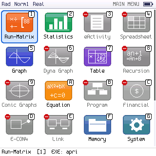
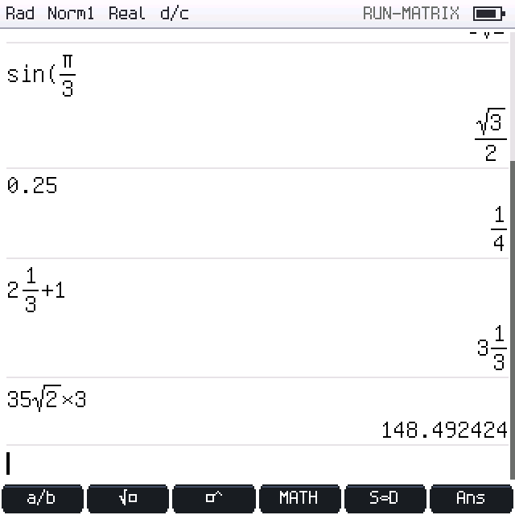
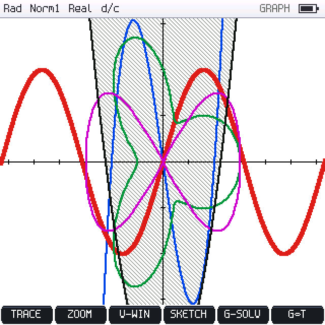
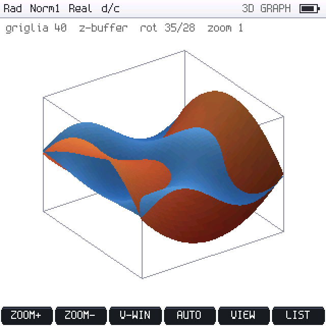

# PicoCalc FX-CG50 AI — firmware indipendente per PicoCalc + Pimoroni Pico Plus 2 W

Firmware **scritto da zero** in C++20 per la ClockworkPi **PicoCalc**, ispirato
alle funzioni e all'interfaccia della calcolatrice grafica Casio fx-CG50, con
chat AI (Claude e ChatGPT) tramite Wi-Fi. Scheda principale: **Pimoroni Pico
Plus 2 W** (RP2350B, 8 MB di PSRAM, 16 MB di flash); profilo alternativo:
**Raspberry Pi Pico 2 W** (RP2350A, 4 MB di flash, senza PSRAM).

> **Non è un emulatore.** Non contiene firmware, ROM, codice o grafica Casio:
> ogni modalità è reimplementata in modo indipendente. La documentazione Casio è
> usata solo come riferimento di comportamento.

   

## Stato (v1.9.0)

La v1.9.0 è la v1.8.0 completa (tutte le modalità, gli algoritmi e i test)
con il supporto del Pimoroni Pico Plus 2 W: PSRAM usata come pool separato,
flash da 16 MB partizionata, grafico 3D. Rapporto del consolidamento:
[docs/reports/CONSOLIDAMENTO_v1.9.0.md](docs/reports/CONSOLIDAMENTO_v1.9.0.md).

| | Stato |
|---|---|
| Compilazione UF2 (Pico SDK 2.2.0) per Pimoroni Pico Plus 2 W e per Pico 2 W | ✅ entrambe compilano, nessun warning; cartelle e UF2 separati per scheda |
| Test automatici host | ✅ 35 test per ciascun profilo di scheda: 34 suite C++ (7 705 controlli sulla Plus e 7 699 sul Pico 2 W, più le ≈ 333 000 verifiche di integrità dello stress dell'allocatore su due thread) e l'interoperabilità FAT/exFAT con fsck e mtools (41); tutti superati anche con AddressSanitizer/UBSan, allocatore su due thread con ThreadSanitizer |
| Test relay AI | ✅ 15 test (SDK ufficiali contro API simulate, TLS reale in loopback) |
| Parità con la fx-CG50 | ❌ **non completa** — GRAPH: matrice voce per voce in [docs/GRAPH_PARITY.md](docs/GRAPH_PARITY.md) |
| **Prova su PicoCalc fisica** | ❌ **non ancora eseguita**, né con il Pico Plus 2 W né con il Pico 2 W: display, tastiera, flash, PSRAM, microSD, Wi-Fi e TLS vanno collaudati con [docs/HARDWARE_TEST_v1.9.0.md](docs/HARDWARE_TEST_v1.9.0.md) (più le prove della [v1.8.0](docs/HARDWARE_TEST_v1.8.0.md)), diagnostica SYSTEM → DIAG |

Dettagli: [docs/BUILD_STATUS.md](docs/BUILD_STATUS.md) · stato per funzione:
[docs/FEATURE_MATRIX.md](docs/FEATURE_MATRIX.md) · scheda e memoria:
[docs/PICO_PLUS_2W.md](docs/PICO_PLUS_2W.md) · ripresa del lavoro: [CONTINUE.md](CONTINUE.md).

### Cosa cambia con il Pimoroni Pico Plus 2 W

| | Pico Plus 2 W | Pico 2 W |
|---|---|---|
| Memoria per i dati pesanti | PSRAM 8 MB (pool TLSF separato; la SRAM resta per stack, framebuffer e codice critico) | heap SRAM ≈ 190 KB |
| Liste statistiche / cronologia Run-Matrix | 999 elementi (come la fx-CG50) / 200 righe | 255 / 40 |
| Punti delle curve GRAPH | 400 000 per schermata (40 000 per grafico), layer statici in cache durante TRACE | 24 000 (6000 per grafico) |
| Immagini PICT, poligoni pieni | 1 MB, 4096 vertici | 96 KB, 256 vertici |
| 3D Graph | griglia fino a 128, z-buffer | griglia 24, algoritmo del pittore |
| Flash | firmware 4 MB, archivio interno LittleFS ≈ 11 MB, workspace 2 × 512 KB | firmware 2 MB, LittleFS ≈ 1,9 MB, workspace 2 × 64 KB |

Se la PSRAM non supera il self-test all'avvio il firmware parte comunque, con i
limiti RAM del Pico 2 W, e lo segnala. Un UF2 della Plus copiato su un Pico 2 W
viene riconosciuto (capacità reale della flash) e non scrive oltre il chip.

## Modalità disponibili

| Tasto | Modalità | Contenuto |
|---|---|---|
| 1 | **Run-Matrix** | input naturale 2D (frazioni, frazioni miste, radici, potenze, ∫, d/dx, Σ, Π, \|x\|, logₐb, periodo); **risultati esatti** (frazioni, √, π) con S⇔D che non altera il valore, Frac Result d/c ↔ ab/c, sviluppo periodico; cronologia modificabile sul posto con ricalcolo; Ans/PreAns e A–Z che conservano la forma esatta, `→A~F`; relazioni e logica, Int÷/Rmdr; VARS (A–Z, V-WIN, TABLE); Base-N, DMS, complessi, Pol/Rec, copia/incolla, undo/redo — vedi [docs/RUN_MATRIX.md](docs/RUN_MATRIX.md) |
| 2 | **Statistics** | liste 1–6 (fino a 999 elementi sulla Pico Plus 2 W, 255 sul Pico 2 W), 1-Var/2-Var, 9 regressioni (ax+b, Med-Med, X², X³, X⁴, Log, Exp, ab^x, Power) con grafico e copia in GRAPH, scatter/xyLine/istogramma/box plot, distribuzioni (normale, binomiale, Poisson, t, χ², F), test Z/t e intervalli |
| 5 | **Graph** | Y1–Y20: Y=, r=, parametriche, X=, 8 tipi di disequazioni (Union/Intsect), intervalli, sovrapposizioni [A=…], grafici da lista, funzioni composte; TRACE, ZOOM (13 funzioni), V-Window con memorie, SKETCH, G-SOLVE (ROOT, MAX, MIN, Y-ICEPT, INTSECT, Y-CAL, X-CAL, ∫dx anche tra radici/intersezioni), Modify, memorie grafiche, PICT e sfondo, progetti `.pcgraph` sulla microSD o nella flash interna — vedi [docs/GRAPH_PARITY.md](docs/GRAPH_PARITY.md) |
| 7 | **Table** | tabelle di Y=, r= e parametriche da Start/End/Step o da una lista (fino a 999 righe), derivate, EDIT e ROW DELETE/INSERT/ADD, LISTMEM, GPH-CON/GPH-PLT — vedi [docs/TABLE.md](docs/TABLE.md) |
| J | **3D Graph** | superfici z = f(x, y) Z1–Z3 con colori per funzione, finestra 3D (x, y, z), griglia 5–128, rotazione con le frecce e zoom senza ricalcolo, AUTO sull'intervallo z, VIEW iniziale; calcolo progressivo con avanzamento, z-buffer con la PSRAM e algoritmo del pittore senza; salvato nel workspace — vedi [docs/PICO_PLUS_2W.md](docs/PICO_PLUS_2W.md#6-grafica) |
| A | **Equation** | sistemi lineari 2–6 incognite, polinomi di grado 2–6 (radici complesse), solver numerico f(x)=g(x), disequazioni polinomiali di grado 1–6 |
| F | **Memory** | uso della memoria, cancellazione selettiva (anche delle funzioni 3D), salvataggio |
| G | **System** | angolo, formato display, modo complesso, frazioni, retroilluminazione, archivio dei file (microSD o flash interna), Wi-Fi, relay AI; INFO (SRAM, PSRAM) e DIAG (memoria, PSRAM, allocatore su 2 core, flash, LCD, microSD, flash interna, GRAPH) |
| K | **Conversion** | conversioni metriche (10 grandezze) |
| M | **AI Chat** | conversazione con Claude o ChatGPT tramite relay HTTPS |
| N | **Symbols** | guida di simboli e funzioni |

Le altre icone del menu (eActivity, Spreadsheet, Dyna Graph, Recursion, Conic
Graphs, Program, Financial, E-CON4, Link, Geometry, Picture Plot, Python) sono **mostrate in grigio con un segno rosso** e aprono una schermata che
spiega cosa manca: non sono presentate come funzionanti.
Il progetto di ogni modalità (responsabilità, servizi condivisi, modello dati,
dipendenze, test) è in [docs/APPLICATIONS_ARCHITECTURE.md](docs/APPLICATIONS_ARCHITECTURE.md);
la separazione tra le applicazioni è verificata da `tests/architecture_test.cpp`.

## Tastiera PicoCalc → fx-CG50

| PicoCalc | Funzione | PicoCalc | Funzione |
|---|---|---|---|
| F1–F5 | tasti funzione F1–F5 | Shift+F1 (F6) | F6 |
| Shift+F2 (F7) | SHIFT (one-shot) | Shift+F3 (F8) | OPTN |
| Shift+F4 (F9) | VARS | Shift+F5 (F10) | SET UP |
| Enter | EXE | Esc | EXIT (tenuto premuto: menu) |
| Tab | MENU | Backspace / Del | DEL / cancella a destra |
| Shift+Esc (Break) | AC | Shift+Enter (Insert) | → (memorizza) |
| Ctrl+C / V / Z / Y | copia / incolla / annulla / ripeti | frecce | navigazione |

Nel menu principale i tasti `1`–`9` e `A`–`N` aprono direttamente la modalità.

## Installazione rapida

1. Scarica l'UF2 della tua scheda (dalla release o compilandolo, vedi sotto):
   `picocalc_fxai_pico_plus_2w.uf2` per il Pimoroni Pico Plus 2 W,
   `picocalc_fxai_pico2w.uf2` per il Raspberry Pi Pico 2 W. **Gli UF2 non sono
   intercambiabili**: un'immagine Plus su un Pico 2 W lo segnala all'avvio e non
   salva nulla finché non si installa quella giusta.
2. Tieni premuto **BOOT/BOOTSEL** sul modulo e collegalo via USB: appare l'unità `RP2350`.
3. Copia l'UF2 sull'unità: il modulo si riavvia nel firmware. I dati salvati
   (variabili, liste, grafici) restano dopo l'aggiornamento; quelli di una
   v1.8.0 vengono importati.

Guida completa (relay AI incluso): [docs/INSTALLATION.md](docs/INSTALLATION.md).

## Compilazione

```bash
export PICO_SDK_PATH=/percorso/pico-sdk   # SDK >= 2.1, testato con 2.2.0
scripts/build.sh                          # Pico Plus 2 W -> build/pico_plus_2w/picocalc_fxai_pico_plus_2w.uf2
scripts/build.sh --board pico2w           # Pico 2 W      -> build/pico2w/picocalc_fxai_pico2w.uf2
tests/run_host_tests.sh                   # test host di entrambi i profili (--sanitize: ASan/UBSan, --tsan)
```

Opzioni (`scripts/build.sh --help`, oppure `-D` a CMake): `FXAI_BOARD`
(`PICO_PLUS_2W` predefinito, `PICO2W`), `FXAI_OPT_LEVEL` (`O2` predefinito),
`FXAI_FRAMEBUFFER_IN_PSRAM` (solo Plus), `FXAI_ENABLE_BT`, `FXAI_ENABLE_LTO`
(sperimentale), `FXAI_DISPLAY_CALIBRATION_SCREEN` (schermata di prova colori
all'avvio), `FXAI_LCD_RGB565` (LCD a 16 bit invece dei 18 bit ufficiali),
`FXAI_RELAY_CA_FILE` (certificato CA del relay AI). Dettagli in
[docs/PICO_PLUS_2W.md](docs/PICO_PLUS_2W.md#8-build).

## AI (Claude e ChatGPT)

Il Pico non contiene chiavi API: si collega via Wi-Fi + TLS a un **relay** (`relay/`)
che custodisce le chiavi Anthropic/OpenAI, autentica ogni calcolatrice con un token
dedicato e applica limiti. Vedi [docs/AI_INTEGRATION.md](docs/AI_INTEGRATION.md).
Senza rete tutte le funzioni matematiche restano disponibili.

## Documentazione

[ARCHITECTURE](docs/ARCHITECTURE.md) · [HARDWARE](docs/HARDWARE.md) ·
[GRAPH_PARITY](docs/GRAPH_PARITY.md) · [GRAPH_ENGINE](docs/GRAPH_ENGINE.md) ·
[STORAGE](docs/STORAGE.md) · [PCGRAPH_FORMAT](docs/PCGRAPH_FORMAT.md) ·
[TABLE](docs/TABLE.md) · [PICO_PLUS_2W](docs/PICO_PLUS_2W.md) ·
[HARDWARE_TEST v1.9.0](docs/HARDWARE_TEST_v1.9.0.md) · [v1.8.0](docs/HARDWARE_TEST_v1.8.0.md) ·
[GRAPHICS_ENGINE](docs/GRAPHICS_ENGINE.md) · [MATH_ENGINE](docs/MATH_ENGINE.md) ·
[AI_INTEGRATION](docs/AI_INTEGRATION.md) · [TESTING](docs/TESTING.md) ·
[ROADMAP](docs/ROADMAP.md) · [CHANGELOG](docs/CHANGELOG.md) ·
[INSTALLATION](docs/INSTALLATION.md) · [indice completo](docs/README.md)

## Licenze

Codice del progetto: GPL-3.0 (vedi `LICENSE`). Font: GNU Unifont (GPL-2.0-or-later)
e Spleen (BSD-2-Clause). Linker script derivato dal Pico SDK (BSD-3-Clause).
Configurazioni lwIP/mbedTLS derivate da pico-examples (BSD-3-Clause).
FatFs R0.16 di ChaN (licenza FatFs, tipo BSD a una clausola) in `third_party/fatfs`.
LittleFS v2.11.3 (BSD-3-Clause) in `third_party/littlefs`.
Casio e fx-CG50 sono marchi dei rispettivi proprietari; il progetto non è affiliato a Casio.
