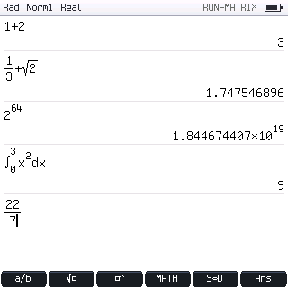
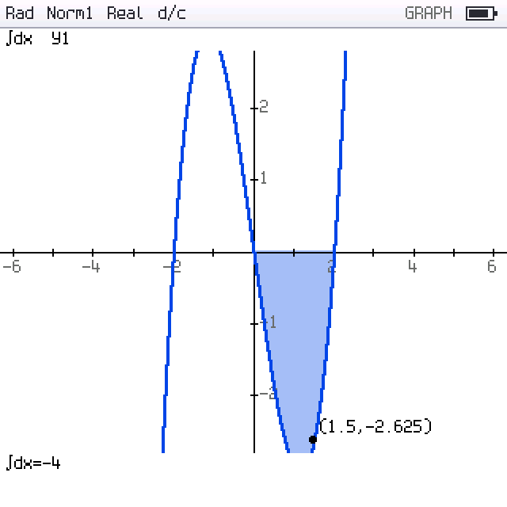

# PicoCalc FX-CG50 AI — firmware indipendente per PicoCalc + Raspberry Pi Pico 2 W

Firmware **scritto da zero** in C++20 per la ClockworkPi **PicoCalc** con
**Raspberry Pi Pico 2 W (RP2350)**, ispirato alle funzioni e all'interfaccia della
calcolatrice grafica Casio fx-CG50, con chat AI (Claude e ChatGPT) tramite Wi-Fi.

> **Non è un emulatore.** Non contiene firmware, ROM, codice o grafica Casio:
> ogni modalità è reimplementata in modo indipendente. La documentazione Casio è
> usata solo come riferimento di comportamento.

  

## Stato (v1.6.0)

| | Stato |
|---|---|
| Compilazione UF2 per RP2350 (Pico SDK 2.2.0, `pico2_w`) | ✅ compila, nessun warning nei sorgenti del progetto |
| Test automatici host | ✅ 14 suite, 4495 controlli, anche con AddressSanitizer/UBSan |
| Test relay AI | ✅ 15 test (SDK ufficiali contro API simulate, TLS reale in loopback) |
| **Prova su PicoCalc fisica** | ❌ **non ancora eseguita** — display, tastiera, flash, Wi-Fi e TLS sono implementati secondo i driver ufficiali ClockworkPi ma vanno collaudati |

Dettagli: [docs/BUILD_STATUS.md](docs/BUILD_STATUS.md) · stato per funzione:
[docs/FEATURE_MATRIX.md](docs/FEATURE_MATRIX.md) · ripresa del lavoro: [CONTINUE.md](CONTINUE.md).

## Modalità disponibili

| Tasto | Modalità | Contenuto |
|---|---|---|
| 1 | **Run-Matrix** | input naturale 2D (frazioni, radici, potenze, ∫, d/dx, Σ, Π, \|x\|, logₐb), storia richiamabile, Ans/PreAns, variabili A–Z con `→`, S⇔D, Base-N, DMS, numeri complessi, Pol/Rec, catalogo OPTN, VARS, copia/incolla, undo/redo |
| 2 | **Statistics** | liste 1–6, 1-Var/2-Var, 9 regressioni (ax+b, Med-Med, X², X³, X⁴, Log, Exp, ab^x, Power) con grafico e copia in GRAPH, scatter/xyLine/istogramma/box plot, distribuzioni (normale, binomiale, Poisson, t, χ², F), test Z/t e intervalli |
| 5 | **Graph** | Y1–Y6: Y=, r= (polari), Y>, Y<, Y≥, Y≤ (con campitura), trace, zoom, V-Window, tangente/normale, G-Solve (radici, max, min, intercetta, intersezioni, ∫dx con area) |
| 7 | **Table** | tabella dei valori con Start/End/Step |
| A | **Equation** | sistemi lineari 2–6 incognite, polinomi di grado 2–6 (radici complesse), solver numerico f(x)=g(x), disequazioni polinomiali di grado 1–6 |
| F | **Memory** | uso della memoria, cancellazione selettiva, salvataggio |
| G | **System** | angolo, formato display, modo complesso, frazioni, retroilluminazione, Wi-Fi, relay AI |
| K | **Conversion** | conversioni metriche (10 grandezze) |
| M | **AI Chat** | conversazione con Claude o ChatGPT tramite relay HTTPS |
| N | **Symbols** | guida di simboli e funzioni |

Le altre icone del menu (eActivity, Spreadsheet, Dyna Graph, Recursion, Conic
Graphs, Program, Financial, E-CON4, Link, Geometry, Picture Plot, 3D Graph,
Python) sono **mostrate in grigio con un segno rosso** e aprono una schermata che
spiega cosa manca: non sono presentate come funzionanti.

## Tastiera PicoCalc → fx-CG50

| PicoCalc | Funzione | PicoCalc | Funzione |
|---|---|---|---|
| F1–F5 | tasti funzione F1–F5 | Shift+F1 (F6) | F6 |
| Shift+F2 (F7) | SHIFT (one-shot) | Shift+F3 (F8) | OPTN |
| Shift+F4 (F9) | VARS | Shift+F5 (F10) | SET UP |
| Enter | EXE | Esc | EXIT (tenuto premuto: menu) |
| Tab | MENU | Backspace / Del | DEL / cancella a destra |
| Shift+Esc (Break) | AC | Shift+Enter (Insert) | → (memorizza) |
| Ctrl+C / V / Z / Y | copia / incolla / annulla / ripeti | frecce | navigazione |

Nel menu principale i tasti `1`–`9` e `A`–`N` aprono direttamente la modalità.

## Installazione rapida

1. Scarica `picocalc_fxai.uf2` (dalla release o compilandolo, vedi sotto).
2. Tieni premuto **BOOTSEL** sul Pico 2 W e collegalo via USB: appare l'unità `RP2350`.
3. Copia l'UF2 sull'unità: il Pico si riavvia nel firmware.

Guida completa (relay AI incluso): [docs/INSTALLATION.md](docs/INSTALLATION.md).

## Compilazione

```bash
export PICO_SDK_PATH=/percorso/pico-sdk   # SDK >= 2.0, testato con 2.2.0
scripts/build_pico2w.sh                   # -> build/pico2w/picocalc_fxai.uf2
tests/run_host_tests.sh                   # test host (aggiungere --sanitize per ASan/UBSan)
```

Opzioni CMake: `-DFXAI_DISPLAY_CALIBRATION_SCREEN=ON` (schermata di prova colori
all'avvio), `-DFXAI_LCD_RGB565=ON` (LCD a 16 bit invece dei 18 bit ufficiali),
`-DFXAI_RELAY_CA_FILE=...` (certificato CA del relay AI).

## AI (Claude e ChatGPT)

Il Pico non contiene chiavi API: si collega via Wi-Fi + TLS a un **relay** (`relay/`)
che custodisce le chiavi Anthropic/OpenAI, autentica ogni calcolatrice con un token
dedicato e applica limiti. Vedi [docs/AI_INTEGRATION.md](docs/AI_INTEGRATION.md).
Senza rete tutte le funzioni matematiche restano disponibili.

## Documentazione

[ARCHITECTURE](docs/ARCHITECTURE.md) · [HARDWARE](docs/HARDWARE.md) ·
[GRAPHICS_ENGINE](docs/GRAPHICS_ENGINE.md) · [MATH_ENGINE](docs/MATH_ENGINE.md) ·
[AI_INTEGRATION](docs/AI_INTEGRATION.md) · [TESTING](docs/TESTING.md) ·
[ROADMAP](docs/ROADMAP.md) · [CHANGELOG](docs/CHANGELOG.md) ·
[INSTALLATION](docs/INSTALLATION.md) · [indice completo](docs/README.md)

## Licenze

Codice del progetto: GPL-3.0 (vedi `LICENSE`). Font: GNU Unifont (GPL-2.0-or-later)
e Spleen (BSD-2-Clause). Linker script derivato dal Pico SDK (BSD-3-Clause).
Configurazioni lwIP/mbedTLS derivate da pico-examples (BSD-3-Clause).
Casio e fx-CG50 sono marchi dei rispettivi proprietari; il progetto non è affiliato a Casio.
