# Geometry — guida completa (v1.19.0)

Solo **Pimoroni Pico Plus 2 W**. MENU › **H**. Dalla v1.19.0 Geometry è alla
**parità completa** con il capitolo 14 del manuale della fx-CG50 (stato
**Available**); la tabella voce per voce è in
[reports/ANALISI_FONTI_v1.19.0.md](reports/ANALISI_FONTI_v1.19.0.md) e lo
stato finale in [reports/SVILUPPO_v1.19.0.md](reports/SVILUPPO_v1.19.0.md).
Grafica e testi sono del progetto; il manuale è servito solo come descrizione
del comportamento.

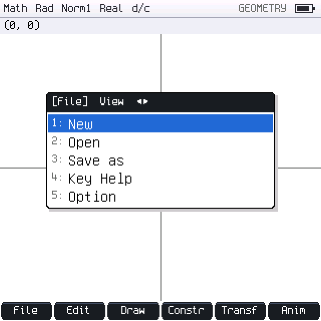

## 1. Lo schermo e i tasti

- In alto le **coordinate del puntatore** e una riga che dice cosa fare
  («Line Segment: secondo punto», «Select Axis») o cosa è selezionato («1
  vertice selezionato», «3 lati selezionati»); senza strumento attivo, il nome
  dell'oggetto sotto il puntatore («Segmento AB»).
- In basso la barra dei sei menu: **F1 File**, **F2 Edit**, **F3 Draw**,
  **F4 Constr**, **F5 Transf**, **F6 Anim**. Ogni tasto apre un menu a tendina;
  ◀ ▶ cambiano **scheda** (File/View, Edit/Option/Properties, Draw/Draw Spec),
  le cifre 1–9 scelgono la voce, EXIT chiude.
- Sulla PicoCalc: F6 = SHIFT+F1, SHIFT = F7, OPTN = F8, SET UP = F10, MENU = Tab,
  EXIT = Esc, AC = Break, DEL = Backspace.

| Tasto | Effetto |
|---|---|
| Frecce | muovono il puntatore a passi «rotondi» (0,25 alla scala iniziale); con SHIFT ×4; la vista segue il puntatore |
| 1–9 | il puntatore salta al centro di uno dei nove settori dello schermo (7 8 9 in alto) |
| EXE | con uno strumento: mette il punto; senza: seleziona o deseleziona l'oggetto sotto il puntatore |
| AC | Deselect All; annulla lo strumento; ferma un'animazione |
| DEL | cancella la selezione (e ciò che ne dipende) |
| x | Select Figure |
| * | Undo/Redo |
| v | sposta la selezione con le frecce (EXE posa, AC annulla); senza selezione: Pan |
| + / − | Zoom In / Zoom Out (×2) |
| . | Scroll |
| OPTN (anche EXIT a riposo) | casella di misura |
| SHIFT F3 | V-Window (Xmin, Xmax, Ymid, F1 INITIAL) |
| SHIFT MENU | SET UP (le stesse voci di File › Option) |
| SHIFT 5 | FORMAT della selezione (colori, linee, aree) |
| MENU | menu principale |

Nei moduli (Option, SET UP, V-Window, FORMAT, Edit Animation) **EXIT
conferma** e **AC annulla**; File › Key Help mostra queste tabelle in tre
schermate. Aperta da una **striscia di eActivity**, Geometry torna al documento
con MENU, SHIFT ' o EXIT a riposo senza selezione (la casella si apre con OPTN).

## 2. File e View

| Voce | Uso |
|---|---|
| File › New | nuova costruzione (conferma se ce n'è una); le opzioni restano |
| File › Open | elenco dei `.pcgeo` in `PICOCALC/GEOM` (microSD o flash interna, come scelto in SYSTEM); F1 nell'elenco = DELETE con conferma. Si aprono anche i file della v1.17.0 (formato 1), convertiti in punti e figure legate |
| File › Save as | nome fino a 8 caratteri, sovrascrittura con conferma |
| File › Key Help | tre schermate di aiuto sui tasti |
| File › Option | Number Format (Fix0–9, Sci1–10, Norm; iniziale Fix2), Angle (Deg, Rad), Length Unit (Off, mm, cm, m, km, inch, feet, yard, mile), Grid (Off, On a punti, Line), Grid Space (0,01–1000), Axes (Off, On, Scale) |
| View › Zoom Box | due angoli: il riquadro riempie lo schermo |
| View › Pan / Scroll | le frecce spostano la vista; EXIT finisce |
| View › Zoom In / Zoom Out | ×2 / ×½ |
| View › Zoom to Fit | inquadra tutti gli oggetti visibili (non le funzioni) |
| View › Axes / Grid | cambiano gli assi (On, Scale, Off) e la griglia (On, Line, Off) |

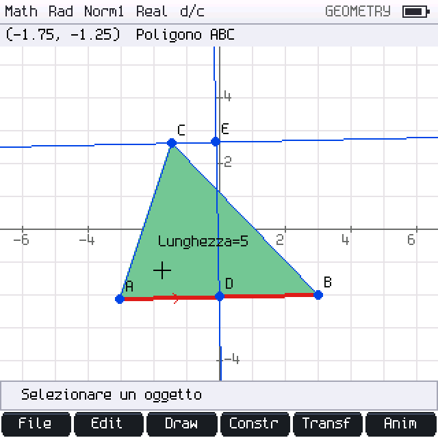

## 3. Draw e Draw Spec

Ogni punto messo sopra una linea o una curva **resta legato** a quell'oggetto
(si sposta solo lungo di esso); un punto già esistente sotto il puntatore viene
riusato. I punti prendono le etichette A, B, C… (dopo Z: A1, B1…). Gli
strumenti restano attivi finché non si preme EXIT.

| Voce | Come |
|---|---|
| Point | EXE per ogni punto |
| Line Segment, Infinite Line, Ray, Vector | due punti |
| Circle | centro, poi un punto della circonferenza |
| Arc | centro, inizio, poi la direzione della fine (antiorario) |
| SemiCirc (Diam) | gli estremi del diametro (antiorario dal primo) |
| 3-Point Arc | inizio, un punto intermedio, fine |
| Triangle, Isosc Triangle, Rectangle, Square | due angoli di un riquadro; l'isoscele, il rettangolo e il quadrato **restano** tali quando si spostano i vertici (il quadrato prende il lato minore del riquadro) |
| Polygon | EXE per vertice; EXE sul primo vertice chiude; EXIT lascia la spezzata aperta |
| Regular n-gon | numero di lati (3–12), poi il riquadro; resta regolare |
| Function f(x) | Y= con il motore di calcolo unico, sempre in radianti |

Un riquadro di un solo punto disegna la figura più grande che sta nello
schermo. Al più 50 vertici per poligono.

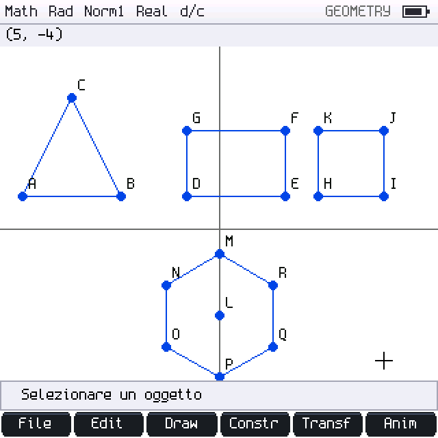
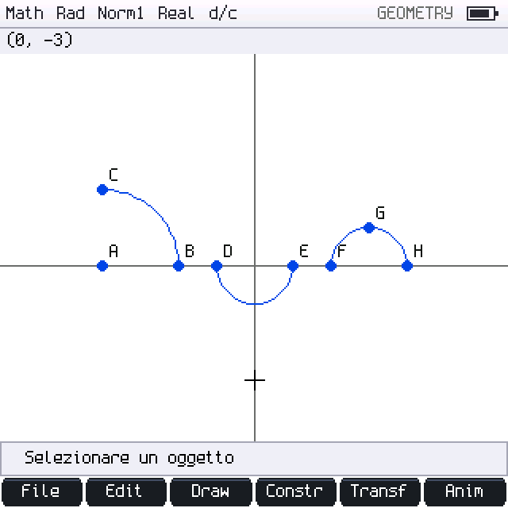

## 4. Construct: le costruzioni restano legate

Si seleziona prima (EXE sugli oggetti), poi si sceglie la voce. Ogni oggetto
costruito è **legato ai genitori** (grafo delle dipendenze): spostando un punto
si aggiorna tutto ciò che ne dipende, e solo quello (ricalcolo incrementale).

| Voce | Selezione | Risultato |
|---|---|---|
| Perp Bisector | un segmento (o un lato) o due punti | asse |
| Perpendicular | una linea e un punto | perpendicolare per il punto |
| Midpoint | un segmento o due punti | punto medio |
| Intersection | due tra segmenti, rette, semirette, vettori, circonferenze, archi | tutti i punti d'intersezione |
| Angle Bisector | due linee che si incontrano | le due bisettrici |
| Parallel | una linea e un punto | parallela, con i segni ">" sulle due linee |
| Tangent | «Select Curve»: EXE vicino al punto della circonferenza, dell'arco o del grafico | punto legato e tangente |
| Attached Angle | due lati | la misura dell'angolo, posata dove si sceglie con «Select Display Position» |

Quando una costruzione non si può fare (rette diventate parallele, cerchi
concentrici, punti coincidenti) l'oggetto diventa **indefinito**: non si
disegna e le misure dicono «Undefined»; torna appena la figura lo permette.
Tolleranze dichiarate in ANALISI_FONTI §4.4.

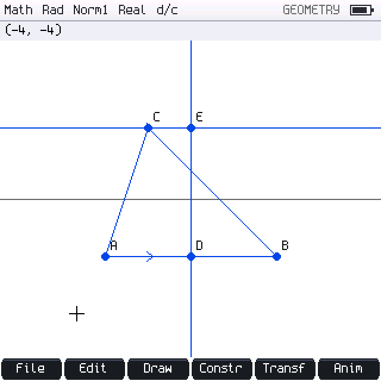

## 5. Transform: le immagini restano legate

Si selezionano le figure (con **x** si prende tutta la figura), poi:

| Voce | Poi |
|---|---|
| Reflection | «Select Axis»: EXE su un segmento, una retta, una semiretta o un lato |
| Translation | X e Y |
| Trans(Sel Vec) | «Select Vector»: EXE sul vettore |
| Rotation | «Sel Rotation Center» (EXE su un punto o su uno spazio vuoto: il centro viene creato), poi l'angolo antiorario nell'unità delle Option |
| Dilation | centro, poi il fattore (0,1 ≤ \|k\| ≤ 10) |
| Symmetry | «Select Center Point»: simmetria centrale (rotazione di 180°) |

Le immagini hanno i vertici con l'apice (A′, B′…) e restano **legate**: se si
sposta un vertice dell'originale, l'asse, il centro o il vettore, l'immagine si
aggiorna. Le funzioni f(x) non si trasformano. Con la casella di misura, un
punto e la sua immagine mostrano l'angolo di rotazione o il fattore di
dilatazione, che si possono anche riscrivere.

## 6. La casella di misura

**OPTN** (o EXIT quando non c'è altro da chiudere) apre la casella in basso;
**EXIT** rimanda i tasti al disegno lasciandola visibile (si può cambiare la
selezione e la casella segue); **OPTN** di nuovo la chiude. ◀ ▶ o **F1 TYPE**
scelgono il tipo di misura secondo la selezione:

| Selezione | Misure |
|---|---|
| un punto | Coordinate (bloccabili: il punto resta fisso) |
| due punti | Lunghezza; Angolo di rotazione / Fattore se uno è l'immagine dell'altro |
| tre punti | Angolo al secondo punto |
| un segmento | Lunghezza, Pendenza, Direzione, Equazione |
| un vettore | Lunghezza, Componenti, Pendenza, Direzione, Equazione |
| una retta o una semiretta | Pendenza, Direzione, Equazione |
| una circonferenza | Raggio, Circonferenza, Area, Equazione |
| un arco | Raggio, Circonferenza (lunghezza dell'arco), Equazione |
| un poligono, o lati che chiudono una figura | Area, Perimetro |
| due linee | Angolo, Supplementare (e Congruenza se sono due segmenti) |
| un punto e una curva | Incidenza (Sì/No) |
| una retta e una circonferenza, o due circonferenze | Tangenza (Sì/No) |
| un testo o una misura incollata | Etichetta; un'espressione: Espressione |

- **Scrivere un valore** (cifre, poi EXE; per due valori «x,y») cambia la
  figura con lo spostamento più piccolo possibile e **blocca** la misura: da
  lì in poi resta vera anche quando si spostano i punti (gli altri si
  adattano). **F2 LOCK** blocca il valore attuale (per Sì/No: lo rende vero) o
  sblocca. Blocchi incompatibili danno «Math ERROR: vincoli incompatibili» e
  non cambiano nulla. Il calcolo è un lavoro a passi: AC lo interrompe.
- **F3 PASTE** incolla la misura sullo schermo come testo che si aggiorna
  (nome di 14 caratteri al più, modificabile con F5 LABEL o Option › Label;
  il formato dei numeri con Option › Number Format).
- **F4 TABLE** aggiunge la misura alla tabella delle animazioni.
- Un valore che porta la figura fuori dallo schermo fa inquadrare la vista.

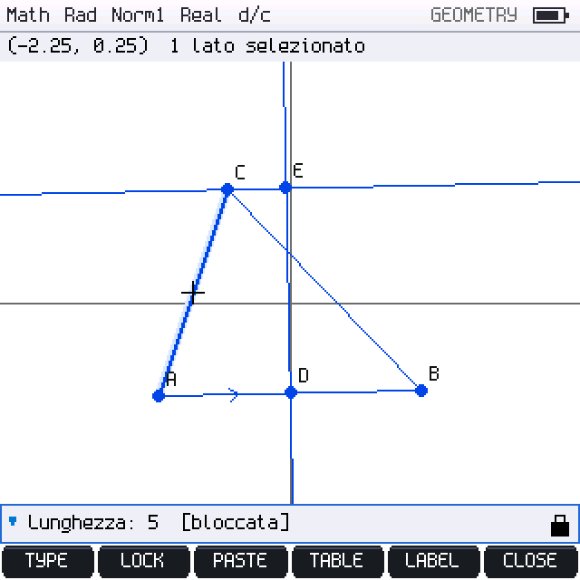

## 7. Option, Properties e FORMAT

| Voce | Uso |
|---|---|
| Option › Text | testo di 31 caratteri, posato con EXE |
| Option › Label | etichetta dell'oggetto selezionato (14 caratteri) |
| Option › Expression | formula con le misure incollate: `@1`, `@2`… e `@1X`, `@1Y` per coordinate e componenti; si aggiorna con la figura |
| Option › Number Format | formato delle misure incollate scelte (senza selezione: quello iniziale) |
| Option › Clr Constraint | toglie i blocchi e i vincoli delle figure di Draw Spec (che diventano poligoni liberi); le costruzioni e le trasformazioni restano legate |
| Option › Show All / Hide | mostra tutto / nasconde la selezione |
| Option › Area Calc | aree delle figure chiuse colorate scelte, incollate e (se più d'una) sommate |
| Properties › to the front / to the back / All TEXT | ordine di disegno |
| Properties › Fade I/O | luminosità dello sfondo (0–100 %) |
| Properties › Store Picture | l'area del disegno in Pict 1–20 (gli stessi file di Graph, `PICOCALC/PICT`) |
| Properties › Recall Picture / Clear Picture | sfondo da una Pict / nessuno sfondo |
| Properties › Format (anche SHIFT 5) | Line Style (Normal, Thick, Thin, Broken, Dot), Line Color, Area Color (o Clear), Paint Style (Normal, Lighter), Char Color, con le sole voci che valgono per la selezione |

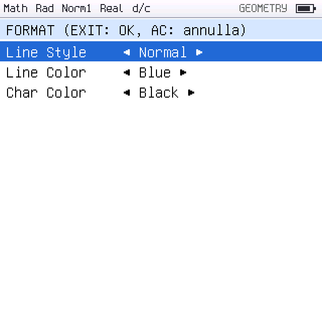

## 8. Edit

**Undo/Redo** (anche `*`) annulla l'ultima operazione; scelto di nuovo la
rifà (un livello, come la fx-CG50). Clear All, la vista e il SET UP non si
annullano. **Select All**, **Deselect All** (anche AC), **Select Figure**
(anche `x`), **Delete** (anche DEL: cancella anche ciò che dipende dagli oggetti
scelti), **Clear All** (conferma).

## 9. Animate

1. Selezionare **un punto** (libero o già legato al percorso) e **il
   percorso** (segmento, retta, semiretta, vettore, lato, circonferenza, arco o
   funzione), poi Animate › **Add Animation** (Replace Animation toglie quelle di
   prima). Si possono animare fino a 16 punti insieme.
2. **Trace**: i punti selezionati lasciano la traccia.
3. **Edit Animation**: per ogni punto Steps (2–100, iniziale 20), t0 e t1
   (−10…10: 0 è l'inizio del percorso, 1 la fine; sulla circonferenza 1 è un
   giro; sulla funzione t è la x), Times (per Go (repeat): 0 = senza fine);
   F5 DELETE, F6 DEL-ALL.
4. **Go (once)** / **Go (repeat)**: AC o EXIT fermano; alla fine i punti
   tornano dov'erano e la traccia resta sullo schermo.
5. **Add Table** (o F4 TABLE nella casella): la misura diventa una colonna
   (al più 26; coordinate e componenti danno due colonne). **Display Table**
   mostra una riga per passo (calcolata a passi se l'animazione non è ancora
   stata eseguita); F1 STORE › LIST salva la colonna in List 1–26, STORE › STAT
   mette tutte le colonne in List 1… e apre Statistics; F2 DELETE / DEL-ALL.

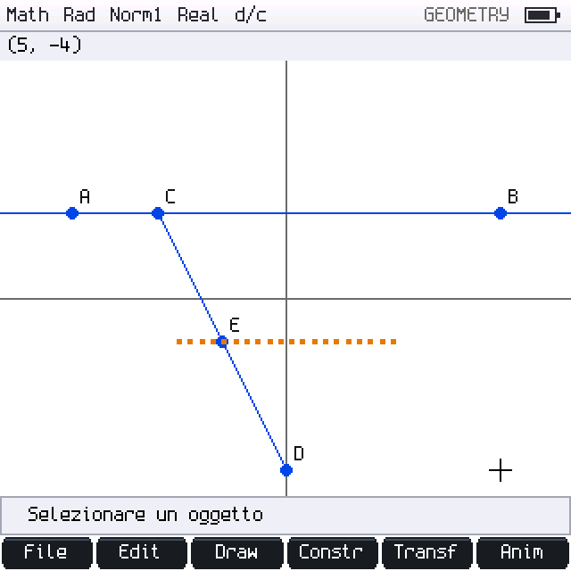
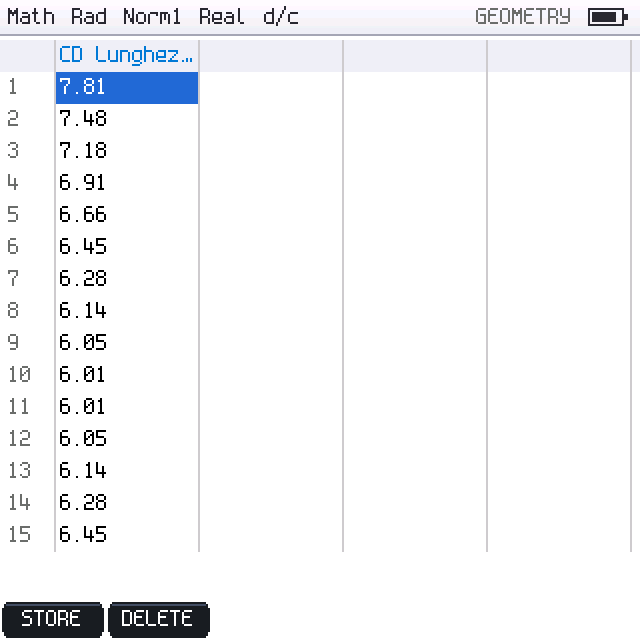

## 10. Esempi da scuola

**Traslare un triangolo con un vettore.** F3 › ▶ › 1 Triangle, due angoli del
riquadro, EXIT. F3 › 5 Vector, due punti, EXIT. EXE dentro il triangolo, `x`
(tutta la figura). F5 › 3 Trans(Sel Vec), EXE sul vettore: compare A′B′C′,
legato; spostando un estremo del vettore (selezione, `v`, frecce, EXE) il
triangolo immagine si sposta. Con la casella sulle due figure si verifica che
l'area è la stessa.

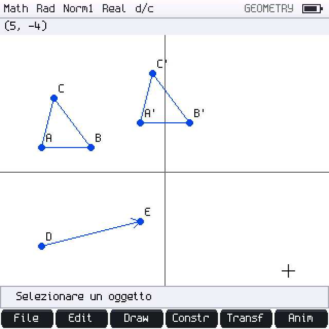

**Ruotare un triangolo di 90° attorno all'origine.** Disegnare il triangolo,
selezionarlo con `x`, F5 › 4 Rotation, EXE sull'origine (il centro viene
creato se non c'è), scrivere `90`, EXE. Selezionando un vertice e la sua
immagine, la casella mostra «Ang. rotazione: 90°»; scrivendo `45` la rotazione
cambia.

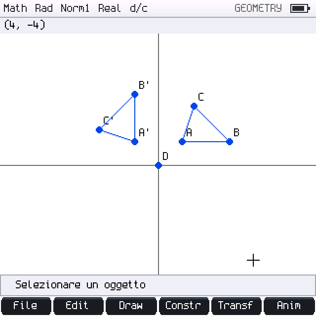

**Simmetria rispetto a una retta.** F3 › 3 Infinite Line per due punti
(per esempio y = x), poi la figura; selezionare la figura (`x`), F5 › 1
Reflection, EXE sulla retta. Spostando la retta l'immagine si ribalta di
conseguenza; riflettere due volte rimette i punti al loro posto.

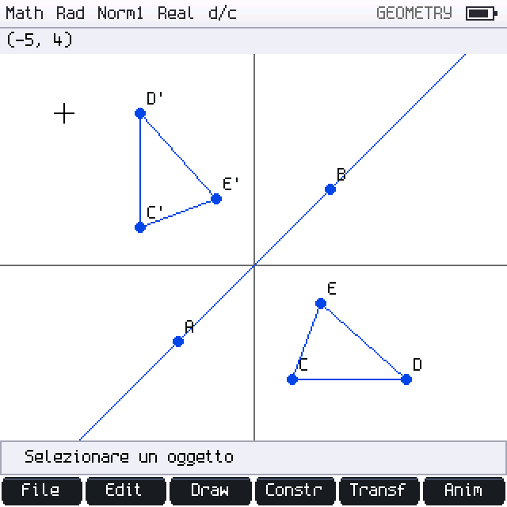

**Omotetia di fattore 2.** Disegnare un quadrato (F3 › ▶ › 4), selezionarlo,
F5 › 5 Dilation, EXE sul centro, `2`, EXE. Selezionando i due quadrati e
incollando l'area con OPTN › F3 PASTE si legge 1 e 4: con fattore k le
lunghezze si moltiplicano per |k| e l'area per k².

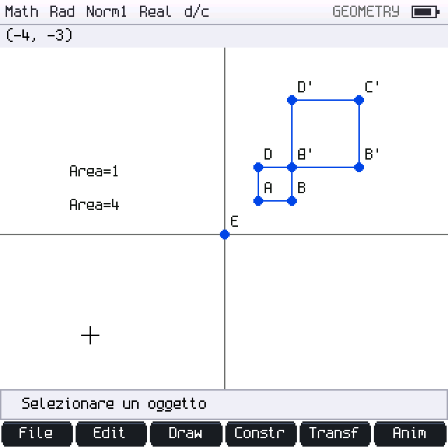

## 11. File, memoria e limiti

| Voce | Valore |
|---|---|
| File | `.pcgeo` versione 2 (oggetti con definizioni e genitori, blocchi, animazioni, tabella, opzioni, vista, sfondo); legge il formato 1 della v1.17.0 ([FILE_FORMATS.md](FILE_FORMATS.md)) |
| Record del workspace | sezione `0x0110` versione 2 (la versione 1 si migra; danneggiata = isolata) |
| Oggetti | 1 000 con la PSRAM, 250 senza («Memory ERROR» oltre, nulla si perde) |
| Altri limiti | 50 vertici, 16 animazioni, 64 blocchi, 26 colonne, 100 righe, testi di 31 caratteri, etichette di 14 |
| Differenze dalla fx-CG50 | ANALISI_FONTI §6 (D1–D9): grafica propria, tasti della PicoCalc, casella anche con OPTN, Option in Edit, Clr Constraint non tocca le costruzioni, nessun riscalamento nascosto, sfondi `.pcpict`, STORE › STAT al posto di S-SHT, voci in più (3-Point Arc, tratti Broken e Dot, Axes e Grid in View, Clear Picture) |
