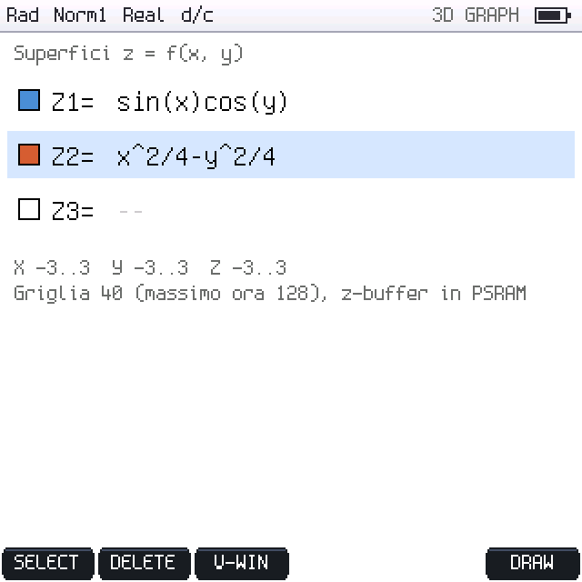
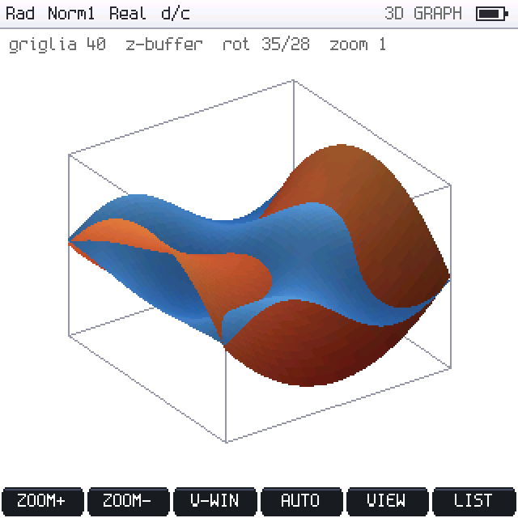

# PicoCalc FX-CG50 AI sul Pimoroni Pico Plus 2 W (v1.9.0)

La v1.9.0 ha come **scheda principale il Pimoroni Pico Plus 2 W** (RP2350B,
8 MB di PSRAM, 16 MB di flash) e mantiene il **Raspberry Pi Pico 2 W** come
profilo alternativo. Il software è quello completo della v1.8.0 (tutte le
modalità, motore matematico, GRAPH, TABLE, microSD, relay AI) con il layer
hardware e di memoria introdotto dalla prima 1.9.0 e adattato a questa
architettura. Storia del consolidamento:
[reports/CONSOLIDAMENTO_v1.9.0.md](reports/CONSOLIDAMENTO_v1.9.0.md).

> **Stato di verifica.** Tutto ciò che è descritto qui è **compilato per
> entrambe le schede e provato sul PC** (test host, ASan/UBSan, TSan per
> l'allocatore). **Nessuna prova è stata fatta su hardware reale**: driver
> PSRAM, scritture flash, LCD, tastiera, microSD, Wi-Fi vanno validati con la
> procedura [HARDWARE_TEST_v1.9.0.md](HARDWARE_TEST_v1.9.0.md) e con
> SYSTEM → F2 DIAG.

## 1. Le due schede

| | Pimoroni Pico Plus 2 W (principale) | Raspberry Pi Pico 2 W (alternativa) |
|---|---|---|
| MCU | RP2350**B** (QFN-80), 2× Cortex-M33 a 150 MHz | RP2350**A** (QFN-60), 2× Cortex-M33 a 150 MHz |
| SRAM | 520 KB | 520 KB |
| PSRAM | **8 MB** APS6404L su QMI CS1, **GPIO47** | — |
| Flash QSPI | **16 MB** | 4 MB |
| GPIO | 48 (GP0–47) | 30 (GP0–29) |
| ADC | GPIO40–47 | GP26–29 |
| Wireless | modulo RM2 (CYW43439, Wi-Fi 2,4 GHz + BT) | CYW43439 |
| Pin CYW43 (header SDK) | WL_ON 23, DATA 24, CS 25, CLK 29 | identici |
| `FXAI_BOARD` / `PICO_BOARD` | `PICO_PLUS_2W` / `pimoroni_pico_plus2_w_rp2350` | `PICO2W` / `pico2_w` |
| UF2 | `picocalc_fxai_pico_plus_2w.uf2` | `picocalc_fxai_pico2w.uf2` |

I valori specifici del modulo vengono dagli header dell'SDK (`pico2_w.h`,
`pimoroni_pico_plus2_w_rp2350.h`, `hardware/platform_defs.h`) e sono raccolti
in `include/board_config.hpp`, che li verifica con `static_assert`
(dimensione della flash, RP2350A/B, CS della PSRAM, nessun pin della PicoCalc
in conflitto con i pin interni del modulo).

**Pin della PicoCalc (invariati, quelli del driver ufficiale usato dalla v1.8.0):**

| Funzione | Pin |
|---|---|
| LCD ST7365P, SPI1 hardware a 25 MHz, RGB666 | SCK GP10, MOSI GP11, MISO GP12, CS GP13, DC GP14, RST GP15 |
| Tastiera/batteria STM32 (I²C1, 0x1F, 10 kHz) | SDA GP6, SCL GP7 |
| microSD (SPI0) | SCK GP18, MOSI GP19, MISO GP16, CS GP17, card detect GP22 (attivo basso) |
| UART0 → USB-C PicoCalc | TX GP0, RX GP1 (non usata: stdio su USB CDC) |

Il firmware non usa l'ADC del modulo (la batteria si legge dallo STM32) e non
usa il Bluetooth (opzione `FXAI_ENABLE_BT`, spenta).

## 2. Mappa della memoria

```
0x10000000  flash XIP (CS0), con cache ─ firmware + partizioni (§5)
0x11000000  PSRAM (CS1), con cache, write-back ─ pool PSRAM_BOARD (TLSF), 8 MB
0x14000000  alias senza cache della flash
0x15000000  alias senza cache della PSRAM (self-test, diagnostica)
0x20000000  SRAM: vettori, .data, .bss (framebuffer 200 KB), heap newlib
0x20078000  STACK core 0: 32 KB (linker script), guardia MSPLIM
0x20080000  SCRATCH_X: stack core 1 (4 KB, solo diagnostica), guardia MSPLIM
0x20081000  SCRATCH_Y: libero
```

| Build (Release, `-O2`, SDK 2.2.0) | Immagine flash | RAM statica | Heap SRAM |
|---|---|---|---|
| Pico Plus 2 W | vedi [BUILD_STATUS.md](BUILD_STATUS.md) | ≈ 294 KB | ≈ 186 KB + **8 MB PSRAM** |
| Pico 2 W | vedi [BUILD_STATUS.md](BUILD_STATUS.md) | ≈ 290 KB | ≈ 190 KB |

SRAM e PSRAM sono **due banchi distinti**, mai presentati come memoria
contigua: la PSRAM passa per la cache XIP da 16 KB (condivisa con il codice in
flash) a 75 MHz in QPI, con latenza e banda molto diverse dalla SRAM.

## 3. Driver PSRAM (`src/psram.cpp`)

Porting della sequenza di SparkFun `sfe_psram.c` (MIT), con il CS dal board
header dell'SDK: uscita da QPI (`0xF5`), **Read ID `0x9F`** (KGD deve essere
`0x5D`), Reset Enable/Reset (`0x66`/`0x99`), Enter Quad (`0x35`), timing M1 da
`clk_sys` (`CLKDIV = ceil(clk_sys/109 MHz)` → 75 MHz a 150 MHz, `MAX_SELECT`
≤ 8 µs, `MIN_DESELECT` ≥ 50 ns, pagine da 1 KB), lettura `0xEB` quad con 6
cicli di attesa, scrittura `0x38` quad, `XIP_CTRL.WRITABLE_M1`.

**Self-test all'avvio** (`include/psram_selftest.hpp`, provato sul PC con
modelli di guasto): bus dati, bus indirizzi, 8192 campioni casuali su tutti gli
8 MB, percorso con cache (scrittura + clean + lettura dall'alias senza cache) e
inverso. **Se il chip non risponde o il test fallisce la finestra M1 resta in
sola lettura, il pool PSRAM non viene registrato e il firmware parte solo in
SRAM**: i limiti RAM tornano automaticamente ai valori del Pico 2 W (§4) e
all'avvio compare "Memory ERROR: PSRAM disabilitata, avvio solo in SRAM".

## 4. Allocazione: due pool e regole esplicite

`include/mem_pools.hpp`:

| Pool | Gestore | Note |
|---|---|---|
| `SRAM` | heap newlib (mutex di `pico_malloc` con due core) | blocchi sovra-allineati tramite registro senza lock |
| `PSRAM_BOARD` | **TLSF** (`src/tlsf.cpp`) sugli 8 MB | O(1), coalescenza immediata; assente (anche il blocco di controllo) nelle build per il Pico 2 W |
| `PSRAM_PICOCALC` | solo interfaccia | nessun driver: lo schema della PSRAM della mainboard non è verificato |

- **`operator new` globale** (`src/mem_new.cpp`, solo firmware): richieste
  ≥ 512 byte → `PREFER_PSRAM` (PSRAM, poi SRAM), più piccole → `PREFER_SRAM`
  (SRAM con 16 KB di riserva, poi PSRAM); dentro le interruzioni sempre SRAM;
  `mem::PlacementScope` forza una regola per un blocco di codice. Nessun
  `#ifdef` nelle applicazioni: sul Pico 2 W tutto finisce nell'heap SRAM come
  nella v1.8.0.
- `malloc` C (lwIP con `MEM_LIBC_MALLOC`, mbedTLS, newlib) resta nell'heap SRAM.
- Thread-safety su due core: `critical_section` (spin lock + IRQ mascherati).
- Fallimento: `std::bad_alloc` → "Memory ERROR" (mai `panic`, `PICO_MALLOC_PANIC=0`).

**Cosa resta in SRAM e cosa va in PSRAM (sulla Plus):**

| SRAM | PSRAM |
|---|---|
| stack (32 KB core 0, 4 KB core 1), vettori, ISR | punti delle curve di GRAPH (fino a 400 000) |
| framebuffer 320×320 (predefinito, vedi §6) | layer statici di GRAPH durante TRACE (180 KB) |
| buffer di rimbalzo flash (1 KB), buffer LittleFS se piccoli | immagini PICT/sfondo (fino a 1 MB RLE) |
| lwIP, mbedTLS, CYW43, USB | mesh e z-buffer del 3D Graph |
| nodi AST e stringhe brevi | liste, cronologia, righe di TABLE, workspace serializzato, risposta HTTP, file system LittleFS (cache) |

## 4.1 Limiti: tre categorie (`include/limits.hpp`)

| Categoria | Pico 2 W | Pico Plus 2 W | Note |
|---|---|---|---|
| **Persistenti** (record del workspace) | cronologia 40, liste 255 | cronologia **200**, liste **999** (fx-CG50) | fissi per scheda: un record salvato è sempre rileggibile |
| **RAM** (scelti a runtime dai pool presenti) | curve 6000/24 000 punti, PICT 96 KB, 3D griglia 24 senza z-buffer, nessuna cache dei layer | curve **40 000/400 000** punti, PICT **1 MB**, 3D griglia **128 con z-buffer**, cache dei layer di GRAPH | con la PSRAM disabilitata la Plus usa i valori del Pico 2 W |
| **Strutturali** (stack, tempo CPU) | 320 token, 32 livelli, editor 12 livelli, budget di valutazione 16 KB | identici | protezione dello stack da 32 KB |

Le chat AI restano a 30 messaggi e le richieste/risposte nei limiti del
protocollo del relay (16 KB / 4000 caratteri): buffer più grandi sul
dispositivo non servirebbero.

## 5. Flash: partizioni e protezioni

Calcolate da `PICO_FLASH_SIZE_BYTES` in `cmake/fxai_board.cmake`, ripetute in
`board_config.hpp` con `static_assert`:

| Area | Pico Plus 2 W (16 MB) | Pico 2 W (4 MB) |
|---|---|---|
| Firmware | 0 – 4 MB (immagine 1,32 MB) | 0 – 2 MB (immagine 1,31 MB) |
| Settore diagnostico 4 KB | 4 MB | 2 MB |
| **LittleFS** (file utente interni) | **≈ 11,0 MB** | ≈ 1,9 MB |
| BTstack (riservato, 8 KB) | prima del record | prima del record |
| **Record del workspace** (A/B con CRC) | **1 MB** (2 × 512 KB) | 128 KB (2 × 64 KB), **stessa posizione della v1.8.0** |
| Ultimo settore (4 KB) | mai scritto | mai scritto dai nuovi salvataggi |

- **Ultimo settore**: il workaround dell'erratum RP2350-E10 del bootrom
  sovrascrive l'ultimo blocco della flash durante l'aggiornamento via UF2
  (pico-sdk PR #2412). Nella v1.8.0 lo slot B del workspace terminava proprio lì:
  ora nessun salvataggio lo scrive (capacità del Pico 2 W 59,75 KB invece di
  63,75 KB; i record più grandi già presenti vengono ancora letti) e la regione
  stessa rifiuta scritture in quell'area.
- **Bus condiviso flash/PSRAM**: durante erase/program l'XIP è fermo per
  entrambi i chip. Ogni scrittura passa da `flash_safe_execute()` con un helper
  del progetto (blocca il core 1 solo se è attivo, IRQ mascherati), i dati sono
  copiati prima in un **buffer di rimbalzo in SRAM** (1 KB: un blocco
  serializzato in PSRAM non sarebbe leggibile durante la scrittura — difetto
  della v1.8.0 se eseguita su una scheda con PSRAM), le cancellazioni avvengono
  un settore alla volta (USB e tastiera servite tra un settore e l'altro) e la
  configurazione QMI M1 della PSRAM viene verificata e ripristinata prima che
  l'XIP riparta. L'SDK 2.2.0 esegue già `xip_cache_clean_all()` e ripristina
  timing/rcmd/rfmt di M1.
- **Migrazione**: sulla Plus, se il nuovo archivio è vuoto e all'indirizzo
  usato dalla v1.8.0 (4 MB − 128 KB, dentro la partizione firmware ma oltre
  l'immagine) c'è un workspace valido, viene importato una volta (sola
  lettura) e salvato nel nuovo archivio.
- **LittleFS** (v2.11.3, `third_party/littlefs`): file system interno per
  progetti GRAPH e immagini, scelto in SYSTEM → "Archivio file" (microSD o
  flash interna); montato solo quando serve, formattato se la partizione è
  vuota; resistente alle interruzioni di alimentazione (provato con il
  modello NOR e tagli in ogni punto del salvataggio atomico).
- **UF2 della scheda sbagliata**: all'avvio `board::init()` legge il JEDEC ID
  della flash (comando 0x9F in un job in RAM tramite `flash_safe_execute()`)
  prima di creare le regioni. Un'immagine Plus copiata su un Pico 2 W
  metterebbe LittleFS e il workspace oltre i 4 MB del chip, dove gli indirizzi
  ricominciano da zero: la prima formattazione cancellerebbe il firmware e i
  dati del Pico 2 W. Le regioni che non stanno nel chip vengono disattivate,
  l'avvio mostra "System ERROR: UF2 per … su una flash da 4 MB. Installare
  picocalc_fxai_pico2w.uf2" e l'autosalvataggio dice che il salvataggio non è
  disponibile. Un ID non riconosciuto mantiene la mappa della build. La
  capacità e il chip compaiono in DIAG (gruppo MEM) e nel log USB (`[flash]`).

## 6. Grafica

- **Framebuffer in SRAM** (predefinito). `FXAI_FRAMEBUFFER_IN_PSRAM=ON` lo
  sposta in PSRAM (200 KB di heap SRAM in più) con ripiego in SRAM; disegnare
  in PSRAM passa dalla cache XIP condivisa con il codice, quindi non è il
  predefinito. SYSTEM → DIAG misura il tempo di un aggiornamento completo.
- **GRAPH**: con la PSRAM i budget dei punti crescono di 16 volte (le curve
  polari/parametriche dense e 20 grafici insieme non vengono più troncati).
  Il ridisegno cresce con i punti: misurato sul PC 2 ms (24 000 punti) contro
  23,6 ms (249 000 punti). Per questo durante **TRACE e il puntatore** i layer
  statici (sfondo, regioni, griglia, assi, curve, sketch) restano in PSRAM e
  vengono copiati invece di essere ridisegnati: 0,05 ms invece di 18,6 ms per
  passo sul PC, immagine identica al pixel (test `graphics_memory_test`); la
  cache vale solo per i tasti cursore e si invalida con qualunque altro tasto,
  con il disegno in corso o con un cambio di finestra/impostazioni.
- **3D Graph** (modalità `J` del menu): fino a 3 superfici z=f(x,y), finestra
  3D, rotazione e zoom; campionamento a passi nel `tick()` (tastiera sempre
  reattiva), mesh e z-buffer in PSRAM con griglie fino a 128; senza PSRAM
  algoritmo del pittore e griglia fino a 24. Ogni superficie ha la sua famiglia
  di colore (Z1 blu, Z2 rosso, Z3 verde, come le relazioni di GRAPH) con la
  luminosità legata all'altezza.

 

Screenshot del simulatore host (`tests/sim/graph3d.txt`, profilo Pico Plus 2 W
con il pool PSRAM simulato), prodotti dallo stesso codice del firmware.

## 7. Stack, guasti e due core

- Stack del core 0 da 32 KB dal reset (linker script della v1.8.0) con
  **guardia hardware MSPLIM** (`PICO_USE_STACK_GUARDS=1`); stack del core 1
  in SCRATCH_X con guardia.
- **HardFault** (in SRAM): azzera MSPLIM, passa a uno stack di emergenza,
  registra tipo/PC/LR nei registri scratch del watchdog e riavvia; all'avvio
  successivo la causa compare su USB e in una finestra di errore.
- Core 1: usato solo dalla diagnostica "allocatore su 2 core". Un uso
  permanente (per esempio rendering in parallelo) non è stato introdotto: senza
  misure sull'hardware il guadagno non è dimostrabile e aumenterebbe la
  complessità (flash e PSRAM condividono il bus QMI).

## 8. Build

```bash
export PICO_SDK_PATH=/percorso/pico-sdk          # SDK >= 2.1 (provato 2.2.0)
scripts/build.sh --board pico_plus_2w            # build/pico_plus_2w/picocalc_fxai_pico_plus_2w.uf2
scripts/build.sh --board pico2w                  # build/pico2w/picocalc_fxai_pico2w.uf2
scripts/build_pico2w.sh                          # come sopra (comando della v1.8.0)
# opzioni: --opt O2|O3|Os  --fb-psram  --bt  --lto  --clean  -DVAR=VALORE
```

Una cartella di build per scheda (CMake rifiuta il cambio di scheda nella
stessa cartella). **Gli UF2 non sono intercambiabili**: un firmware Pico 2 W
su una Plus non usa la PSRAM né i 16 MB; un firmware Plus su un Pico 2 W non
trova la PSRAM (avvio solo SRAM) e assume 16 MB di flash.

| Opzione | Predefinito | Effetto |
|---|---|---|
| `FXAI_BOARD` | `PICO_PLUS_2W` | scheda |
| `FXAI_OPT_LEVEL` | `O2` | ottimizzazione (codice più compatto per la cache XIP rispetto a `-O3`) |
| `FXAI_FRAMEBUFFER_IN_PSRAM` | OFF | framebuffer in PSRAM (solo Plus) |
| `FXAI_ENABLE_BT` | OFF | BTstack LE (nessuna funzione lo usa) |
| `FXAI_ENABLE_LTO` | OFF | LTO dei soli sorgenti dell'applicazione (sperimentale) |
| `FXAI_PSRAM_NEW_THRESHOLD` | 512 | soglia di `operator new` per la PSRAM |

Flashing: tenere premuto **BOOT/BOOTSEL** collegando l'USB-C e copiare l'UF2
sull'unità `RP2350`, oppure `picotool load -x <file>.uf2`.

## 9. Diagnostica sul dispositivo (SYSTEM → F2 DIAG)

Righe anche sulla seriale USB con prefisso `[DIAG]`:

| Gruppo | Contenuto |
|---|---|
| MEM | scheda, ID e timing della PSRAM, esito del self-test, pool SRAM/PSRAM, limiti RAM attivi, partizioni flash e chip (JEDEC, capacità reale), stack (con guardia), framebuffer, allocazioni fallite |
| PSR | pattern su 256 KB della PSRAM (bus dati, campioni, percorsi con/senza cache) |
| ALC | stress dell'allocatore su tutti i pool + integrità TLSF, poi stress **contemporaneo sui due core** |
| FLS | cancellazione e scrittura del settore diagnostico con 64 KB di PSRAM riempiti: dati flash, PSRAM con e senza cache, PSRAM ancora scrivibile, configurazione M1 |
| LCD | posizione del framebuffer, tempo di un aggiornamento completo, tempo della copia di un layer GRAPH dalla PSRAM |
| SD / INT | microSD e flash interna: montaggio, spazio, scrittura/lettura 64 KB con CRC, progetto `.pcgraph` |
| GPH | tempi di campionamento e G-Solve |

## 10. Limitazioni note

- Nessuna verifica su hardware (timing PSRAM: valori SparkFun per APS6404L).
- `PSRAM_PICOCALC`: solo interfaccia.
- Le scritture flash mascherano gli IRQ per la durata di un settore (≈ 45 ms
  tipici, fino a ≈ 400 ms) o di 1 KB di programmazione.
- LTO dell'intero target non supportato dall'SDK (`--wrap`).
- Matrici di grandi dimensioni: l'API C++ le supporta (fino a 999×999 con la
  PSRAM) ma l'editor MAT di Run-Matrix non esiste ancora.
