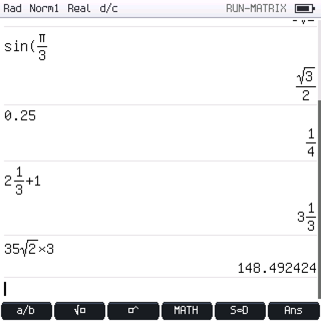
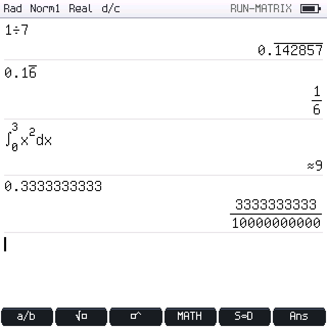

# Run-Matrix — v1.7.0

Run-Matrix mostra **solo calcoli e risultati** (grafici, statistiche, tabelle e
conversioni sono nelle rispettive modalità). Riferimento di comportamento: manuale
fx-CG50, capitoli 1-3…1-31 e 2-1…2-41. Stato per voce:
[FEATURE_MATRIX.md](FEATURE_MATRIX.md).

 

## Tasti

| Tasto | Normale | Dopo SHIFT (F7) |
|---|---|---|
| F1 | frazione `□/□` (prende l'operando a sinistra) | frazione mista `□ □/□` |
| F2 | radice `√□` | quadrato `□²` |
| F3 | potenza `□^□` | π |
| F4 | menu MATH | `→` (memorizza) |
| F5 | **S⇔D** sull'ultimo risultato | **a b/c ⇔ d/c** |
| F6 | `Ans` | θ |
| OPTN (F8) | CALC, PROB, NUMERIC, ANGLE, COMPLEX, HYPERBL, LOG, LOGIC, RELAZIONI, CONST, RISULTATO, BASE-N | |
| VARS (F9) | A~Z (con il valore esatto), Ans/PreAns, V-WIN di Graph, TABLE | |
| ↑ | entra nella cronologia (con il cursore fuori dai modelli) | |
| EXE | calcola; su riga vuota ripete l'ultimo calcolo | |
| EXIT | cancella l'input; su input vuoto torna al menu | |
| AC (Shift+Esc) | cancella l'input; su input vuoto cancella la cronologia | |
| Ctrl+C/V/Z/Y | copia, incolla, annulla, ripeti | |

MATH: frazione mista, `ˣ√□` con indice modificabile, `∛□`, `□²`, `□⁻¹`, `logₐb`,
`eˣ`, `10ˣ`, `|□|`, d/dx, ∫dx, Σ, Π, `( )`, **periodo** (dopo le cifre decimali).

### Cronologia (funzione History della CG50)

Con ↑ si seleziona una riga; i tasti funzione diventano:

| Tasto | Azione |
|---|---|
| EXE / F1 MODIF | modifica la riga **sul posto**; EXE la ricalcola insieme a tutte le righe successive (Ans e memorizzazioni vengono rieseguite); EXIT annulla |
| F2 COPIA (o ←/→) | copia l'espressione nella riga di input |
| F3 RIS | inserisce il risultato nella riga di input (forma esatta se esiste) |
| F4 PERIOD | mostra/nasconde il periodo del risultato |
| F5 S⇔D (SHIFT: ab/c) | cambia la vista della riga selezionata |
| F6 ELIM / DEL | elimina la riga |
| Ctrl+C | copia l'espressione negli appunti |

Se la riga modificata produce un errore, la cronologia e la memoria tornano come
prima e la riga resta in modifica; se falliscono righe successive, conservano il
messaggio d'errore (in rosso). La prima riga vede `Ans = 0`, come sulla CG50.

## Risultati esatti e decimali

Ogni calcolo viene valutato due volte sullo **stesso AST**: in virgola mobile
(sempre) e in forma esatta (quando possibile, `evaluateExact`). La forma esatta,
se esiste, è il valore: il suo valore in virgola mobile sostituisce quello
arrotondato (`1/3×3` è esattamente 1, `10¹⁶+1−10¹⁶` è 1).

Forme esatte (`include/exact.hpp`):
- **razionali** p/q a 64 bit con controllo di overflow;
- **radicali** con al più due termini: `a√b/c ± d√e/f` (√12 = 2√3, √2+√8 = 3√2,
  1/(1+√2) = −1+√2 con il denominatore razionalizzato);
- **multipli razionali di π**: 156π, 2π/3.

Funzioni esatte: + − × ÷, potenze intere e razionali (radici perfette), √, ∛,
ˣ√, sin/cos/tan ai multipli di 30° e 45° (in Deg, Rad con π, Gra), asin/acos/atan
dei valori notevoli, log/log₂/logₐb di potenze esatte, ln 1, exp(0), |x|, Int, Frac,
Intg, arrotondamenti, n!, nCr, nPr, GCD, LCM, MOD, Int÷, Rmdr, relazioni e
operatori logici, Σ e Π con termini esatti. Le funzioni trascendenti, i metodi
numerici (∫, d/dx, d²/dx², SOLVE) e i numeri casuali **non** producono mai una
forma esatta.

### Regole di visualizzazione (come la fx-CG50)

| Caso | Vista automatica | S⇔D |
|---|---|---|
| `1/2`, `3/4`, `1/3` | `1/2`, `3/4`, `1/3` | `0.5`, `0.75`, `0.3333333333` |
| `0.25`, `0.125` (input decimale) | `0.25`, `0.125` | `1/4`, `1/8` |
| frazioni + decimali (`1/2×0.5`) | decimale `0.25` (manuale 2-23 *3) | `1/4` |
| più di 10 caratteri (`1/2578+1/4572`) | decimale `6.066202547E−04` | `3575/5893308` |
| radicali nei limiti (1≤a<100, 1<b<1000, c<100) | `3√2`, `6−4√5`, `√3/2` | decimale |
| radicali fuori limite (`35√2×3`) | decimale `148.492424` | `105√2` |
| π: nπ con \|n\|<10⁶, b/c π con ≤8 cifre e c≤3 cifre | `156π`, `2π/3` | decimale |
| irrazionali/numerici (`sin 1`, `π²`, `∫`) | decimale | nessun cambio (avviso) |

- **Frac Result** (System › "Frac Result" d/c o ab/c, indicata nella barra di
  stato): frazioni improprie o miste (`22/7` ↔ `3 1/7`, `−7/3` ↔ `−2 1/3`);
  SHIFT+F5 cambia il formato del singolo risultato.
- **Forme esatte** (System › "Forme esatte" On/Off): con Off i risultati sono
  decimali, ma S⇔D mostra comunque la forma esatta memorizzata.
- Un decimale digitato è un razionale **esatto** (`0.3333333333` è
  3333333333/10¹⁰, non 1/3): nessuna conversione inventa un valore diverso.
- **Periodo**: OPTN › RISULTATO › ▶Periodo (o F4 nella cronologia) mostra lo
  sviluppo periodico con la linea sopra il periodo: `1/7 = 0.‾142857‾`,
  `1/6 = 0.1‾6‾`; testo lineare `0.1(6)`. Periodi oltre 40 cifre sono troncati con `…`.
- **Input periodico**: MATH › periodo dopo le cifre decimali (`0.1` + `6` = 0.1666… = 1/6).
- **≈** davanti al risultato: valore prodotto da un metodo numerico (∫, d/dx, SOLVE).
- Il cambio di vista **non modifica** né il valore né Ans: cambia solo come il
  risultato è mostrato.
- Arrotondamento di Fix/Sci come la calcolatrice: mantissa decimale a 15 cifre,
  poi arrotondamento per eccesso a metà (`0.125` in Fix2 → `0.13`, `2.675` → `2.68`).

## Variabili e memoria condivisa

- `→` memorizza in A–Z; `→A~F` in un intervallo di variabili.
- Ans, PreAns e A–Z conservano la forma esatta (`1/7→A`, poi `7A` = 1) e
  l'indicazione "input decimale" (`0.5` poi `Ans+1/3` è decimale, S⇔D → 5/6).
- VARS › V-WIN e TABLE inseriscono `Xmin…Tptch`, `TblStart/TblEnd/TblPitch`: sono
  letti dal workspace al momento del calcolo (non copie) tramite `NameResolver`.
- Le variabili sono le stesse usate da Graph, Table, Equation e Conversion.

## Operatori aggiunti nella v1.7.0

| Gruppo | Sintassi | Esempio |
|---|---|---|
| Relazioni | `=`, `≠`, `<`, `>`, `≤`/`<=`, `≥`/`>=` | `3>2` → 1 |
| Logica | `And`, `Or`, `Xor`, `Not` | `3 And 2` → 1 (manuale 2-24) |
| Interi | `Int÷`, `Rmdr` | `107 Int÷ 7` → 15, `107 Rmdr 7` → 2 (manuale 2-25) |
| Numerici | `MOD_Exp(n,p,m)`, `RndFix(x,n)` | `MOD_Exp(5,3,3)` → 2; `RndFix(200/7,3)×14` → 399.994 |
| Casuali | `RanNorm#(σ,μ)`, `RanBin#(n,p)` | |
| Frazioni | `mixed(w,n,d)` (modello a b/c), periodo `0.1_6` | |

Priorità (dalla più bassa): Or/Xor < And < relazioni < + − < × ÷ Int÷ Rmdr <
moltiplicazione implicita < segno < potenza < postfissi < parentesi/funzioni.

## Implementazione

| File | Contenuto |
|---|---|
| `include/run_matrix.hpp`, `src/run_matrix.cpp` | `evaluateEntry`, `runCalculation`, `editHistoryEntry`, `recalculateHistory`, viste (`toggleExactDecimal`, `toggleMixedFraction`, `togglePeriodic`), `resultText`, `resultTree`, `resultExpression` |
| `src/apps/run_matrix_app.cpp` | interfaccia: tasti, menu, cronologia, modifica sul posto, disegno |
| `include/exact.hpp`, `src/exact.cpp` | aritmetica esatta |
| `src/expression.cpp` | parser e valutatori (virgola mobile ed esatto) |

## Limiti noti

- Matrici, vettori e liste come valori del parser (MAT/VCT, List) non ancora
  disponibili in Run-Matrix (le API C++ esistono).
- Il cursore non si posiziona sul punto dell'errore dopo EXIT (resta l'input
  intero da correggere).
- Selezione parziale per copia/taglia (CLIP) non disponibile: si copia l'intera espressione.
- Simboli ingegneristici (k, M, m, µ…), `Simp` manuale e modalità Base-N come
  modalità di calcolo intera (Mode Hex/Bin/Oct) non realizzati.
- Nessuna prova su hardware PicoCalc.
