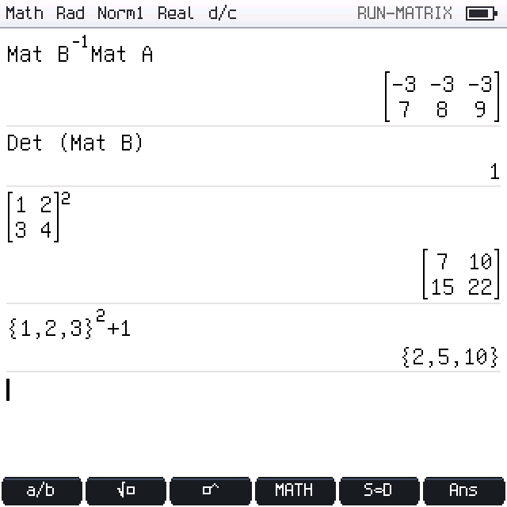
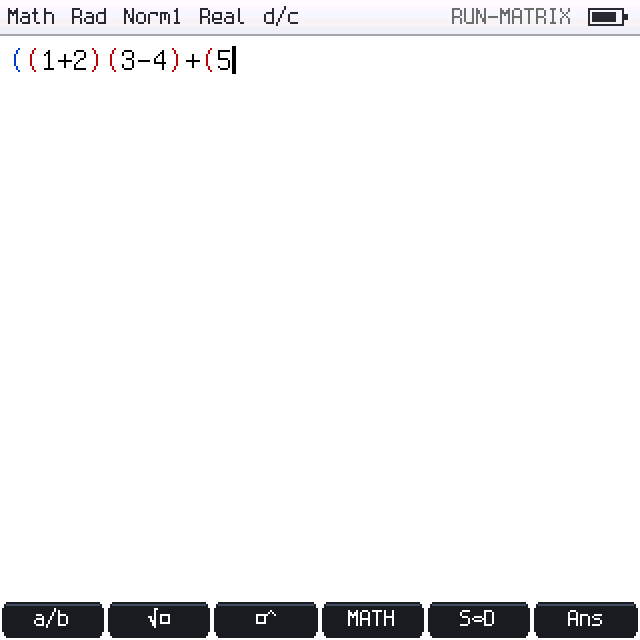
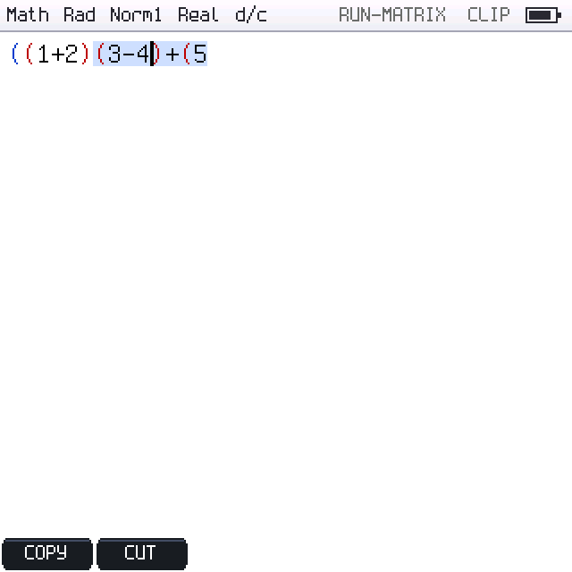
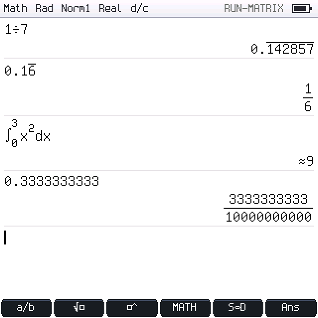
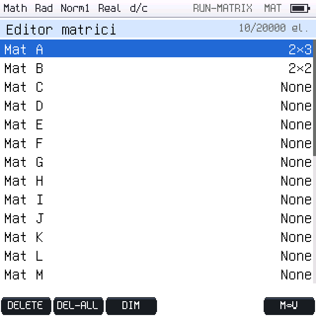

# Run-Matrix — v1.10.0

Run-Matrix mostra **solo calcoli e risultati** (grafici, statistiche, tabelle e
conversioni sono nelle rispettive modalità). Riferimento di comportamento: manuale
fx-CG50, capitoli 1-3…1-31, 2-1…2-63 (matrici e vettori 2-42…2-63) e 3-7…3-16
(liste). Stato per voce: [FEATURE_MATRIX.md](FEATURE_MATRIX.md).

Novità della v1.10.0 (dettagli nelle sezioni sotto): **matrici, vettori e
liste** come valori del parser, **editor MAT/VCT**, modalità **Math/Line**,
**selezione parziale CLIP**, **parentesi colorate** per livello e **cursore
sulla causa di un errore**.

     

 

## Tasti

| Tasto | Normale | Dopo SHIFT (F7) |
|---|---|---|
| F1 | frazione `□/□` (prende l'operando a sinistra) | frazione mista `□ □/□` |
| F2 | radice `√□` | quadrato `□²` |
| F3 | potenza `□^□` | π |
| F4 | menu MATH | `→` (memorizza) |
| F5 | **S⇔D** sull'ultimo risultato | **a b/c ⇔ d/c** |
| F6 | `Ans` | θ |
| OPTN (F8) | CALC, PROB, NUMERIC, ANGLE, COMPLEX, HYPERBL, LOG, LOGIC, RELAZIONI, CONST, **MAT/VCT**, **LIST**, RISULTATO, BASE-N | |
| VARS (F9) | A~Z (con il valore esatto), Ans/PreAns, V-WIN di Graph, TABLE | |
| ↑ | entra nella cronologia (con il cursore fuori dai modelli) | |
| EXE | calcola; su riga vuota ripete l'ultimo calcolo | |
| EXIT | cancella l'input; su input vuoto torna al menu | |
| AC (Shift+Esc) | cancella l'input; su input vuoto cancella la cronologia | |
| SHIFT `3` | | **editor MAT/VCT** (fx-CG50 SHIFT 3 'MAT/VCT') |
| SHIFT `8` | | **CLIP**: inizia la selezione |
| SHIFT `9` | | **PASTE**: incolla gli appunti |
| Ctrl+C/X/V/Z/Y | copia, taglia, incolla, annulla, ripeti (con una selezione CLIP attiva: copia/taglia la selezione) | |

MATH: **MAT/VCT** (2×2, 3×3, m×n fino a 6×6, 2×1, 3×1, 1×2, 1×3), frazione
mista, `ˣ√□` con indice modificabile, `∛□`, `□²`, `□⁻¹`, `logₐb`, `eˣ`, `10ˣ`,
`|□|`, d/dx, ∫dx, Σ, Π, `( )`, **periodo** (dopo le cifre decimali).

### Cronologia (funzione History della CG50)

Con ↑ si seleziona una riga; i tasti funzione diventano:

| Tasto | Azione |
|---|---|
| EXE / F1 MODIF | modifica la riga **sul posto**; EXE la ricalcola insieme a tutte le righe successive (Ans e memorizzazioni vengono rieseguite); EXIT annulla |
| F2 COPIA (o ←/→) | copia l'espressione nella riga di input |
| F3 RIS | inserisce il risultato nella riga di input (forma esatta se esiste) |
| F4 PERIOD | mostra/nasconde il periodo del risultato |
| F5 S⇔D (SHIFT: ab/c) | cambia la vista della riga selezionata |
| F6 ELIM / DEL | elimina la riga |
| Ctrl+C | copia l'espressione negli appunti |

Se la riga modificata produce un errore, la cronologia e la memoria tornano come
prima e la riga resta in modifica; se falliscono righe successive, conservano il
messaggio d'errore (in rosso). La prima riga vede `Ans = 0`, come sulla CG50.

## Risultati esatti e decimali

Ogni calcolo viene valutato due volte sullo **stesso AST**: in virgola mobile
(sempre) e in forma esatta (quando possibile, `evaluateExact`). La forma esatta,
se esiste, è il valore: il suo valore in virgola mobile sostituisce quello
arrotondato (`1/3×3` è esattamente 1, `10¹⁶+1−10¹⁶` è 1).

Forme esatte (`include/exact.hpp`):
- **razionali** p/q a 64 bit con controllo di overflow;
- **radicali** con al più due termini: `a√b/c ± d√e/f` (√12 = 2√3, √2+√8 = 3√2,
  1/(1+√2) = −1+√2 con il denominatore razionalizzato);
- **multipli razionali di π**: 156π, 2π/3.

Funzioni esatte: + − × ÷, potenze intere e razionali (radici perfette), √, ∛,
ˣ√, sin/cos/tan ai multipli di 30° e 45° (in Deg, Rad con π, Gra), asin/acos/atan
dei valori notevoli, log/log₂/logₐb di potenze esatte, ln 1, exp(0), |x|, Int, Frac,
Intg, arrotondamenti, n!, nCr, nPr, GCD, LCM, MOD, Int÷, Rmdr, relazioni e
operatori logici, Σ e Π con termini esatti. Le funzioni trascendenti, i metodi
numerici (∫, d/dx, d²/dx², SOLVE) e i numeri casuali **non** producono mai una
forma esatta.

### Regole di visualizzazione (come la fx-CG50)

| Caso | Vista automatica | S⇔D |
|---|---|---|
| `1/2`, `3/4`, `1/3` | `1/2`, `3/4`, `1/3` | `0.5`, `0.75`, `0.3333333333` |
| `0.25`, `0.125` (input decimale) | `0.25`, `0.125` | `1/4`, `1/8` |
| frazioni + decimali (`1/2×0.5`) | decimale `0.25` (manuale 2-23 *3) | `1/4` |
| più di 10 caratteri (`1/2578+1/4572`) | decimale `6.066202547E−04` | `3575/5893308` |
| radicali nei limiti (1≤a<100, 1<b<1000, c<100) | `3√2`, `6−4√5`, `√3/2` | decimale |
| radicali fuori limite (`35√2×3`) | decimale `148.492424` | `105√2` |
| π: nπ con \|n\|<10⁶, b/c π con ≤8 cifre e c≤3 cifre | `156π`, `2π/3` | decimale |
| irrazionali/numerici (`sin 1`, `π²`, `∫`) | decimale | nessun cambio (avviso) |

- **Frac Result** (System › "Frac Result" d/c o ab/c, indicata nella barra di
  stato): frazioni improprie o miste (`22/7` ↔ `3 1/7`, `−7/3` ↔ `−2 1/3`);
  SHIFT+F5 cambia il formato del singolo risultato.
- **Forme esatte** (System › "Forme esatte" On/Off): con Off i risultati sono
  decimali, ma S⇔D mostra comunque la forma esatta memorizzata.
- Un decimale digitato è un razionale **esatto** (`0.3333333333` è
  3333333333/10¹⁰, non 1/3): nessuna conversione inventa un valore diverso.
- **Periodo**: OPTN › RISULTATO › ▶Periodo (o F4 nella cronologia) mostra lo
  sviluppo periodico con la linea sopra il periodo: `1/7 = 0.‾142857‾`,
  `1/6 = 0.1‾6‾`; testo lineare `0.1(6)`. Periodi oltre 40 cifre sono troncati con `…`.
- **Input periodico**: MATH › periodo dopo le cifre decimali (`0.1` + `6` = 0.1666… = 1/6).
- **≈** davanti al risultato: valore prodotto da un metodo numerico (∫, d/dx, SOLVE).
- Il cambio di vista **non modifica** né il valore né Ans: cambia solo come il
  risultato è mostrato.
- Arrotondamento di Fix/Sci come la calcolatrice: mantissa decimale a 15 cifre,
  poi arrotondamento per eccesso a metà (`0.125` in Fix2 → `0.13`, `2.675` → `2.68`).

## Variabili e memoria condivisa

- `→` memorizza in A–Z; `→A~F` in un intervallo di variabili.
- Ans, PreAns e A–Z conservano la forma esatta (`1/7→A`, poi `7A` = 1) e
  l'indicazione "input decimale" (`0.5` poi `Ans+1/3` è decimale, S⇔D → 5/6).
- VARS › V-WIN e TABLE inseriscono `Xmin…Tptch`, `TblStart/TblEnd/TblPitch`: sono
  letti dal workspace al momento del calcolo (non copie) tramite `NameResolver`.
- Le variabili sono le stesse usate da Graph, Table, Equation e Conversion.

## Operatori aggiunti nella v1.7.0

| Gruppo | Sintassi | Esempio |
|---|---|---|
| Relazioni | `=`, `≠`, `<`, `>`, `≤`/`<=`, `≥`/`>=` | `3>2` → 1 |
| Logica | `And`, `Or`, `Xor`, `Not` | `3 And 2` → 1 (manuale 2-24) |
| Interi | `Int÷`, `Rmdr` | `107 Int÷ 7` → 15, `107 Rmdr 7` → 2 (manuale 2-25) |
| Numerici | `MOD_Exp(n,p,m)`, `RndFix(x,n)` | `MOD_Exp(5,3,3)` → 2; `RndFix(200/7,3)×14` → 399.994 |
| Casuali | `RanNorm#(σ,μ)`, `RanBin#(n,p)` | |
| Frazioni | `mixed(w,n,d)` (modello a b/c), periodo `0.1_6` | |

Priorità (dalla più bassa): Or/Xor < And < relazioni < + − < × ÷ Int÷ Rmdr <
moltiplicazione implicita < segno < potenza < postfissi < parentesi/funzioni.

## Matrici, vettori e liste (v1.10.0)

Sono **valori di prima classe dello stesso parser** delle espressioni (nessun
parser separato): un'espressione può dare un numero, una lista, una matrice o
un vettore, e gli stessi nodi dell'AST sono usati dal valutatore numerico, da
quello esatto, dall'editor e dal renderer.

| Scrittura | Significato |
|---|---|
| `[[1,2][3,4]]` | matrice 2×2 (formato della fx-CG50: un gruppo `[ ]` per riga); in modalità Math anche come modello MATH › MAT/VCT |
| `{1,2,3}` | lista |
| `Mat A`…`Mat Z`, `Mat Ans` | memorie delle matrici (OPTN › MAT/VCT › Mat; `Mat x` = `Mat X`) |
| `Vct A`…`Vct Z`, `Vct Ans` | memorie dei vettori (matrici con una riga o una colonna) |
| `List 1`…`List 6`, `List Ans` | le liste di Statistics e la lista risposta |
| `Mat A[2,1]`, `Vct B[3]`, `List 1[4]` | un elemento (in lettura e, dopo `→`, in scrittura) |
| `→Mat A`, `→Vct A`, `→List 1`, `→Mat A[1,2]`, `{2,3}→Dim Mat A` | memorizzazione (Dim crea una matrice di zeri) |

Operazioni (manuale 2-49…2-63, 3-7…3-16):

| Gruppo | Funzioni |
|---|---|
| Aritmetica | `+ −` tra matrici della stessa dimensione, `×` (anche implicito) riga per colonna, numero × matrice, matrice ÷ numero, `^n` intero tra −32766 e 32766 (`^−1` = inversa, `^0` = identità), `□²`; tra liste e numeri elemento per elemento (anche relazioni e funzioni scientifiche: `sin({0,30})`) |
| Matrici | `Det`, `Trn`, `Identity`, `Dim`, `Augment(`, `Fill(`, `Ref`, `Rref`, `Mat→List(`, `List→Mat(`, `Abs`/`Int`/`Frac`/`Intg` e parti complesse elemento per elemento, `Norm(` |
| Vettori | `DotP(`, `CrossP(` (dimensioni 2 e 3), `Angle(` (nell'unità angolare corrente), `UnitV(`, `Norm(` |
| Liste | `Sum`, `Prod`, `Min(`, `Max(`, `Mean(`, `Median(`, `Cuml`, `Percent`, `ΔList`, `SortA(`, `SortD(`, `Seq(espr,var,inizio,fine,passo)`, `Augment(`, `Dim` |

- **Risultati**: una lista va in `List Ans`, una matrice in `Mat Ans` (e anche
  in `Vct Ans` se ha una riga o una colonna, come sulla fx-CG50), un vettore in
  `Vct Ans` e `Mat Ans`; `Ans` resta l'ultimo **numero**.
- **Forme esatte negli elementi**: `[[1,2][3,4]]^−1` = `[[−2,1][3/2,−1/2]]`;
  S⇔D passa insieme tutti gli elementi tra forme esatte e decimali. Le matrici
  memorizzate partecipano alla valutazione esatta con i loro elementi interi.
- **Vista naturale** (modalità Math): matrici e vettori fino a 6×6 disegnati a
  griglia tra parentesi quadre, liste fino a 20 elementi tra graffe; oltre,
  la riga mostra `Mat 7×7 → Mat Ans` e il risultato si legge nell'editor
  MAT/VCT (riga *Mat Ans*) o si riusa con `Mat Ans`.
- **Errori** (tabella α-1 del manuale): `Dimension ERROR` (dimensioni
  incompatibili, memoria non definita, indice fuori intervallo, oltre i limiti
  della scheda), `Type ERROR` (tipo sbagliato: lista con matrice, `sin` di una
  matrice, numero al posto di una matrice…), `Math ERROR` (matrice singolare),
  `Non-Real ERROR` (elementi complessi nel modo Real), `Memory ERROR`
  (memoria di matrici e vettori piena).
- **Limiti per scheda** (`limits.hpp`): lato massimo 40 (Pico 2 W) / 999
  (Pico Plus 2 W); elementi per matrice 400 / 10 000; elementi di tutte le
  memorie insieme 1 200 / 20 000. Liste: 255 / 999 elementi (come prima).

### Editor MAT/VCT (SHIFT 3)

| Schermata | Tasti |
|---|---|
| Elenco `Mat A`…`Mat Z`, `Mat Ans` con le dimensioni (`2×3`, `None`) | ↑↓ seleziona, una **lettera** salta alla memoria, EXE/→ apre le celle (DIM se non definita), F1 **DELETE**, F2 **DEL-ALL** (con conferma), F3 **DIM**, F6 **M⇔V** (elenco dei vettori), EXIT torna ai calcoli |
| DIM | righe `m`, colonne `n` (↑↓ cambia campo, EXE passa al successivo e conferma); vettori solo `m×1` o `1×n`; le nuove dimensioni azzerano il contenuto, come sulla fx-CG50 |
| Celle | il numero digitato va nella cella evidenziata, **EXE passa alla cella a destra** (poi alla riga successiva); F1 **ROW-OP** (SWAP, ×Rw, ×Rw+, Rw+; solo matrici), F2 **ROW** e F3 **COLUMN** (DELETE, INSERT, ADD), F4 EDIT; DEL azzera la cella; EXIT torna all'elenco |

`Mat Ans` e `Vct Ans` sono in sola lettura. I valori sono quelli del
workspace (`ws.matrices`): li usano i calcoli, restano cambiando applicazione e
vengono salvati in flash con il resto dei dati (record v6).

## Modalità Math / Line (v1.10.0)

SYSTEM › **Input/Output** (primo campo del SET UP, come sulla fx-CG50),
salvato nel workspace e indicato nella barra di stato (`Math`/`Line`).

| | Math (predefinita) | Line |
|---|---|---|
| Input | modelli 2D: frazioni, radici, potenze, Σ/∫, matrici | una riga di testo: F1 inserisce `/`, F2 `√(`, F3 `^`, i modelli MATH il loro testo (`log(`, `abs(`, `[[,][,]]`…); frazione mista non disponibile (come sulla calcolatrice) |
| Cronologia | espressioni in 2D | espressioni come digitate |
| Risultati | frazioni impilate, radicali, ×10ⁿ, matrici a griglia | su una riga: `1/2`, `2√3/3`, `[[1,2][3,4]]`, `{1,2,3}` |

Cambiando modalità la riga di input in corso viene convertita (testo lineare ⇄
modelli) senza perdere nulla.

## Selezione parziale CLIP (v1.10.0)

Come sulla fx-CG50 (manuale 1-11): **SHIFT 8** inizia la selezione nel punto
del cursore, **←/→** la estendono (evidenziata), **F1 COPY** copia, **F2 CUT**
taglia, **DEL** elimina, **EXIT** annulla; **SHIFT 9** (o Ctrl+V) incolla.

- In modalità Math la selezione resta nel campo in cui si trova il cursore
  (numeratore, cella, esponente…); spostandosi oltre il bordo del campo
  seleziona l'**intero modello**.
- Copia e taglia **non spezzano mai la struttura**: una selezione con una
  parentesi (tonda, quadra o graffa) senza la sua corrispondente si estende
  fino a includerla, e una parentesi di funzione porta con sé il nome
  (`(30)` dentro `sin(30)` copia `sin(30)`).
- Gli appunti sono condivisi da tutte le modalità; incollando in modalità Line
  i modelli diventano testo lineare.

## Parentesi colorate (v1.10.0)

Durante l'input le parentesi sono colorate per livello, dall'esterno verso
l'interno: **blu, rosso, verde, magenta, nero**, poi di nuovo dal blu
(manuale 1-8). La parentesi di chiusura ha il colore di quella di apertura,
parentesi dello stesso livello hanno lo stesso colore, il gruppo `( )` del
menu MATH segue le stesse regole; dopo l'esecuzione (cronologia) tornano nere.
I colori sono più scuri di quelli puri per restare leggibili su ogni sfondo
dell'input (bianco, azzurro della riga in modifica, evidenziazioni): il test
`editor_v110_test` verifica un contrasto di almeno 4,5:1 (WCAG AA).

## Cursore sulla causa di un errore (v1.10.0)

Il parser registra la posizione di ogni token e di ogni sotto-espressione;
per un errore di sintassi indica il token che non ha potuto usare, per un
errore di calcolo la sotto-espressione che non è riuscita (`14÷0` in
`14÷0×2.3`, `Det([[1,2]])` in `1+Det([[1,2]])`). Chiusa la finestra
d'errore, **il cursore è alla fine della causa** (come nell'esempio 1-10 del
manuale: ← e `1` correggono `14÷0` in `14÷10`) e la causa è **evidenziata**
fino al tasto successivo; dentro i modelli il cursore va nel campo giusto
(numeratore, cella, esponente). Vale anche per la modifica di una riga della
cronologia e per gli errori dopo la freccia (segnalati sulla freccia).

## Implementazione

| File | Contenuto |
|---|---|
| `include/run_matrix.hpp`, `src/run_matrix.cpp` | `evaluateEntry` (anche destinazioni Mat/Vct/List ed elementi), `runCalculation`, `editHistoryEntry`, `recalculateHistory`, viste (`toggleExactDecimal`, `toggleMixedFraction`, `togglePeriodic`), `resultText`, `resultTree`, `resultExpression`, `elementText` |
| `src/apps/run_matrix_app.cpp` | interfaccia: tasti, menu, cronologia, modifica sul posto, CLIP, Math/Line, disegno |
| `src/apps/matrix_editor.cpp` | editor MAT/VCT (`MatrixEditorView`) |
| `include/value.hpp`, `src/value.cpp` | `CalcValue`: numero, lista, matrice o vettore |
| `include/exact.hpp`, `src/exact.cpp` | aritmetica esatta |
| `src/expression.cpp` | lexer, parser e valutatori (virgola mobile ed esatto; `CollEval` per liste, matrici e vettori) |
| `src/natural_editor.cpp`, `src/math_renderer.cpp` | modelli MAT/VCT, Math/Line, CLIP, posizione degli errori; griglia delle matrici, parentesi colorate, evidenziazioni |

## Limiti noti

- Liste: nei calcoli sono disponibili `List 1`–`List 6` (quelle di Statistics);
  `List 7`–`List 26`, i nomi delle liste (`"QTY"`) e i file CSV (CSV LOAD/SAVE
  dell'editor) non sono realizzati.
- Editor MAT/VCT: le celle si inseriscono come numeri reali (un elemento
  complesso si assegna con un'espressione, es. `1+2i→Mat A[1,1]` nel modo
  a+bi); la griglia mostra 4 colonne alla volta.
- Modalità Line: niente sovrascrittura (INS) e niente simbolo `⌟` per le
  frazioni (si usa `/`); i risultati più lunghi della riga vengono tagliati.
- Risultati oltre 6×6 (o 20 elementi per una lista): visibili nell'editor
  MAT/VCT (`Mat Ans`), non in una schermata MatAns/ListAns dedicata.
- Simboli ingegneristici (k, M, m, µ…), `Simp` manuale e modalità Base-N come
  modalità di calcolo intera (Mode Hex/Bin/Oct) non realizzati.
- Nessuna prova su hardware PicoCalc (tasti SHIFT 3/8/9, colori sul pannello,
  tempi di Det/inversa con matrici grandi: [HARDWARE_TEST_v1.10.0.md](HARDWARE_TEST_v1.10.0.md)).
