# Run-Matrix — v1.13.0

Run-Matrix mostra **calcoli e risultati**; grafici, statistiche, tabelle e
conversioni sono nelle rispettive modalità (i comandi grafici eseguiti qui li
disegna GRAPH). Riferimento di comportamento: manuale fx-CG50, capitoli 1-3…1-31,
2-1…2-63 (matrici e vettori 2-42…2-63), 3-7…3-20 (liste e CSV), 5 (SKETCH) e 8
(comandi). Stato per voce: [FEATURE_MATRIX.md](FEATURE_MATRIX.md).

Novità della v1.13.0 (completamento di Run-Matrix, sezione
[v1.13.0](#completamento-della-v1120) sotto): **CALC** completo (Solve con
limiti, SolveN, FMin, FMax, Σ con variabile e passo, d²/dx² anche come
modello), **PROB** (Ran# n, RanList#, RanSamp#, P( Q( R( t( ), **STAT** (x̂ ŷ,
24 distribuzioni, S-Dev, Var), **TVM**, **CONVERT**, **ʳ ᵍ ° ′ ″**, **∠** e
►r∠θ/►a+bi, Pol/Rec in List Ans, **Rnd**, simboli **P E** ed **ENG/ENG←**,
**Simplify Manual** con la regola del m.c.m., **Bin a 16 bit** e variabili A–F
in Hex, istruzioni multiple **`:`** e **`◢`**, **Str 1–20**, **function
memory**, variabili **r θ** e di sistema assegnabili, **List "nome"**, **List
File 1–6**, matrici esatte senza limite di 64 elementi, **tutti i comandi
grafici** (PxlTest(, disequazioni, G∫dx, stili, Pict, Draw…), **CATALOG**,
**CAPTURE**, OPTN nell'ordine della fx-CG50 e VARS completo.

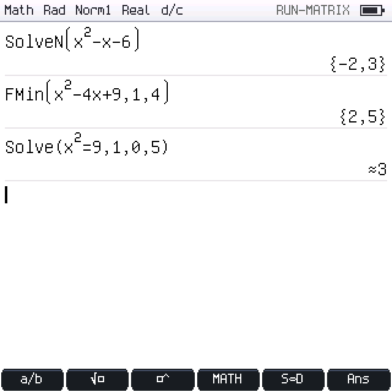 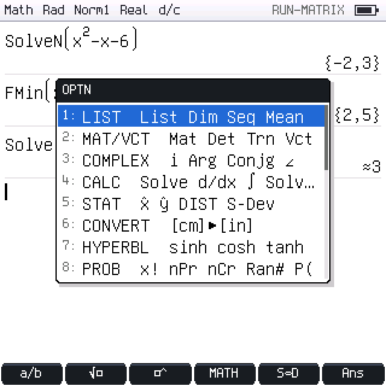  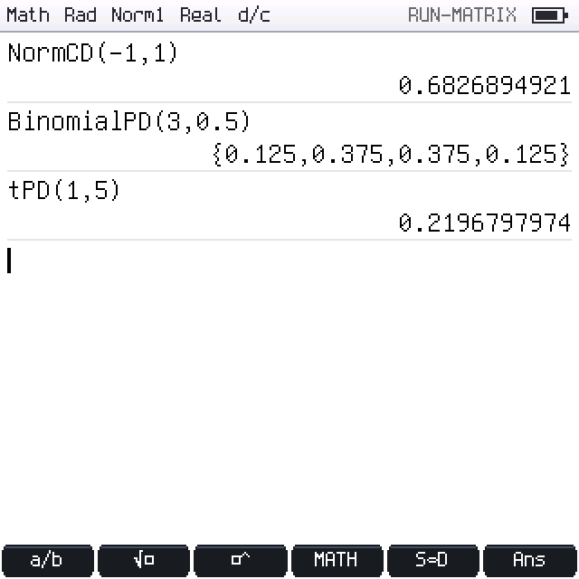 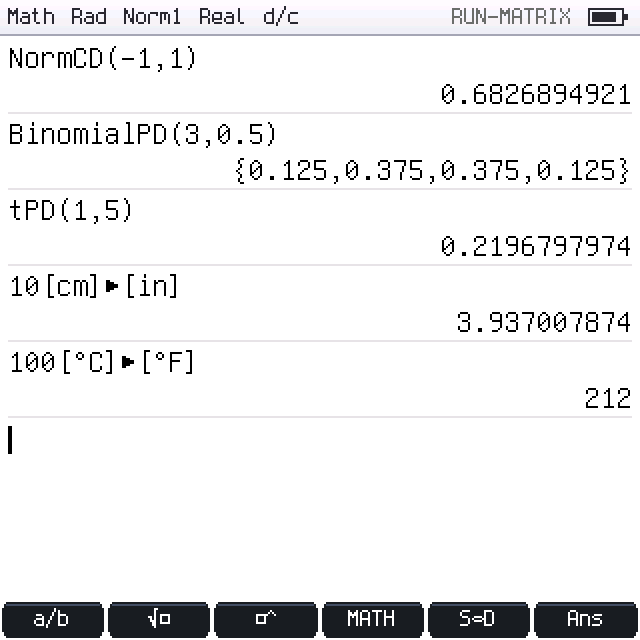

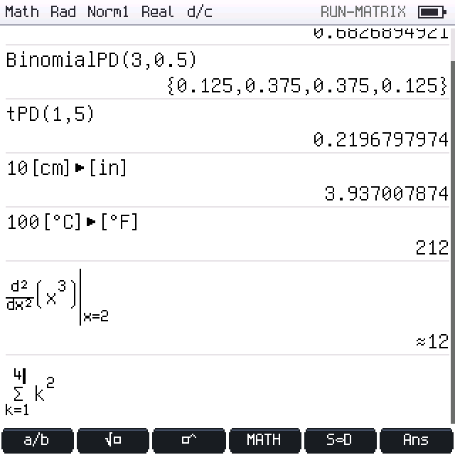 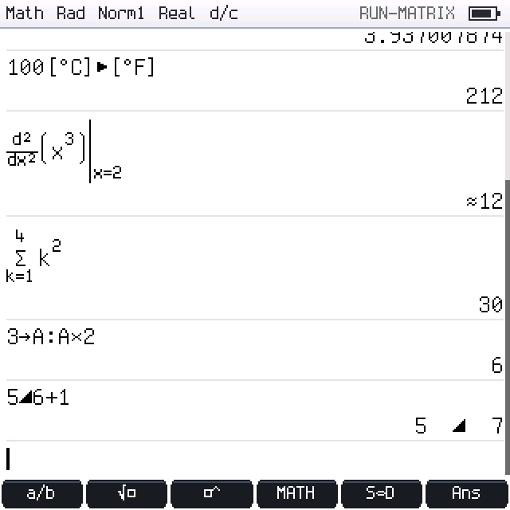 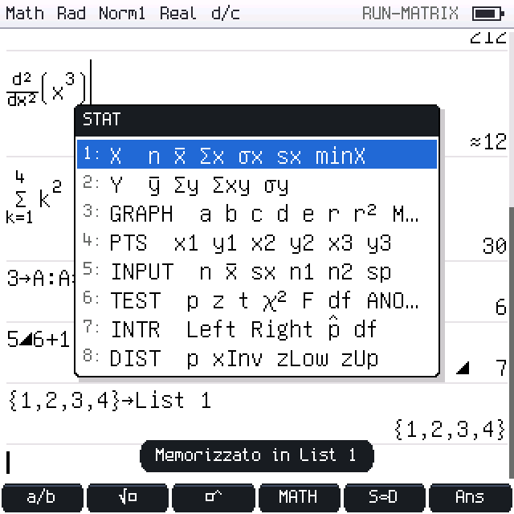 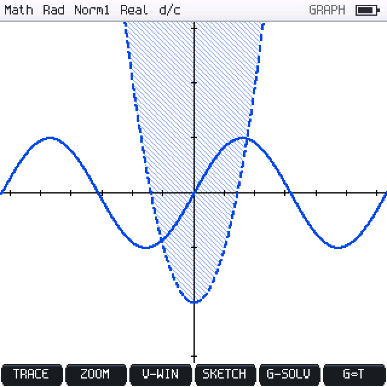 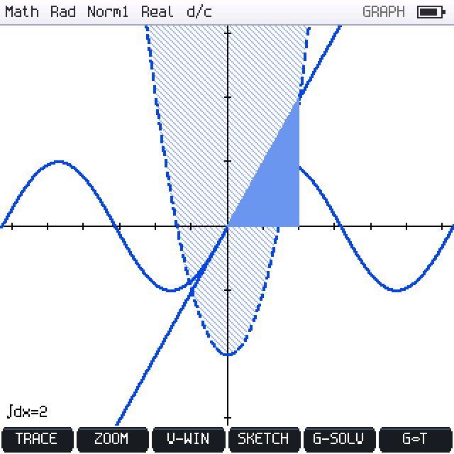 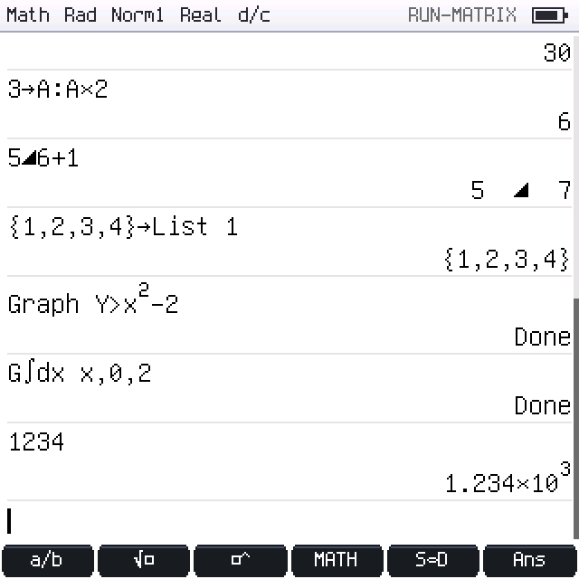

Novità della v1.11.0 (dettagli nelle sezioni sotto): **List 1–26** con i
sottonomi, **file CSV** di liste e matrici, schermate **MatAns/ListAns**,
celle dell'editor MAT/VCT con **espressioni esatte e complesse** e
scorrimento delle colonne, modalità Line con **INS** (sovrascrittura),
**SHIFT+INS**, frazioni **⌟** e **risultati scorrevoli**, **simboli
ingegneristici** e display **Eng** con i simboli, **Simp** delle frazioni,
modalità **Base-N intera** (Dec/Hex/Bin/Oct, operatori bit a bit), **comandi
grafici** (Plot, F-Line, Graph Y=…) disegnati da GRAPH.

Novità della v1.10.0: **matrici, vettori e
liste** come valori del parser, **editor MAT/VCT**, modalità **Math/Line**,
**selezione parziale CLIP**, **parentesi colorate** per livello e **cursore
sulla causa di un errore**.

  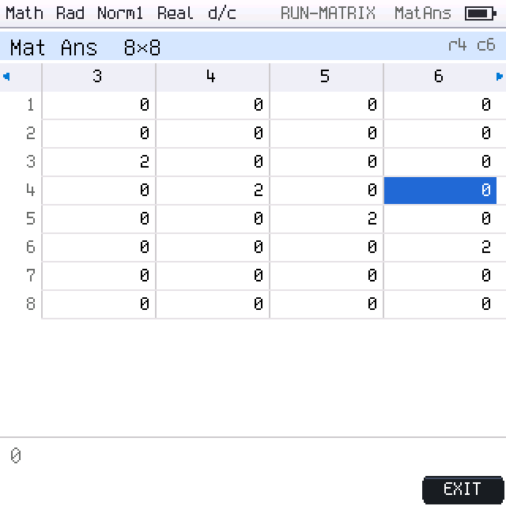 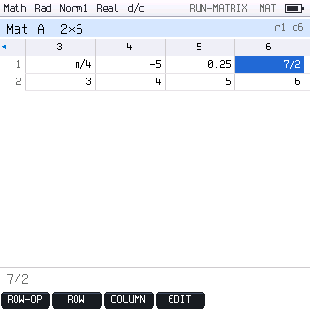 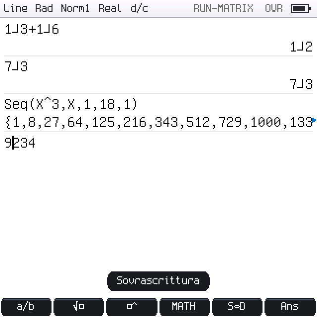

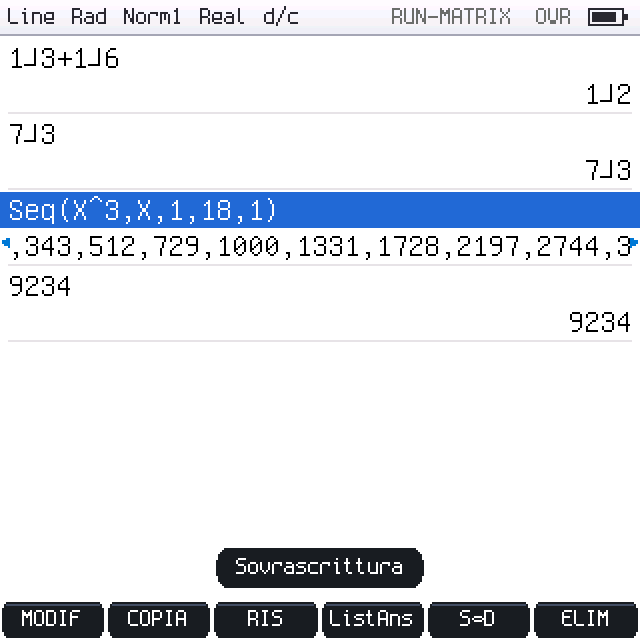  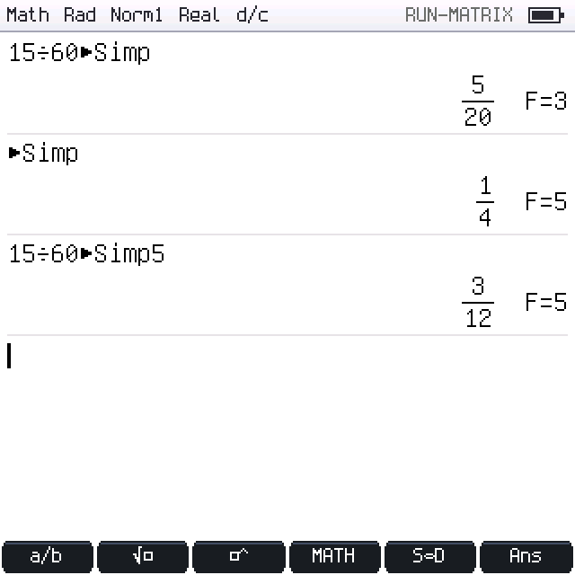  

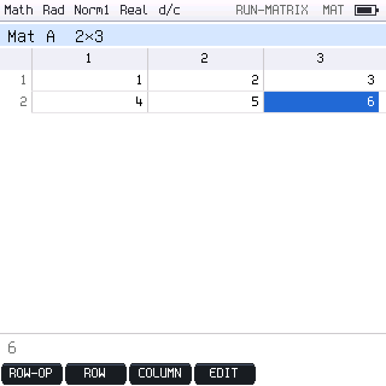    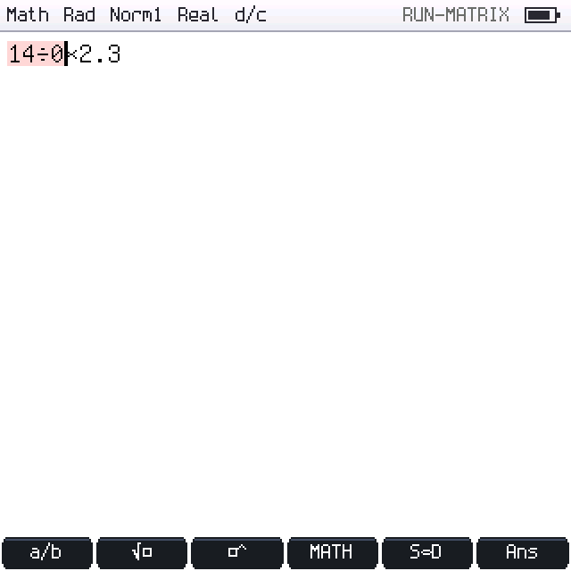 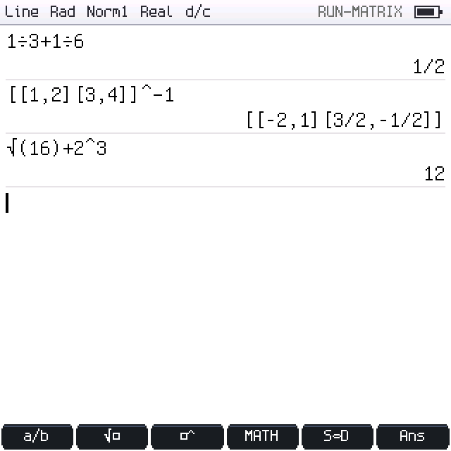

 

## Tasti

| Tasto | Normale | Dopo SHIFT (F7) |
|---|---|---|
| F1 | frazione `□/□` (prende l'operando a sinistra); in Line `⌟` | frazione mista `□ □/□`; in Line `⌟` |
| F2 | radice `√□` | quadrato `□²` |
| F3 | potenza `□^□` | π |
| F4 | menu MATH | `→` (memorizza) |
| F5 | **S⇔D** sull'ultimo risultato | **a b/c ⇔ d/c** |
| F6 | `Ans` | θ |
| OPTN (F8) | v1.13.0, ordine della fx-CG50: **LIST, MAT/VCT, COMPLEX, CALC, STAT, CONVERT, HYPERBL, PROB, NUMERIC, ANGLE, ESYM, PICTURE, FUNCMEM, LOGIC, CAPTURE, TVM**, poi SKETCH (comandi grafici, SHIFT F4 sulla calcolatrice), RELAZIONI (anche `:` e `◢`), RISULTATO (S⇔D, ab/c, periodo, basi, DMS, ENG, ►r∠θ), BASE-N, CONST (v1.14.0: gruppo → costante, 73 costanti, [PHYSICAL_CONSTANTS.md](PHYSICAL_CONSTANTS.md)) | |
| DEL | cancella a sinistra | **INS**: in Line alterna sovrascrittura/inserimento (barra di stato `OVR`), in Math il prossimo modello prende come argomento il valore a destra del cursore |
| VARS (F9) | A~Z, r, θ (con il valore esatto), Ans/PreAns, **V-WIN, FACTOR, STAT, GRAPH, DYNA, TABLE (anche Result), RECURSION, TVM, Str** (v1.13.0), EQUATION (SimRes, SimCoef, PlyRes, PlyCoef: matrici di EQUATION, v1.12.0, [EQUATION.md](EQUATION.md#5-uso-dei-risultati)) | |
| ↑ | entra nella cronologia (con il cursore fuori dai modelli) | |
| EXE | calcola; su riga vuota ripete l'ultimo calcolo | |
| EXIT | cancella l'input; su input vuoto torna al menu | |
| AC (Shift+Esc) | cancella l'input; su input vuoto cancella la cronologia | |
| SHIFT `3` | | **editor MAT/VCT** (fx-CG50 SHIFT 3 'MAT/VCT') |
| SHIFT `4` | | **CATALOG**: tutti i comandi in ordine alfabetico (v1.13.0) |
| SHIFT `7` | | **CAPTURE**: la schermata in Capture 1–20 (v1.13.0) |
| SHIFT `8` | | **CLIP**: inizia la selezione |
| SHIFT `9` | | **PASTE**: incolla gli appunti |
| Ctrl+C/X/V/Z/Y | copia, taglia, incolla, annulla, ripeti (con una selezione CLIP attiva: copia/taglia la selezione) | |

MATH: **MAT/VCT** (2×2, 3×3, m×n fino a 6×6, 2×1, 3×1, 1×2, 1×3), frazione
mista, `ˣ√□` con indice modificabile, `∛□`, `□²`, `□⁻¹`, `logₐb`, `eˣ`, `10ˣ`,
`|□|`, d/dx, ∫dx, Σ, Π, `( )`, **periodo** (dopo le cifre decimali).

### Cronologia (funzione History della CG50)

Con ↑ si seleziona una riga; i tasti funzione diventano:

| Tasto | Azione |
|---|---|
| EXE / F1 MODIF | modifica la riga **sul posto**; EXE la ricalcola insieme a tutte le righe successive (Ans e memorizzazioni vengono rieseguite); EXIT annulla |
| F2 COPIA | copia l'espressione nella riga di input |
| F3 RIS | inserisce il risultato nella riga di input (forma esatta se esiste) |
| F4 PERIOD | mostra/nasconde il periodo del risultato; per un risultato lista/matrice/vettore **MatAns**/**VctAns**/**ListAns** apre la schermata della risposta |
| ←/→ | su un risultato più largo della riga lo **scorrono** (◀ ▶ indicano le parti nascoste); altrimenti copiano l'espressione nella riga di input |
| F5 S⇔D (SHIFT: ab/c) | cambia la vista della riga selezionata |
| F6 ELIM / DEL | elimina la riga |
| Ctrl+C | copia l'espressione negli appunti |

Se la riga modificata produce un errore, la cronologia e la memoria tornano come
prima e la riga resta in modifica; se falliscono righe successive, conservano il
messaggio d'errore (in rosso). La prima riga vede `Ans = 0`, come sulla CG50.

## Risultati esatti e decimali

Ogni calcolo viene valutato due volte sullo **stesso AST**: in virgola mobile
(sempre) e in forma esatta (quando possibile, `evaluateExact`). La forma esatta,
se esiste, è il valore: il suo valore in virgola mobile sostituisce quello
arrotondato (`1/3×3` è esattamente 1, `10¹⁶+1−10¹⁶` è 1).

Forme esatte (`include/exact.hpp`):
- **razionali** p/q a 64 bit con controllo di overflow;
- **radicali** con al più due termini: `a√b/c ± d√e/f` (√12 = 2√3, √2+√8 = 3√2,
  1/(1+√2) = −1+√2 con il denominatore razionalizzato);
- **multipli razionali di π**: 156π, 2π/3.

Funzioni esatte: + − × ÷, potenze intere e razionali (radici perfette), √, ∛,
ˣ√, sin/cos/tan ai multipli di 30° e 45° (in Deg, Rad con π, Gra), asin/acos/atan
dei valori notevoli, log/log₂/logₐb di potenze esatte, ln 1, exp(0), |x|, Int, Frac,
Intg, arrotondamenti, n!, nCr, nPr, GCD, LCM, MOD, Int÷, Rmdr, relazioni e
operatori logici, Σ e Π con termini esatti. Le funzioni trascendenti, i metodi
numerici (∫, d/dx, d²/dx², SOLVE) e i numeri casuali **non** producono mai una
forma esatta.

### Regole di visualizzazione (come la fx-CG50)

| Caso | Vista automatica | S⇔D |
|---|---|---|
| `1/2`, `3/4`, `1/3` | `1/2`, `3/4`, `1/3` | `0.5`, `0.75`, `0.3333333333` |
| `0.25`, `0.125` (input decimale) | `0.25`, `0.125` | `1/4`, `1/8` |
| frazioni + decimali (`1/2×0.5`) | decimale `0.25` (manuale 2-23 *3) | `1/4` |
| più di 10 caratteri (`1/2578+1/4572`) | decimale `6.066202547E−04` | `3575/5893308` |
| radicali nei limiti (1≤a<100, 1<b<1000, c<100) | `3√2`, `6−4√5`, `√3/2` | decimale |
| radicali fuori limite (`35√2×3`) | decimale `148.492424` | `105√2` |
| π: nπ con \|n\|<10⁶, b/c π con ≤8 cifre e c≤3 cifre | `156π`, `2π/3` | decimale |
| irrazionali/numerici (`sin 1`, `π²`, `∫`) | decimale | nessun cambio (avviso) |

- **Frac Result** (System › "Frac Result" d/c o ab/c, indicata nella barra di
  stato): frazioni improprie o miste (`22/7` ↔ `3 1/7`, `−7/3` ↔ `−2 1/3`);
  SHIFT+F5 cambia il formato del singolo risultato.
- **Forme esatte** (System › "Forme esatte" On/Off): con Off i risultati sono
  decimali, ma S⇔D mostra comunque la forma esatta memorizzata.
- Un decimale digitato è un razionale **esatto** (`0.3333333333` è
  3333333333/10¹⁰, non 1/3): nessuna conversione inventa un valore diverso.
- **Periodo**: OPTN › RISULTATO › ▶Periodo (o F4 nella cronologia) mostra lo
  sviluppo periodico con la linea sopra il periodo: `1/7 = 0.‾142857‾`,
  `1/6 = 0.1‾6‾`; testo lineare `0.1(6)`. Periodi oltre 40 cifre sono troncati con `…`.
- **Input periodico**: MATH › periodo dopo le cifre decimali (`0.1` + `6` = 0.1666… = 1/6).
- **≈** davanti al risultato: valore prodotto da un metodo numerico (∫, d/dx, SOLVE).
- Il cambio di vista **non modifica** né il valore né Ans: cambia solo come il
  risultato è mostrato.
- Arrotondamento di Fix/Sci come la calcolatrice: mantissa decimale a 15 cifre,
  poi arrotondamento per eccesso a metà (`0.125` in Fix2 → `0.13`, `2.675` → `2.68`).

## Variabili e memoria condivisa

- `→` memorizza in A–Z; `→A~F` in un intervallo di variabili.
- Ans, PreAns e A–Z conservano la forma esatta (`1/7→A`, poi `7A` = 1) e
  l'indicazione "input decimale" (`0.5` poi `Ans+1/3` è decimale, S⇔D → 5/6).
- VARS › V-WIN e TABLE inseriscono `Xmin…Tptch`, `TblStart/TblEnd/TblPitch`: sono
  letti dal workspace al momento del calcolo (non copie) tramite `NameResolver`.
- Le variabili sono le stesse usate da Graph, Table, Equation e Conversion.

## Operatori aggiunti nella v1.7.0

| Gruppo | Sintassi | Esempio |
|---|---|---|
| Relazioni | `=`, `≠`, `<`, `>`, `≤`/`<=`, `≥`/`>=` | `3>2` → 1 |
| Logica | `And`, `Or`, `Xor`, `Not` | `3 And 2` → 1 (manuale 2-24) |
| Interi | `Int÷`, `Rmdr` | `107 Int÷ 7` → 15, `107 Rmdr 7` → 2 (manuale 2-25) |
| Numerici | `MOD_Exp(n,p,m)`, `RndFix(x,n)` | `MOD_Exp(5,3,3)` → 2; `RndFix(200/7,3)×14` → 399.994 |
| Casuali | `RanNorm#(σ,μ)`, `RanBin#(n,p)` | |
| Frazioni | `mixed(w,n,d)` (modello a b/c), periodo `0.1_6` | |

Priorità (dalla più bassa): Or/Xor < And < relazioni < + − < × ÷ Int÷ Rmdr <
moltiplicazione implicita < segno < potenza < postfissi < parentesi/funzioni.

## Matrici, vettori e liste (v1.10.0)

Sono **valori di prima classe dello stesso parser** delle espressioni (nessun
parser separato): un'espressione può dare un numero, una lista, una matrice o
un vettore, e gli stessi nodi dell'AST sono usati dal valutatore numerico, da
quello esatto, dall'editor e dal renderer.

| Scrittura | Significato |
|---|---|
| `[[1,2][3,4]]` | matrice 2×2 (formato della fx-CG50: un gruppo `[ ]` per riga); in modalità Math anche come modello MATH › MAT/VCT |
| `{1,2,3}` | lista |
| `Mat A`…`Mat Z`, `Mat Ans` | memorie delle matrici (OPTN › MAT/VCT › Mat; `Mat x` = `Mat X`) |
| `Vct A`…`Vct Z`, `Vct Ans` | memorie dei vettori (matrici con una riga o una colonna) |
| `List 1`…`List 26`, `List Ans` | le liste di Statistics (26 dalla v1.11.0) e la lista risposta |
| `Mat A[2,1]`, `Vct B[3]`, `List 1[4]` | un elemento (in lettura e, dopo `→`, in scrittura) |
| `→Mat A`, `→Vct A`, `→List 1`, `→Mat A[1,2]`, `{2,3}→Dim Mat A` | memorizzazione (Dim crea una matrice di zeri) |

Operazioni (manuale 2-49…2-63, 3-7…3-16):

| Gruppo | Funzioni |
|---|---|
| Aritmetica | `+ −` tra matrici della stessa dimensione, `×` (anche implicito) riga per colonna, numero × matrice, matrice ÷ numero, `^n` intero tra −32766 e 32766 (`^−1` = inversa, `^0` = identità), `□²`; tra liste e numeri elemento per elemento (anche relazioni e funzioni scientifiche: `sin({0,30})`) |
| Matrici | `Det`, `Trn`, `Identity`, `Dim`, `Augment(`, `Fill(`, `Ref`, `Rref`, `Mat→List(`, `List→Mat(`, `Abs`/`Int`/`Frac`/`Intg` e parti complesse elemento per elemento, `Norm(` |
| Vettori | `DotP(`, `CrossP(` (dimensioni 2 e 3), `Angle(` (nell'unità angolare corrente), `UnitV(`, `Norm(` |
| Liste | `Sum`, `Prod`, `Min(`, `Max(`, `Mean(`, `Median(`, `Cuml`, `Percent`, `ΔList`, `SortA(`, `SortD(`, `Seq(espr,var,inizio,fine,passo)`, `Augment(`, `Dim` |

- **Risultati**: una lista va in `List Ans`, una matrice in `Mat Ans` (e anche
  in `Vct Ans` se ha una riga o una colonna, come sulla fx-CG50), un vettore in
  `Vct Ans` e `Mat Ans`; `Ans` resta l'ultimo **numero**.
- **Forme esatte negli elementi**: `[[1,2][3,4]]^−1` = `[[−2,1][3/2,−1/2]]`;
  S⇔D passa insieme tutti gli elementi tra forme esatte e decimali. Le matrici
  memorizzate partecipano alla valutazione esatta con i loro elementi interi.
- **Vista naturale** (modalità Math): matrici e vettori fino a 6×6 disegnati a
  griglia tra parentesi quadre, liste fino a 20 elementi tra graffe; oltre,
  la riga mostra `Mat 7×7 → Mat Ans` e il risultato si apre subito nella
  **schermata MatAns/VctAns/ListAns** (sotto); si riusa con `Mat Ans`.
- **Errori** (tabella α-1 del manuale): `Dimension ERROR` (dimensioni
  incompatibili, memoria non definita, indice fuori intervallo, oltre i limiti
  della scheda), `Type ERROR` (tipo sbagliato: lista con matrice, `sin` di una
  matrice, numero al posto di una matrice…), `Math ERROR` (matrice singolare),
  `Non-Real ERROR` (elementi complessi nel modo Real), `Memory ERROR`
  (memoria di matrici e vettori piena).
- **Limiti per scheda** (`limits.hpp`): lato massimo 40 (Pico 2 W) / 999
  (Pico Plus 2 W); elementi per matrice 400 / 10 000; elementi di tutte le
  memorie insieme 1 200 / 20 000. Liste: 255 / 999 elementi per lista e
  1 530 / 20 000 elementi in tutte le 26 liste insieme (v1.11.0).

### Schermate MatAns / VctAns / ListAns (v1.11.0)

Un risultato più grande della vista naturale (oltre 6×6, o più di 20
elementi per una lista) apre al termine del calcolo la schermata della
risposta, come sulla fx-CG50: griglia scorrevole in entrambe le direzioni
(◀ ▶ quando ci sono colonne nascoste), riga e colonna della cella corrente
(`r4 c6`, `elemento 12`), valore completo in basso (forme esatte e complessi
compresi). È in sola lettura; EXIT (o EXE) torna ai calcoli. Dalla
cronologia, F4 **MatAns/ListAns** sulla riga riapre la schermata (mostra il
contenuto attuale della memoria della risposta, cioè l'ultimo risultato di
quel tipo).

### Editor MAT/VCT (SHIFT 3)

| Schermata | Tasti |
|---|---|
| Elenco `Mat A`…`Mat Z`, `Mat Ans` con le dimensioni (`2×3`, `None`) | ↑↓ seleziona, una **lettera** salta alla memoria, EXE/→ apre le celle (DIM se non definita), F1 **DELETE**, F2 **DEL-ALL** (con conferma), F3 **DIM**, F4 **CSV** (LOAD, SAVE·AS: v1.11.0), F6 **M⇔V** (elenco dei vettori), EXIT torna ai calcoli |
| DIM | righe `m`, colonne `n` (↑↓ cambia campo, EXE passa al successivo e conferma); vettori solo `m×1` o `1×n`; le nuove dimensioni azzerano il contenuto, come sulla fx-CG50 |
| Celle | il valore digitato va nella cella evidenziata, **EXE passa alla cella a destra** (poi alla riga successiva); dalla v1.11.0 una cella accetta **un'espressione** (`1/3`, `2√3`, `π/4`, `Mat B[1,2]×2`) con la sua **forma esatta** e i **numeri complessi** (`1+2i`, anche nel modo Real); le colonne oltre le 4 visibili scorrono (◀ ▶) e l'intestazione indica la cella (`r1 c6`); F1 **ROW-OP** (SWAP, ×Rw, ×Rw+, Rw+; solo matrici), F2 **ROW** e F3 **COLUMN** (DELETE, INSERT, ADD), F4 EDIT (riapre il testo della cella, forma esatta compresa); DEL azzera la cella; EXIT torna all'elenco |

`Mat Ans` e `Vct Ans` sono in sola lettura. I valori sono quelli del
workspace (`ws.matrices`): li usano i calcoli, restano cambiando applicazione e
vengono salvati in flash con il resto dei dati (record v6; dal v7 anche le
forme esatte).

**Forme esatte nelle memorie (v1.11.0).** Una memoria reale fino a 64
elementi conserva la forma esatta di ogni elemento (celle digitate come
`1/3`, risultati esatti memorizzati con `→Mat A`, `1/7→Mat A[2,2]`): i calcoli
esatti la usano (`[[1/3,1/2][2,1/5]]→Mat A`, poi `Mat A×6` = `[[2,3][12,6/5]]`,
`Det(Mat A)` = `−14/15`). Un elemento complesso o un decimale non intero
inserito con ROW-OP toglie le forme esatte della memoria (restano i valori);
un numero decimale digitato in una cella si conserva come il suo valore
esatto (`0.25` → `1/4`).

**CSV (v1.11.0, manuale 2-48).** F4 **CSV** nell'elenco: **LOAD** carica un
file nella memoria selezionata (righe del file = righe della matrice; un
vettore deve avere una riga o una colonna), **SAVE·AS** salva la memoria
selezionata (anche Mat Ans) con un nome di 8 caratteri (proposto `MATA`,
`VCTB`…). Formato e regole: sezione [File CSV](#file-csv-v1110).

## Modalità Math / Line (v1.10.0)

SYSTEM › **Input/Output** (primo campo del SET UP, come sulla fx-CG50),
salvato nel workspace e indicato nella barra di stato (`Math`/`Line`).

| | Math (predefinita) | Line |
|---|---|---|
| Input | modelli 2D: frazioni, radici, potenze, Σ/∫, matrici | una riga di testo: F1 inserisce `/`, F2 `√(`, F3 `^`, i modelli MATH il loro testo (`log(`, `abs(`, `[[,][,]]`…); frazione mista non disponibile (come sulla calcolatrice) |
| Cronologia | espressioni in 2D | espressioni come digitate |
| Risultati | frazioni impilate, radicali, ×10ⁿ, matrici a griglia | su una riga: `1/2`, `2√3/3`, `[[1,2][3,4]]`, `{1,2,3}` |

Cambiando modalità la riga di input in corso viene convertita (testo lineare ⇄
modelli) senza perdere nulla.

### Modalità Line: ⌟, INS, risultati scorrevoli (v1.11.0)

- **Frazioni**: in Line il tasto frazione (F1, e SHIFT F1) scrive `⌟` come la
  fx-CG50: `2⌟3` = 2/3, `1⌟2⌟3` = 1 2/3 (frazione mista). `⌟` lega solo
  interi ed è un unico numero (`1/2⌟3` = 1 ÷ (2/3)); la divisione resta `/`
  (`÷`). I risultati frazionari in Line si scrivono `1⌟3`, `7⌟3` o, con Frac
  Result ab/c, `2⌟1⌟3`; anche negli elementi di matrici e liste.
- **INS** (SHIFT DEL): alterna inserimento e **sovrascrittura**; in
  sovrascrittura il carattere sotto il cursore viene sostituito, il cursore è
  una sottolineatura e la barra di stato mostra `OVR`. Resta attiva finché
  non si preme di nuovo INS (cambiando modalità torna l'inserimento).
- **Risultati più lunghi della riga**: selezionando la riga con ↑, ←/→ la
  scorrono a passi di 48 pixel; ◀ ▶ indicano le parti nascoste (anche in
  Math). Sulle righe corte ←/→ copiano l'espressione come prima.

 

### SHIFT+INS: un valore come argomento (Math, v1.11.0)

Come nel manuale (1-17): con il cursore a sinistra di un valore o di
un'espressione, **SHIFT DEL** (INS) e poi un tasto di modello rendono quel
valore l'argomento del modello: `1+(2+3)+4` con il cursore prima di `(` e
√ diventa `1+√(2+3)+4`. Vale per √, ˣ√, ∛, |x|, logₐb, eˣ, 10ˣ, d/dx, ∫, Σ, Π,
la frazione (il valore diventa il numeratore) e gli altri modelli; il valore
è un numero o un nome, un gruppo tra parentesi (le parentesi esterne
spariscono), una funzione con la sua parentesi (`sin(30)`) o un modello
intero. Il cursore ha la forma di `[` finché il modello non arriva; una
freccia o un altro tasto annullano.

## Simboli ingegneristici e display Eng (v1.11.0)

OPTN › **ESYM** inserisce i simboli della fx-CG50: **m** (10⁻³), **µ** (10⁻⁶),
**n** (10⁻⁹), **p** (10⁻¹²), **f** (10⁻¹⁵), **k** (10³), **M** (10⁶),
**G** (10⁹), **T** (10¹²). Un simbolo moltiplica il valore che precede, con la
priorità dei postfissi (`1/2k` = 1/(2000), `2k²` = 4×10⁶). Nel testo canonico
si scrivono `#k`, `#u` (µ)…, così non si confondono con le variabili `k`, `M`.
Il valore è esatto ma, come un numero con la virgola, si mostra in decimale
(S⇔D dà la frazione: `5m` → `1/200`).

Con **SET UP › Display = Eng** i risultati si mostrano con il simbolo:
`999k+25k` = `1.024M`, `9÷10` = `900m`, `47µ×2` = `94µ`; fuori da f…T resta
la forma ×10ⁿ (`1E−18`). In Eng le frazioni si mostrano in decimale e S⇔D
mostra la forma esatta.

## Simp e Simplify (v1.11.0)

- **▶Simp** (OPTN › NUMERIC) in coda all'espressione semplifica una frazione
  dividendo numeratore e denominatore per il **più piccolo fattore primo
  comune**; **▶Simp n** per il fattore n. Il risultato mostra la frazione e
  il fattore usato: `15/60▶Simp` → `5/20  F=3`, poi `▶Simp` (o `Ans▶Simp`) →
  `1/4  F=5`; `15/60▶Simp 5` → `3/12  F=5`. Il valore (e Ans) non cambia.
- Errori: un fattore che non divide entrambi i termini, un fattore minore di
  2, un risultato che non è una frazione (intero, radicale, decimale non
  esatto) → Math ERROR. Una frazione già irriducibile dà `F=1`.
- **SET UP › Simplify**: *Auto* (predefinito) riduce sempre; *Manual* lascia
  una frazione digitata come è stata scritta (`15/60`, anche col modello
  frazione o `15⌟60`), da ridurre con ▶Simp; i risultati di altre operazioni
  sono comunque ridotti (scelta del progetto, vedi
  [ANALISI_FONTI_v1.11.0](reports/ANALISI_FONTI_v1.11.0.md)).
- S⇔D passa dal decimale alla frazione non ridotta e viceversa; la frazione e
  il fattore sono salvati con la cronologia (record v7).

## Base-N intera (v1.11.0)

**SET UP › Mode**: *Comp* (calcolo normale) oppure **Dec**, **Hex**, **Bin**,
**Oct** — la modalità Base-N della fx-CG50, indicata nella barra di stato.

| Regola | Dettaglio |
|---|---|
| Valori | interi a **32 bit in complemento a due**: Dec da −2147483648 a 2147483647; Hex `0`…`FFFFFFFF`, Bin 32 cifre, Oct `0`…`37777777777` (`FFFFFFFF` = −1) |
| Input | i numeri senza prefisso sono nella base della modalità; in Hex `A`–`F` sono cifre (anche attaccate agli operatori: `FFxor0F`), `G`–`Z` variabili; prefissi **d h b o** (OPTN › BASE-N) per un singolo numero (`d10+h10`) |
| Operatori | `+ − × ÷` interi (la divisione scarta la parte frazionaria: `7÷2` = 3, `−7÷2` = −3), Int÷, Rmdr, relazioni; **And, Or, Xor, Xnor** bit a bit; **Not(** complemento a uno, **Neg(** complemento a due |
| Errori | risultato o numero fuori dai 32 bit → Math ERROR; numeri con la virgola, cifre non valide per la base, simboli ingegneristici → Syntax ERROR; funzioni scientifiche → Math ERROR |
| Risultati | nella base della modalità (`FF+1` = `100`, `0−1` = `FFFFFFFF`); ▶Dec ▶Hex ▶Bin ▶Oct (OPTN › BASE-N o RISULTATO) mostrano la riga in un'altra base |
| Cronologia | ogni riga ricorda la base in cui è stata calcolata (record v7): tornando a Comp resta come era; il ricalcolo delle righe successive usa la loro base, la riga modificata quella corrente |

Nel calcolo normale `And`, `Or`, `Xor`, `Xnor` restano operatori logici
(risultato 1/0) e `Neg(x)` è −x.

## Comandi grafici (v1.11.0)

OPTN › **SKETCH** inserisce i comandi della fx-CG50 che, eseguiti con EXE,
**disegnano nella schermata di GRAPH** (che compare al termine; EXIT o G⇔T
tornano a Run-Matrix e la riga mostra `Done`):

| Comando | Effetto |
|---|---|
| `Cls` | cancella gli elementi SKETCH e i grafici dei comandi |
| `ViewWindow Xmin,Xmax,Xscl,Ymin,Ymax,Yscl[,Tmin,Tmax,Tptch]` | imposta la V-Window di GRAPH (con i suoi controlli) |
| `Graph Y=f(x)`, `Graph r=f(θ)`, `Graph X=f(y)`, `Graph(X,Y)=(xt,yt)` | un grafico in più, senza occupare Y1–Y20 (al massimo 10) |
| `Plot x,y`, `PlotOn x,y`, `PlotOff x,y`, `PlotChg x,y` | punto acceso, spento o invertito |
| `Line` | unisce gli ultimi due punti di Plot |
| `F-Line x1,y1,x2,y2`, `Circle x,y,r`, `Vertical x`, `Horizontal y` | segmento, circonferenza, rette |
| `Text riga,colonna,"testo"` | testo nel pixel indicato (riga 1–282, colonna 1–320) |
| `PxlOn riga,colonna`, `PxlOff …`, `PxlChg …` | un pixel della schermata |
| `Tangent f(x),x`, `Normal f(x),x`, `Inverse f(x)` | tangente, normale, grafico inverso |

Gli argomenti sono espressioni dello stesso parser (variabili comprese:
`Plot A,A×2`). Un comando è **tutto o niente**: errori di sintassi, di
calcolo o di limiti (64 elementi SKETCH, 10 grafici) non cambiano nulla e il
cursore va sulla causa. Il ricalcolo della cronologia non riesegue i comandi
delle righe successive (disegnerebbero di nuovo); una riga di comando
modificata si esegue. Gli elementi e i grafici sono dati di GRAPH nel
workspace (salvati nel record v7) e si vedono anche aprendo GRAPH dal menu.

## File CSV (v1.11.0)

Liste (editor di Statistics, OPTN › CSV LOAD / CSV SAVE·AS) e matrici
(editor MAT/VCT, F4 CSV) si salvano e si caricano come file CSV nella
cartella `PICOCALC/CSV` dell'archivio scelto in SYSTEM (**microSD** o **flash
interna** LittleFS), con nomi di 8 caratteri al massimo.

- Formato: **separatore** `,` o `;` e **simbolo decimale** `.` o `,` (SET UP
  › CSV Separator / CSV Decimal, oppure CSV SET nell'editor delle liste;
  `,` + `,` è rifiutato); fine riga CR, LF o CRLF; una prima riga con
  virgolette è un'intestazione e si ignora; il tabulatore non è un separatore.
- Liste: una colonna per lista (SAVE·AS scrive List 1 … l'ultima non vuota;
  le liste più corte lasciano celle vuote; i sottonomi non si scrivono, come
  sulla calcolatrice); LOAD scrive le colonne del file a partire dalla lista
  del cursore.
- Matrici: righe del file = righe della matrice, nessuna cella vuota; solo
  numeri reali (`Complex Number In Data` per un elemento complesso).
- **Scrittura atomica** (`.tmp`, verifica CRC, `.bak`, rinomina): dopo
  un'interruzione resta il file vecchio o quello nuovo; il caricamento
  completa o annulla un salvataggio interrotto.
- Errori senza modifiche ai dati: file mancante (`Storage ERROR: file non
  trovato`), testo non numerico o celle vuote nel mezzo (`Format ERROR`),
  righe/colonne oltre i limiti o liste oltre il budget della scheda
  (`Dimension ERROR`, `Memory ERROR`), scheda assente (`Storage ERROR`).

## Selezione parziale CLIP (v1.10.0)

Come sulla fx-CG50 (manuale 1-11): **SHIFT 8** inizia la selezione nel punto
del cursore, **←/→** la estendono (evidenziata), **F1 COPY** copia, **F2 CUT**
taglia, **DEL** elimina, **EXIT** annulla; **SHIFT 9** (o Ctrl+V) incolla.

- In modalità Math la selezione resta nel campo in cui si trova il cursore
  (numeratore, cella, esponente…); spostandosi oltre il bordo del campo
  seleziona l'**intero modello**.
- Copia e taglia **non spezzano mai la struttura**: una selezione con una
  parentesi (tonda, quadra o graffa) senza la sua corrispondente si estende
  fino a includerla, e una parentesi di funzione porta con sé il nome
  (`(30)` dentro `sin(30)` copia `sin(30)`).
- Gli appunti sono condivisi da tutte le modalità; incollando in modalità Line
  i modelli diventano testo lineare.

## Parentesi colorate (v1.10.0)

Durante l'input le parentesi sono colorate per livello, dall'esterno verso
l'interno: **blu, rosso, verde, magenta, nero**, poi di nuovo dal blu
(manuale 1-8). La parentesi di chiusura ha il colore di quella di apertura,
parentesi dello stesso livello hanno lo stesso colore, il gruppo `( )` del
menu MATH segue le stesse regole; dopo l'esecuzione (cronologia) tornano nere.
I colori sono più scuri di quelli puri per restare leggibili su ogni sfondo
dell'input (bianco, azzurro della riga in modifica, evidenziazioni): il test
`editor_v110_test` verifica un contrasto di almeno 4,5:1 (WCAG AA).

## Cursore sulla causa di un errore (v1.10.0)

Il parser registra la posizione di ogni token e di ogni sotto-espressione;
per un errore di sintassi indica il token che non ha potuto usare, per un
errore di calcolo la sotto-espressione che non è riuscita (`14÷0` in
`14÷0×2.3`, `Det([[1,2]])` in `1+Det([[1,2]])`). Chiusa la finestra
d'errore, **il cursore è alla fine della causa** (come nell'esempio 1-10 del
manuale: ← e `1` correggono `14÷0` in `14÷10`) e la causa è **evidenziata**
fino al tasto successivo; dentro i modelli il cursore va nel campo giusto
(numeratore, cella, esponente). Vale anche per la modifica di una riga della
cronologia e per gli errori dopo la freccia (segnalati sulla freccia).

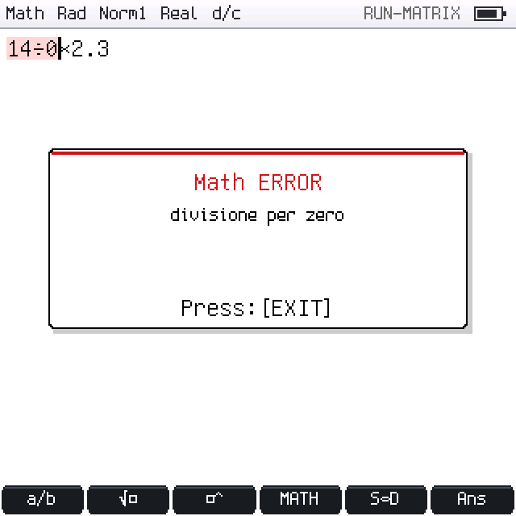

## Implementazione

| File | Contenuto |
|---|---|
| `include/run_matrix.hpp`, `src/run_matrix.cpp` | `evaluateEntry` (anche destinazioni Mat/Vct/List ed elementi), `runCalculation`, `editHistoryEntry`, `recalculateHistory`, viste (`toggleExactDecimal`, `toggleMixedFraction`, `togglePeriodic`), `resultText`, `resultTree`, `resultExpression`, `elementText` |
| `src/apps/run_matrix_app.cpp` | interfaccia: tasti, menu, cronologia, modifica sul posto, CLIP, Math/Line, disegno |
| `src/apps/matrix_editor.cpp` | editor MAT/VCT (`MatrixEditorView`) |
| `include/value.hpp`, `src/value.cpp` | `CalcValue`: numero, lista, matrice o vettore |
| `include/exact.hpp`, `src/exact.cpp` | aritmetica esatta |
| `src/expression.cpp` | lexer, parser e valutatori (virgola mobile ed esatto; `CollEval` per liste, matrici e vettori) |
| `src/natural_editor.cpp`, `src/math_renderer.cpp` | modelli MAT/VCT, Math/Line, CLIP, posizione degli errori, INS e SHIFT+INS, ⌟; griglia delle matrici, parentesi colorate, evidenziazioni, forme del cursore |
| `src/apps/answer_view.cpp` | schermate MatAns / VctAns / ListAns (v1.11.0) |
| `include/graph_commands.hpp`, `src/graph_commands.cpp` | interprete dei comandi grafici (v1.11.0): argomenti valutati dal parser unico, risultato nei dati di GRAPH |
| `include/csv_io.hpp`, `src/csv_io.cpp` | file CSV di liste e matrici (v1.11.0) |

## Completamento della v1.13.0

Perimetro e stato voce per voce: [reports/ANALISI_FONTI_v1.13.0.md](reports/ANALISI_FONTI_v1.13.0.md)
(tabella di parità iniziale) e [reports/SVILUPPO_v1.13.0.md](reports/SVILUPPO_v1.13.0.md)
(tabella finale). Nel testo canonico i comandi nuovi hanno un nome con `_`
(un solo token, che non si forma digitando lettere) e si mostrano con il nome
della calcolatrice.

### CALC, PROB, NUMERIC, ANGLE, COMPLEX

| Comando | Testo canonico | Esempio |
|---|---|---|
| Solve(f, stima[, inf, sup]), anche `a=b` | `solve(` | `solve(x^2=9,1)` → 3; senza soluzione `Iteration ERROR` |
| SolveN(f[=g][, x][, inf, sup]) | `solve_n(` | `SolveN(x²−x−6)` → `{−2,3}` (fino a 10, List Ans); nessuna → `Can't Solve!`; senza limiti cerca tra ±10¹⁰ |
| FMin / FMax(f, a, b[, n]) | `f_min(` `f_max(` | `FMin(x²−4x+9,1,4)` → `{2,5}` |
| Σ(f, k, a, b[, n]), Π | `sum(` `prod(` | `Σ(k²−3k+5,k,3,6)` → 52; modello con il campo della variabile; al più 100 001 termini, estremi interi qualsiasi entro 1E100 (v1.13.1) |
| d²/dx²(f, a) | `derivative2(` | modello Math a due campi |
| ∫(f, a, b[, tol]) | `integral(` | tolleranza tra 0 e 1 |
| Funzioni vietate | | dentro Solve/SolveN/FMin/FMax non si usano Solve, SolveN, FMin, FMax, Σ, d²/dx² (Syntax ERROR, manuale 2-28) |
| Ran# n | `ran 3` | sequenze 1–10 riproducibili; `Ran# 0` le riavvia; altri n: Argument ERROR |
| RanInt#(a,b[,n]), RanNorm#(σ,μ[,n]), RanBin#(n,p[,m]) | | con n: lista di n numeri |
| RanList#(n), RanSamp#(lista,n[,m]) | `ran_list(` `ran_samp(` | m = 0 senza ripetizione, 1 con ripetizione |
| P( Q( R( t( | `prob_p(`… | normale standard; t(x) = (x−x̄)/σx dei dati di Statistics |
| Rnd | `num_rnd(` | arrotonda alle cifre del display (Fix n, Sci n, Norm 10) |
| ʳ ᵍ ° ′ ″ | | `πʳ` = 180 in Deg, `100ᵍ` = 90, `2°20′30″` = 2.341666667 |
| Pol( Rec( | | `{r,θ}`, `{x,y}` in List Ans |
| r∠θ, ►r∠θ, ►a+bi | `∠` | `2∠90` = 2i; viste del risultato da OPTN › COMPLEX o RISULTATO |

### STAT, TVM, CONVERT

- **x̂( ŷ(** (`x_hat`, `y_hat`): stime della regressione dell'ultimo calcolo
  di Statistics (XList/YList del SET); Quad dà due valori.
- **Distribuzioni** (OPTN › STAT › DIST): NormPD, NormCD, InvNormCD
  (`"L"`, `"R"`, `"C"`: centrale = due estremi), tPD, tCD, InvTCD, ChiPD, ChiCD,
  InvChiCD, FPD, FCD, InvFCD (code destre per gli inversi), BinomialPD/CD (con
  2 argomenti la lista per x = 0…n), InvBinomialCD, PoissonPD/CD, InvPoissonCD,
  GeoPD/CD, InvGeoCD, HypergeoPD/CD, InvHypergeoCD; anche su liste.
  Limiti di calcolo (v1.13.1): BinomialCD e InvBinomialCD n ≤ 10⁶,
  PoissonCD x ≤ 10⁶ e InvPoissonCD con risultato ≤ 10⁶ (oltre: Argument
  ERROR), HypergeoCD e InvHypergeoCD al più 10⁶ valori possibili; le inverse
  discrete sommano una sola volta (tempo lineare) e InvGeoCD usa la formula
  chiusa (anche con p minuscoli).
- **S-Dev( Var(** con frequenze; **Mean( Median(** con frequenze; **Min/Max** di due liste.
- **TVM** (OPTN › TVM): Smpl_SI, Smpl_SFV, Cmpd_PV/FV/PMT/n/I%, Cash_NPV/IRR/PBP/NFV,
  Amt_BAL/INT/PRN/ΣINT/ΣPRN, Cnvt_EFF/APR, Cost, Sell, Margin, Days_Prd (anno
  di 365 giorni, pagamento a fine periodo, date 1902–2097).
- **CONVERT**: `valore[unità]▶[unità]` (11 categorie, 103 unità: lunghezza,
  area, volume, tempo, temperatura, velocità, massa, forza, pressione,
  energia, potenza); anche su liste. Il menu inserisce `[u]` dopo il valore e
  `▶[u]` dopo la prima unità.

### ESYM, ENG, overflow

- Simboli **P** (10¹⁵) ed **E** (10¹⁸), anche nel display Eng.
- **ENG / ENG←** (OPTN › ESYM o RISULTATO): `1234` → `1.234E+03` →
  `0.001234E+06`; ENG← → `1234E+00` → `1234000E−03`. Il valore non cambia.
- Un risultato o un passaggio con |x| ≥ 10¹⁰⁰ è un Math ERROR (70! compreso).
- **nCr, nPr** (v1.13.1): n e r interi, 0 ≤ r ≤ n < 1E10, risultato < 1E100
  come nell'Appendice del manuale (prima n ≤ 100000).

### Simplify Manual (regola)

Con SET UP › Simplify **Manual** (solo nel modo Real) le operazioni tra interi
e frazioni non riducono il risultato: **+ e −** sul **minimo comune multiplo**
dei denominatori (`2/4+1/4` = `3/4`, `1/6+1/6` = `2/6`), **× e ÷** sui
prodotti (`1/2×2/3` = `2/6`), potenze intere termine per termine, una frazione
digitata resta com'è. Un risultato intero si mostra intero. **▶Simp** divide
per il più piccolo fattore primo comune o per n; su una frazione irriducibile
restituisce il valore senza «F=»; un divisore che non divide è un Math ERROR.
Un decimale nell'espressione dà un risultato decimale. Fonte della regola:
manuali fx-7400G («least common multiple of the fractions») e fx-9750GII
(stessa famiglia); il manuale fx-CG50 non dà esempi completi.

### Base-N

- **Bin a 16 bit** (0…0111111111111111, negativi fino a 1111111111111111),
  Dec/Oct/Hex a 32 bit; fuori intervallo Math ERROR.
- In **Hex** le lettere digitate A–F sono cifre; la **variabile** A–F si
  inserisce da VARS › A~Z (o Alt+lettera) ed è mostrata **sottolineata**
  (testo canonico `v_a`).
- Liste e matrici calcolate in Base-N si mostrano nella base della riga.

### Istruzioni multiple, stringhe, memorie

- **`:`** separa le istruzioni (si mostra l'ultimo risultato); **`◢`**
  mostra anche il risultato intermedio (`5◢6+1` → `5 ◢ 7`). Una riga con più
  istruzioni si modifica e si ricalcola come le altre.
- **Stringhe**: `"ABC"` mostra il testo; `"ABC"→Str 1`, `Str 1` (VARS › Str).
- **Function memory** f1–f20 (OPTN › FUNCMEM): STORE memorizza l'input,
  RECALL lo reinserisce, fn lo usa nei calcoli con X (`f1`) o con un argomento
  (`f1(3)`), SEE elenca. Anche `x^2+1→f1`.
- Variabili **r** e **θ** (VARS › A~Z, r, θ).
- **Variabili di sistema assegnabili**: `10→Xmax` (Range ERROR se la finestra
  non è valida), Xfct/Yfct, TblStart/End/Pitch, D Start/End/Pitch, R Start/End,
  a0…c2, anStart…, n I% PV PMT FV P/Y C/Y; la formula `"2an+1"→an+1` per
  DrawR/DrawWeb.
- **VARS STAT** (n, x̄, Σx… a…e, r, r², MSe, Q1, Q3, Med, Mod, H-Start,
  H-pitch), **EQUATION** (SimRes, SimCoef, PlyRes, PlyCoef), **TABLE Result**.

### Liste

- **`List "QTY"`** nei calcoli e come destinazione (`{1,2}→List "QTY"`).
- **List File 1–6** (SET UP › List File): 26 liste e sottonomi per file; il
  budget degli elementi è comune a tutti i file. **Sub Name** On/Off.
- `n→Dim List k` crea n zeri; `Fill(v, List n)` e `Fill(v, Mat A)` cambiano la memoria.

### Matrici

- Forme esatte delle celle senza il limite di 64 elementi (budget della
  scheda: 400 forme sul Pico 2 W, 4 000 sulla Plus); una cella digitata come
  decimale resta decimale (`0.25`).
- **Swap A,r1,r2**, **\*Row k,A,r**, **\*Row+ k,A,r1,r2**, **Row+ A,r1,r2**.

### Comandi grafici

`PxlTest(riga,colonna)` (1 se il pixel della schermata del grafico è acceso:
GRAPH la disegna come la VRAM della calcolatrice), `Graph Y> Y< Y≥ Y≤ X> X< X≥ X≤`,
`G∫dx f,a,b` (area colorata e valore), prefissi `SketchNormal/Thick/Broken/Dot/Thin`
(da soli cambiano Sketch Line), `StoPict n`, `RclPict n`, `BG-Pict n`,
`RclCapt n`, `DrawGraph`, `DrawStat` (StatGraph1: Scatter di XList/YList),
`DrawDyna` (Y1 con A da D Start a D End), `DrawR-Con`, `DrawR-Plt`, `DrawWeb`
(formula an+1), `DrawFTG-Con`, `DrawFTG-Plt` (la tabella di TABLE),
`G-SelOn n`, `G-SelOff n`. I grafici dei comandi si salvano nei progetti
`.pcgraph` (righe `c=`).

### Editor Math/Line

- Conversione testo ↔ albero esatta nelle due direzioni (corpus di test):
  gruppi con modelli, radice con indice qualsiasi, d²/dx², Σ/Π con variabile.
- **× obbligatorio prima di una frazione** (manuale 1-23): una frazione
  accostata a un operando è un fattore della moltiplicazione implicita
  (`6÷2[1/3]` = 9); per `6÷2×1/3` serve il ×. In Line si vede `2(1/3)`.
- La cronologia in Line mostra le parentesi minime (`1/3`, `x^2`).
- I nomi dei comandi grafici restano un solo token (`G∫dx x,0,2`).

## Limiti noti

- Nessuna prova su hardware PicoCalc: [HARDWARE_TEST_v1.13.0.md](HARDWARE_TEST_v1.13.0.md).
- Differenze inevitabili (schermo 320×320, tastiera senza ALPHA, generatore
  di Ran# diverso da quello Casio, CONVERT integrato): tabella in
  [reports/SVILUPPO_v1.13.0.md](reports/SVILUPPO_v1.13.0.md#6-differenze-inevitabili-e-scelte).
- Comportamenti non descritti per intero dal manuale e scelti dal progetto:
  intervallo di ricerca di SolveN senza limiti (±10¹⁰), ripartizione tra
  `Can't Solve!` e `Iteration ERROR`, DrawStat sullo StatGraph1 predefinito,
  DrawDyna su Y1 con il coefficiente A.
- PxlTest( ridisegna la schermata di GRAPH a ogni chiamata (lento in un ciclo).
